# 行为金融因子与米筐回测

## 阅读说明

- `ascending=True` 时，q0 是因子最小组、q9 是因子最大组；`ascending=False` 时相反。
- 图表与绩效结果均为历史回测结果，未额外加入交易成本、冲击成本、涨跌停或融券约束。

## 因子目录

> 优质因子标注为⭐

- 1. ⭐最大异常日收益率（ABNRETD）
- 2. 基于异常收益的注意力捕捉
- 3. ⭐平均异常日收益率（ABNRETAVG）
- 4. ⭐每日最大异常成交量（ABNVOLD）
- 5. 基于换手率的注意力捕捉
- 6. CSAD 模型（基于“小型”板块）
- 7. ⭐每日平均异常成交（ABNVOLAVG）
- 8. 未实现盈利量（CGO）
- 9. 衰减加权月频成交量（ATTN）
- 10. CSAD 模型（基于板块中地位）
- 11. 平均换手率（TURNAVG）
- 12. 基于 PE 的分析师锚定效应偏差（CAF_EP）
- 13. ⭐基于异常收益的注意力溢出（SPILL）
- 14. 前景价值（TK）
- 15. CSAD 模型（基于时序回归变形）
- 16. 基于涨跌停的注意力捕捉
- 17. LSV 模型
- 18. 基于沪深总成交额的注意力捕捉
- 19. SLSV 模型（对称 LSV 模型）
- 20. ⭐基于换手率的注意力溢出（SPILL）
- 21. 基于市场波动率的注意力捕捉
- 22. 基于 PB 的前景价值 TK

## 01. 最大异常日收益率（ABNRETD）

### 因子公式

**行为金融因子 —— 投资者注意力**

$$
\text{ABNRETD} = \max_{t} \left| r_{i,t} - \bar{r}_t \right|
$$

其中：

$$
r_{i,t} \text{ 为股票 } i \text{ 在交易日 } t \text{ 的收益率}
$$

$$
\bar{r}_t \text{ 为交易日 } t \text{ 的全市场收益率}
$$

$$
m \text{ 为交易日窗口，一般取为月度}
$$

### 因子描述

最大异常日收益率（ABNRETD）是每月内所有交易日中，个股收益率与市场收益率之差的绝对值的最大值，属于**极端日收益类因子**。极端收益（无论是大幅上涨还是大幅下跌）的股票，相比收益平稳的股票更能吸引投资者的关注。因子取值越高，表明该股票在当月曾出现过极端的日收益，投资者的关注度也就越高。**然而，投资者的注意力是有限的，他们更倾向于交易那些引起自己注意的股票**。通常情况下，关注度较高的股票会伴随更多的买入行为。但在 A 股市场中，由于**做多与做空机制不对称**，投资者非理性买入的倾向强于非理性卖出，导致高关注度股票因净买入力量而出现短期价格溢价，这种过度反应往往会在未来引发价格反转。

数据：日度收盘价

### 因子米筐回测图表

#### 米筐完整回测报告

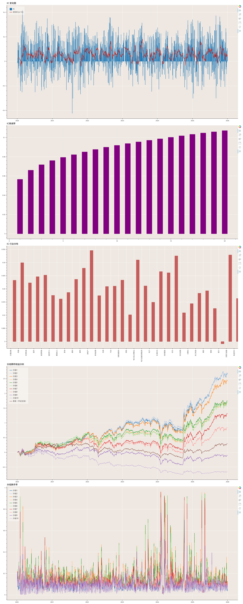

#### 日度 IC、滚动 IC 与累计 Rank IC

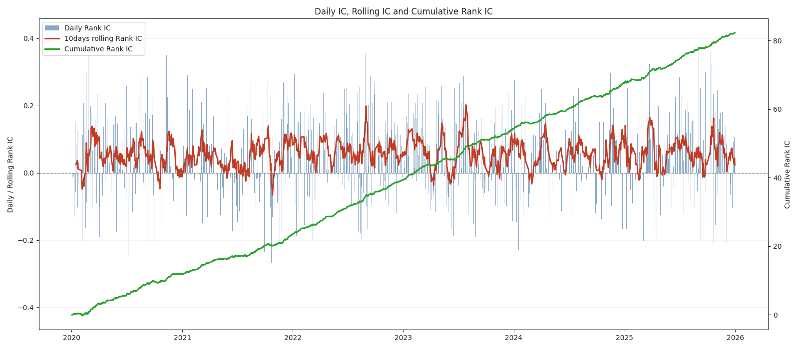

### 因子回测总结

#### IC 统计（中心与显著性）

| 指标          | Result    |
| ----------- | --------- |
| 样本天数        | 1,454     |
| 平均 Rank IC  | 0.057     |
| Rank IC 标准差 | 0.123     |
| ICIR        | 0.461     |
| 年化 ICIR     | 7.314     |
| IC t 值      | 17.569    |
| IC p 值      | 8.319e-63 |

#### IC 统计（分布与持久性）

| 指标         | Result |
| ---------- | ------ |
| 正 IC 占比    | 0.675  |
| 负 IC 占比    | 0.325  |
| IC 偏度      | -0.135 |
| IC 峰度      | -0.177 |
| IC 一阶自相关   | -0.018 |
| 累计 Rank IC | 82.260 |

- 本次绩效计算使用的基准区间： 2020-01-06 至 2025-12-31
- 策略与基准共同样本天数： 1453

#### 分组绝对收益与风险

| 分组               | 累计收益率  | 年化收益率  | 年化波动率 | 夏普比率   | Sortino 比率 | 最大回撤   | Calmar 比率 |
| ---------------- | ------ | ------ | ----- | ------ | ---------- | ------ | --------- |
| q0               | 2.666  | 0.253  | 0.225 | 1.116  | 1.542      | -0.323 | 0.782     |
| q1               | 2.687  | 0.254  | 0.229 | 1.105  | 1.532      | -0.311 | 0.817     |
| q2               | 2.447  | 0.239  | 0.232 | 1.044  | 1.442      | -0.307 | 0.779     |
| q3               | 1.691  | 0.187  | 0.235 | 0.849  | 1.165      | -0.318 | 0.588     |
| q4               | 1.750  | 0.192  | 0.237 | 0.861  | 1.182      | -0.292 | 0.656     |
| q5               | 1.700  | 0.188  | 0.240 | 0.839  | 1.154      | -0.303 | 0.621     |
| q6               | 1.322  | 0.157  | 0.251 | 0.708  | 0.977      | -0.348 | 0.452     |
| q7               | 0.846  | 0.112  | 0.257 | 0.543  | 0.739      | -0.380 | 0.295     |
| q8               | -0.105 | -0.019 | 0.265 | 0.061  | 0.082      | -0.520 | -0.037    |
| q9               | -0.657 | -0.170 | 0.296 | -0.480 | -0.643     | -0.769 | -0.220    |
| total（十组等权）      | 1.057  | 0.133  | 0.240 | 0.641  | 0.877      | -0.329 | 0.405     |
| long_short_q0_q9 | 7.882  | 0.461  | 0.165 | 2.378  | 3.821      | -0.149 | 3.101     |

#### 分组日收益分布

| 分组               | 日胜率   | 平均日收益  | 日收益偏度  | 日收益峰度  |
| ---------------- | ----- | ------ | ------ | ------ |
| q0               | 0.573 | 0.001  | -0.807 | 10.398 |
| q1               | 0.573 | 0.001  | -0.744 | 9.914  |
| q2               | 0.562 | 0.001  | -0.782 | 9.842  |
| q3               | 0.555 | 0.001  | -0.770 | 9.839  |
| q4               | 0.553 | 0.001  | -0.771 | 9.766  |
| q5               | 0.555 | 0.001  | -0.696 | 8.617  |
| q6               | 0.539 | 0.001  | -0.584 | 8.075  |
| q7               | 0.535 | 0.001  | -0.698 | 6.934  |
| q8               | 0.530 | 0.000  | -0.529 | 4.832  |
| q9               | 0.504 | -0.001 | -0.263 | 5.841  |
| total（十组等权）      | 0.545 | 0.001  | -0.673 | 8.571  |
| long_short_q0_q9 | 0.560 | 0.002  | 0.045  | 1.308  |

#### 分组相对基准绩效

| 分组               | 基准年化收益率 | 年化超额收益（几何） | 年化收益差（算术） | Alpha（年化） | Beta   | 跟踪误差  | 信息比率   |
| ---------------- | ------- | ---------- | --------- | --------- | ------ | ----- | ------ |
| q0               | 0.046   | 0.198      | 0.207     | 0.190     | 0.937  | 0.124 | 1.496  |
| q1               | 0.046   | 0.199      | 0.208     | 0.190     | 0.971  | 0.121 | 1.560  |
| q2               | 0.046   | 0.185      | 0.194     | 0.177     | 1.002  | 0.115 | 1.533  |
| q3               | 0.046   | 0.135      | 0.142     | 0.132     | 1.040  | 0.109 | 1.240  |
| q4               | 0.046   | 0.140      | 0.146     | 0.135     | 1.065  | 0.103 | 1.347  |
| q5               | 0.046   | 0.136      | 0.142     | 0.130     | 1.095  | 0.099 | 1.378  |
| q6               | 0.046   | 0.107      | 0.112     | 0.103     | 1.149  | 0.105 | 1.079  |
| q7               | 0.046   | 0.064      | 0.067     | 0.064     | 1.167  | 0.112 | 0.666  |
| q8               | 0.046   | -0.062     | -0.065    | -0.059    | 1.165  | 0.130 | -0.372 |
| q9               | 0.046   | -0.206     | -0.215    | -0.222    | 1.233  | 0.169 | -1.223 |
| total（十组等权）      | 0.046   | 0.084      | 0.088     | 0.084     | 1.082  | 0.105 | 0.851  |
| long_short_q0_q9 | 0.046   | 0.397      | 0.415     | 0.412     | -0.296 | 0.302 | 1.086  |

#### 分组换手率

| 分组               | 平均日换手率 | 中位数日换手率 | 年化换手率  | 最大单日换手率 |
| ---------------- | ------ | ------- | ------ | ------- |
| q0               | 0.090  | 0.078   | 22.786 | 0.534   |
| q1               | 0.145  | 0.121   | 36.579 | 0.904   |
| q2               | 0.156  | 0.128   | 39.297 | 0.963   |
| q3               | 0.156  | 0.128   | 39.343 | 0.959   |
| q4               | 0.150  | 0.120   | 37.861 | 0.945   |
| q5               | 0.140  | 0.114   | 35.298 | 0.944   |
| q6               | 0.127  | 0.105   | 31.963 | 0.961   |
| q7               | 0.114  | 0.099   | 28.617 | 0.910   |
| q8               | 0.100  | 0.090   | 25.173 | 0.768   |
| q9               | 0.066  | 0.058   | 16.619 | 0.495   |
| total（十组等权）      | 0.124  | 0.106   | 31.354 | 0.791   |
| long_short_q0_q9 | 0.156  | 0.139   | 39.405 | 0.937   |

## 02. 基于异常收益的注意力捕捉

### 因子公式

**行为金融因子 —— 投资者注意力**

对每个行业，分别统计每日行业内成分股中收益率绝对值高于 7% 的股票数量占比，作为市场关注程度的代理指标：

$$
\text{indus\_abnd}_d = \frac{n_{\ge 7\%, d}}{N_d}
$$

其中，$n_{\ge 7\%, d}$ 为行业成分股中当日收益率绝对值达到或超过 7% 的股票数量，$N_d$ 为该行业当日交易股票总数。

进一步，将上述市场关注代理指标与个股日收益进行月度时序回归，回归方程如下：

$$
r_{i,d} = \mu_{i,t} + \beta_{i,t} \cdot \text{indus\_abnd}_d + \rho_{1,i,t} \text{Mkt}_d + \rho_{2,i,t} \text{SMB}_d + \rho_{3,i,t} \text{HML}_d + \rho_{4,i,t} \text{UMD}_d + \epsilon_{i,t}
$$

其中，系数 $\beta_{i,t}$ 的绝对值 $|\beta_{i,t}|$ 即为股票 $i$ 对市场关注程度的敏感度，用于衡量该股票受投资者注意力影响的大小。

各变量定义如下：

- $r_{i,d}$ 为股票 $i$ 在交易日 $d$ 的收益率；
- $\text{Mkt}_d$、$\text{SMB}_d$、$\text{HML}_d$ 分别为经典的 Fama‑French 三因子在 $d$ 日的收益；
- $\text{UMD}_d$ 为动量因子收益，即全市场过去 11 个月累积收益率排名前 30% 与后 30% 的股票组合在 $d$ 日的收益差；
- $\mu_{i,t}$ 为截距项，$\epsilon_{i,t}$ 为残差项。

### 因子描述

不同股票对同一市场关注度事件的反映程度往往不同，可通过个股收益对市场关注度事件的敏感程度（即 $|\beta_{i,t}|$）来衡量股票对该事件的注意力捕捉效应。捕捉能力越强（敏感程度越高），表明该股票更能吸引市场注意，从而引发更多的买盘压力，导致股价被高估。

上述因子以异常收益占比（收益率绝对值超过 7% 的股票比例）作为市场关注度事件，其原因在于：极端日收益是衡量关注度的一个重要指标，出现过高或过低的收益都代表着该股票或行业受到了投资者的广泛关注。因此，该指标能够有效捕捉投资者注意力的集中程度，并进一步用于解释个股收益的横截面差异。

数据：日度收盘价、Fama-French因子（市值、无风险收益率、账面市值比（净资产/总市值））、行业分类数据

### 因子米筐回测图表

#### 米筐完整回测报告

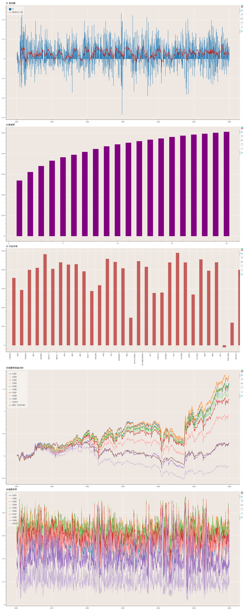

#### 日度 IC、滚动 IC 与累计 Rank IC

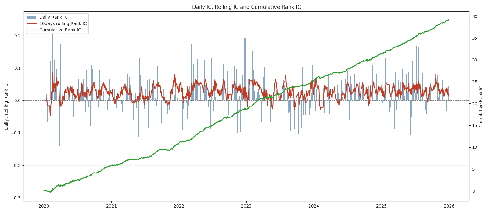

### 因子回测总结

#### IC 统计（中心与显著性）

| 指标          | Result    |
| ----------- | --------- |
| 样本天数        | 1,454     |
| 平均 Rank IC  | 0.027     |
| Rank IC 标准差 | 0.065     |
| ICIR        | 0.412     |
| 年化 ICIR     | 6.537     |
| IC t 值      | 15.702    |
| IC p 值      | 1.938e-51 |

#### IC 统计（分布与持久性）

| 指标         | Result |
| ---------- | ------ |
| 正 IC 占比    | 0.678  |
| 负 IC 占比    | 0.322  |
| IC 偏度      | -0.151 |
| IC 峰度      | 0.450  |
| IC 一阶自相关   | -0.004 |
| 累计 Rank IC | 39.111 |

- 本次绩效计算使用的基准区间： 2020-01-06 至 2025-12-31
- 策略与基准共同样本天数： 1453

#### 分组绝对收益与风险

| 分组               | 累计收益率  | 年化收益率  | 年化波动率 | 夏普比率   | Sortino 比率 | 最大回撤   | Calmar 比率 |
| ---------------- | ------ | ------ | ----- | ------ | ---------- | ------ | --------- |
| q0               | 1.625  | 0.182  | 0.239 | 0.821  | 1.127      | -0.328 | 0.556     |
| q1               | 1.523  | 0.174  | 0.239 | 0.793  | 1.088      | -0.325 | 0.535     |
| q2               | 1.804  | 0.196  | 0.240 | 0.867  | 1.194      | -0.314 | 0.624     |
| q3               | 1.561  | 0.177  | 0.240 | 0.802  | 1.100      | -0.321 | 0.552     |
| q4               | 1.605  | 0.181  | 0.240 | 0.812  | 1.117      | -0.325 | 0.555     |
| q5               | 1.400  | 0.164  | 0.241 | 0.752  | 1.031      | -0.316 | 0.519     |
| q6               | 1.273  | 0.153  | 0.242 | 0.710  | 0.972      | -0.316 | 0.484     |
| q7               | 0.921  | 0.120  | 0.245 | 0.585  | 0.799      | -0.353 | 0.339     |
| q8               | 0.276  | 0.043  | 0.245 | 0.296  | 0.402      | -0.472 | 0.091     |
| q9               | -0.217 | -0.042 | 0.262 | -0.031 | -0.041     | -0.612 | -0.068    |
| total（十组等权）      | 1.055  | 0.133  | 0.241 | 0.640  | 0.874      | -0.329 | 0.404     |
| long_short_q0_q9 | 2.165  | 0.221  | 0.093 | 2.194  | 3.444      | -0.089 | 2.500     |

#### 分组日收益分布

| 分组               | 日胜率   | 平均日收益  | 日收益偏度  | 日收益峰度 |
| ---------------- | ----- | ------ | ------ | ----- |
| q0               | 0.551 | 0.001  | -0.711 | 8.652 |
| q1               | 0.551 | 0.001  | -0.702 | 8.923 |
| q2               | 0.556 | 0.001  | -0.692 | 8.909 |
| q3               | 0.553 | 0.001  | -0.710 | 8.621 |
| q4               | 0.549 | 0.001  | -0.681 | 8.606 |
| q5               | 0.549 | 0.001  | -0.710 | 8.659 |
| q6               | 0.546 | 0.001  | -0.693 | 8.249 |
| q7               | 0.547 | 0.001  | -0.642 | 8.396 |
| q8               | 0.535 | 0.000  | -0.589 | 6.911 |
| q9               | 0.521 | -0.000 | -0.461 | 7.813 |
| total（十组等权）      | 0.545 | 0.001  | -0.675 | 8.546 |
| long_short_q0_q9 | 0.568 | 0.001  | 0.014  | 2.536 |

#### 分组相对基准绩效

| 分组               | 基准年化收益率 | 年化超额收益（几何） | 年化收益差（算术） | Alpha（年化） | Beta   | 跟踪误差  | 信息比率   |
| ---------------- | ------- | ---------- | --------- | --------- | ------ | ----- | ------ |
| q0               | 0.046   | 0.131      | 0.137     | 0.128     | 1.058  | 0.111 | 1.183  |
| q1               | 0.046   | 0.123      | 0.128     | 0.121     | 1.058  | 0.110 | 1.128  |
| q2               | 0.046   | 0.144      | 0.150     | 0.139     | 1.065  | 0.110 | 1.299  |
| q3               | 0.046   | 0.126      | 0.131     | 0.123     | 1.069  | 0.108 | 1.175  |
| q4               | 0.046   | 0.129      | 0.135     | 0.126     | 1.074  | 0.108 | 1.208  |
| q5               | 0.046   | 0.113      | 0.118     | 0.111     | 1.082  | 0.106 | 1.097  |
| q6               | 0.046   | 0.103      | 0.107     | 0.102     | 1.089  | 0.107 | 1.001  |
| q7               | 0.046   | 0.071      | 0.074     | 0.072     | 1.102  | 0.108 | 0.726  |
| q8               | 0.046   | -0.002     | -0.002    | 0.002     | 1.094  | 0.111 | 0.070  |
| q9               | 0.046   | -0.083     | -0.087    | -0.083    | 1.153  | 0.127 | -0.572 |
| total（十组等权）      | 0.046   | 0.084      | 0.087     | 0.084     | 1.084  | 0.105 | 0.848  |
| long_short_q0_q9 | 0.046   | 0.168      | 0.176     | 0.210     | -0.094 | 0.237 | 0.588  |

#### 分组换手率

| 分组               | 平均日换手率 | 中位数日换手率 | 年化换手率   | 最大单日换手率 |
| ---------------- | ------ | ------- | ------- | ------- |
| q0               | 0.527  | 0.518   | 132.687 | 0.895   |
| q1               | 0.648  | 0.647   | 163.417 | 0.896   |
| q2               | 0.668  | 0.667   | 168.214 | 0.911   |
| q3               | 0.667  | 0.667   | 167.971 | 0.913   |
| q4               | 0.656  | 0.652   | 165.239 | 0.941   |
| q5               | 0.633  | 0.632   | 159.553 | 0.923   |
| q6               | 0.597  | 0.590   | 150.349 | 0.920   |
| q7               | 0.538  | 0.532   | 135.640 | 0.918   |
| q8               | 0.396  | 0.383   | 99.910  | 0.880   |
| q9               | 0.220  | 0.201   | 55.338  | 0.834   |
| total（十组等权）      | 0.555  | 0.550   | 139.832 | 0.883   |
| long_short_q0_q9 | 0.746  | 0.723   | 188.025 | 1.702   |

## 03. 平均异常日收益率（ABNRETAVG）

### 因子公式

**行为金融因子 —— 投资者注意力**

$$
\text{ABNRETAVG} = \frac{1}{m} \sum_{t}^{t-m+1} \left( r_{i,t} - \bar{r}_t \right)^2
$$

其中：

- $r_{i,t}$ 为股票 $i$ 在交易日 $t$ 的收益率；
- $\bar{r}_t$ 为交易日 $t$ 的全市场收益率；
- $m$ 为交易日窗口，一般取为月度。

### 因子描述

平均异常日收益率（ABNRETAVG）为每月日频收益率与市场收益率差值的均方，属于**极端日收益类因子**。极端收益（无论是大幅上涨还是大幅下跌）的股票，相比收益平稳的股票更能吸引投资者的关注。因子取值越高，表明该股票在当月曾出现过较为极端的日收益偏离，投资者的关注度也就越高。

然而，**投资者的注意力是有限的，他们更倾向于交易那些引起自己注意的股票。通常情况下，关注度较高的股票会伴随更多的买入行为**。但在 A 股市场中，由于**做多与做空机制不对称**，投资者非理性买入的倾向强于非理性卖出，导致高关注度股票因净买入力量而出现短期价格溢价，这种过度反应往往会在未来引发价格反转。

数据：日度收盘价

### 因子米筐回测图表

#### 米筐完整回测报告

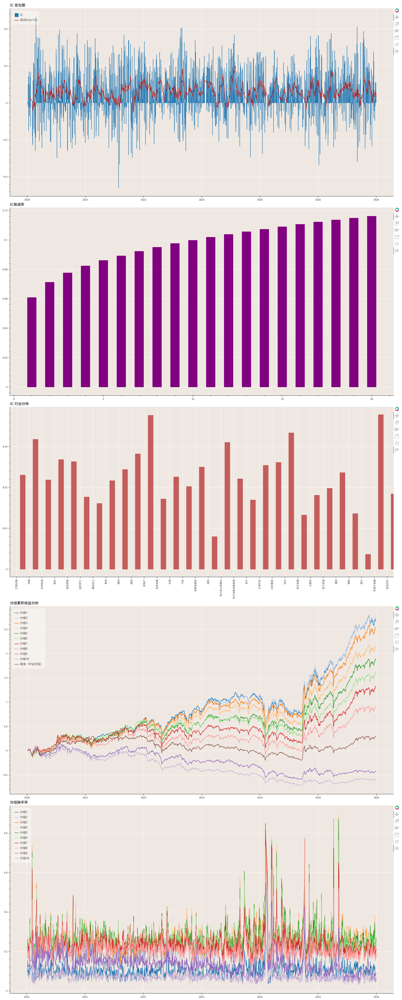

#### 日度 IC、滚动 IC 与累计 Rank IC

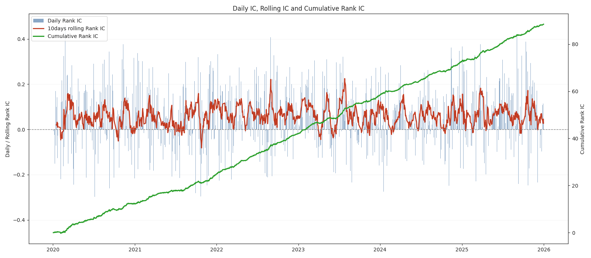

### 因子回测总结

#### IC 统计（中心与显著性）

| 指标          | Result    |
| ----------- | --------- |
| 样本天数        | 1,454     |
| 平均 Rank IC  | 0.061     |
| Rank IC 标准差 | 0.137     |
| ICIR        | 0.444     |
| 年化 ICIR     | 7.041     |
| IC t 值      | 16.913    |
| IC p 值      | 1.032e-58 |

#### IC 统计（分布与持久性）

| 指标         | Result |
| ---------- | ------ |
| 正 IC 占比    | 0.668  |
| 负 IC 占比    | 0.332  |
| IC 偏度      | -0.114 |
| IC 峰度      | -0.199 |
| IC 一阶自相关   | -0.017 |
| 累计 Rank IC | 88.484 |

- 本次绩效计算使用的基准区间： 2020-01-06 至 2025-12-31
- 策略与基准共同样本天数： 1453

#### 分组绝对收益与风险

| 分组               | 累计收益率  | 年化收益率  | 年化波动率 | 夏普比率   | Sortino 比率 | 最大回撤   | Calmar 比率 |
| ---------------- | ------ | ------ | ----- | ------ | ---------- | ------ | --------- |
| q0               | 2.695  | 0.254  | 0.224 | 1.125  | 1.551      | -0.334 | 0.762     |
| q1               | 2.735  | 0.257  | 0.229 | 1.114  | 1.536      | -0.312 | 0.823     |
| q2               | 2.524  | 0.244  | 0.232 | 1.060  | 1.465      | -0.308 | 0.793     |
| q3               | 2.144  | 0.220  | 0.234 | 0.966  | 1.337      | -0.307 | 0.715     |
| q4               | 1.887  | 0.202  | 0.237 | 0.897  | 1.238      | -0.305 | 0.662     |
| q5               | 1.616  | 0.182  | 0.239 | 0.818  | 1.126      | -0.301 | 0.604     |
| q6               | 1.323  | 0.157  | 0.246 | 0.718  | 0.989      | -0.319 | 0.493     |
| q7               | 0.902  | 0.118  | 0.253 | 0.568  | 0.778      | -0.371 | 0.318     |
| q8               | -0.428 | -0.092 | 0.283 | -0.199 | -0.266     | -0.643 | -0.144    |
| q9               | -0.587 | -0.142 | 0.297 | -0.367 | -0.489     | -0.745 | -0.191    |
| total（十组等权）      | 1.057  | 0.133  | 0.240 | 0.641  | 0.876      | -0.329 | 0.405     |
| long_short_q0_q9 | 6.336  | 0.413  | 0.175 | 2.065  | 3.330      | -0.173 | 2.386     |

#### 分组日收益分布

| 分组               | 日胜率   | 平均日收益  | 日收益偏度  | 日收益峰度  |
| ---------------- | ----- | ------ | ------ | ------ |
| q0               | 0.574 | 0.001  | -0.828 | 10.270 |
| q1               | 0.570 | 0.001  | -0.855 | 10.240 |
| q2               | 0.569 | 0.001  | -0.766 | 10.197 |
| q3               | 0.562 | 0.001  | -0.707 | 9.937  |
| q4               | 0.553 | 0.001  | -0.717 | 9.498  |
| q5               | 0.554 | 0.001  | -0.669 | 8.714  |
| q6               | 0.546 | 0.001  | -0.651 | 8.788  |
| q7               | 0.535 | 0.001  | -0.590 | 6.689  |
| q8               | 0.515 | -0.000 | -0.459 | 4.863  |
| q9               | 0.511 | -0.000 | -0.392 | 4.567  |
| total（十组等权）      | 0.545 | 0.001  | -0.673 | 8.571  |
| long_short_q0_q9 | 0.560 | 0.001  | 0.197  | 1.211  |

#### 分组相对基准绩效

| 分组               | 基准年化收益率 | 年化超额收益（几何） | 年化收益差（算术） | Alpha（年化） | Beta   | 跟踪误差  | 信息比率   |
| ---------------- | ------- | ---------- | --------- | --------- | ------ | ----- | ------ |
| q0               | 0.046   | 0.200      | 0.209     | 0.192     | 0.931  | 0.125 | 1.497  |
| q1               | 0.046   | 0.202      | 0.211     | 0.193     | 0.963  | 0.124 | 1.541  |
| q2               | 0.046   | 0.190      | 0.199     | 0.181     | 0.994  | 0.118 | 1.530  |
| q3               | 0.046   | 0.167      | 0.174     | 0.160     | 1.026  | 0.113 | 1.434  |
| q4               | 0.046   | 0.149      | 0.156     | 0.144     | 1.057  | 0.106 | 1.391  |
| q5               | 0.046   | 0.130      | 0.136     | 0.126     | 1.083  | 0.102 | 1.282  |
| q6               | 0.046   | 0.107      | 0.112     | 0.104     | 1.124  | 0.102 | 1.100  |
| q7               | 0.046   | 0.069      | 0.072     | 0.069     | 1.158  | 0.106 | 0.743  |
| q8               | 0.046   | -0.132     | -0.138    | -0.136    | 1.226  | 0.148 | -0.817 |
| q9               | 0.046   | -0.180     | -0.188    | -0.191    | 1.263  | 0.164 | -1.062 |
| total（十组等权）      | 0.046   | 0.084      | 0.088     | 0.084     | 1.082  | 0.105 | 0.851  |
| long_short_q0_q9 | 0.046   | 0.351      | 0.367     | 0.383     | -0.332 | 0.312 | 0.950  |

#### 分组换手率

| 分组               | 平均日换手率 | 中位数日换手率 | 年化换手率  | 最大单日换手率 |
| ---------------- | ------ | ------- | ------ | ------- |
| q0               | 0.101  | 0.096   | 25.558 | 0.375   |
| q1               | 0.216  | 0.207   | 54.449 | 0.735   |
| q2               | 0.253  | 0.240   | 63.659 | 0.837   |
| q3               | 0.266  | 0.253   | 66.953 | 0.897   |
| q4               | 0.266  | 0.253   | 67.134 | 0.872   |
| q5               | 0.257  | 0.244   | 64.760 | 0.864   |
| q6               | 0.239  | 0.229   | 60.275 | 0.822   |
| q7               | 0.213  | 0.204   | 53.585 | 0.773   |
| q8               | 0.133  | 0.131   | 33.445 | 0.550   |
| q9               | 0.071  | 0.068   | 17.980 | 0.312   |
| total（十组等权）      | 0.202  | 0.193   | 50.780 | 0.649   |
| long_short_q0_q9 | 0.173  | 0.165   | 43.538 | 0.668   |

## 04. 每日最大异常成交量（ABNVOLD）

### 因子公式

**行为金融因子 —— 投资者注意力**

$$
\text{ABNVOLD} = \max_{t} \left( \frac{VOL_{i,t}}{\overline{VOL}_{i,t}} \right)
$$

其中：

- $VOL_{i,t}$ 为股票 $i$ 在交易日 $t$ 的成交量；
- $\overline{VOL}_{i,t}$ 为股票 $i$ 在交易日 $t$ 滚动 1 年的平均成交量；
- $m$ 为交易日窗口，一般取为月度。

### 因子描述

每日最大异常成交量（ABNVOLD）为日频成交量除以过去一年平均成交量的最大值，属于**极端交易量类因子**。异常成交量是投资者注意力的常用代理指标之一。因子取值越高，表明该股票在当月曾出现过异常放量，投资者的关注度也就越高。然而，投资者的注意力是有限的，他们更倾向于交易那些引起自己注意的股票。通常情况下，关注度较高的股票会伴随更多的买入行为。但在 A 股市场中，由于**做多与做空机制不对称**，投资者非理性买入的倾向强于非理性卖出，导致高关注度股票因净买入力量而出现短期价格溢价，这种过度反应往往会在未来引发价格反转。

数据：成交量

### 因子米筐回测图表

#### 米筐完整回测报告

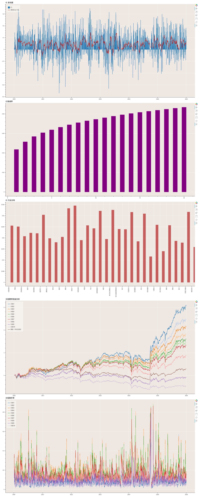

#### 日度 IC、滚动 IC 与累计 Rank IC

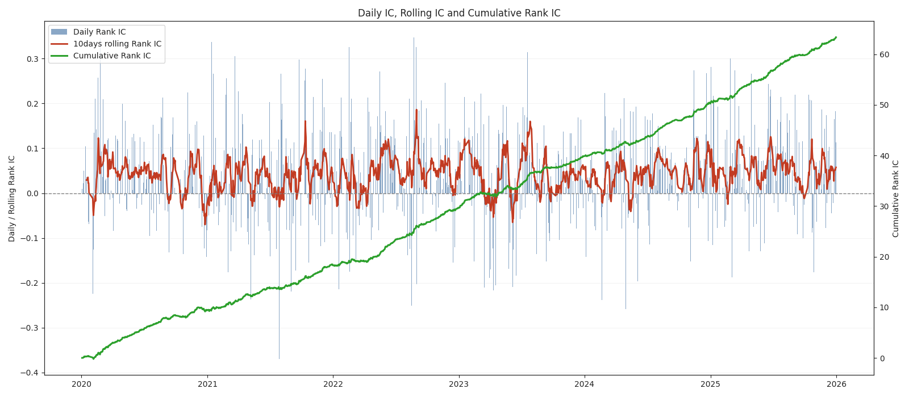

### 因子回测总结

#### IC 统计（中心与显著性）

| 指标          | Result    |
| ----------- | --------- |
| 样本天数        | 1,454     |
| 平均 Rank IC  | 0.044     |
| Rank IC 标准差 | 0.108     |
| ICIR        | 0.405     |
| 年化 ICIR     | 6.431     |
| IC t 值      | 15.447    |
| IC p 值      | 5.919e-50 |

#### IC 统计（分布与持久性）

| 指标         | Result |
| ---------- | ------ |
| 正 IC 占比    | 0.665  |
| 负 IC 占比    | 0.335  |
| IC 偏度      | -0.122 |
| IC 峰度      | 0.109  |
| IC 一阶自相关   | -0.019 |
| 累计 Rank IC | 63.367 |

- 本次绩效计算使用的基准区间： 2020-01-06 至 2025-12-31
- 策略与基准共同样本天数： 1453

#### 分组绝对收益与风险

| 分组               | 累计收益率  | 年化收益率  | 年化波动率 | 夏普比率   | Sortino 比率 | 最大回撤   | Calmar 比率 |
| ---------------- | ------ | ------ | ----- | ------ | ---------- | ------ | --------- |
| q0               | 3.109  | 0.278  | 0.249 | 1.109  | 1.536      | -0.340 | 0.818     |
| q1               | 2.494  | 0.242  | 0.239 | 1.027  | 1.427      | -0.331 | 0.732     |
| q2               | 2.172  | 0.222  | 0.234 | 0.973  | 1.352      | -0.309 | 0.716     |
| q3               | 1.830  | 0.198  | 0.232 | 0.894  | 1.232      | -0.312 | 0.633     |
| q4               | 1.608  | 0.181  | 0.233 | 0.832  | 1.146      | -0.289 | 0.625     |
| q5               | 1.467  | 0.170  | 0.234 | 0.787  | 1.080      | -0.289 | 0.586     |
| q6               | 1.338  | 0.159  | 0.240 | 0.735  | 1.008      | -0.299 | 0.530     |
| q7               | 0.887  | 0.116  | 0.248 | 0.569  | 0.774      | -0.344 | 0.339     |
| q8               | -0.088 | -0.016 | 0.257 | 0.067  | 0.090      | -0.514 | -0.031    |
| q9               | -0.466 | -0.103 | 0.277 | -0.254 | -0.339     | -0.644 | -0.160    |
| total（十组等权）      | 1.131  | 0.140  | 0.239 | 0.669  | 0.915      | -0.325 | 0.431     |
| long_short_q0_q9 | 5.969  | 0.400  | 0.140 | 2.473  | 3.960      | -0.128 | 3.135     |

#### 分组日收益分布

| 分组               | 日胜率   | 平均日收益  | 日收益偏度  | 日收益峰度 |
| ---------------- | ----- | ------ | ------ | ----- |
| q0               | 0.560 | 0.001  | -0.847 | 9.088 |
| q1               | 0.555 | 0.001  | -0.700 | 9.367 |
| q2               | 0.549 | 0.001  | -0.676 | 9.268 |
| q3               | 0.552 | 0.001  | -0.714 | 9.439 |
| q4               | 0.552 | 0.001  | -0.678 | 9.278 |
| q5               | 0.546 | 0.001  | -0.721 | 9.108 |
| q6               | 0.551 | 0.001  | -0.681 | 8.533 |
| q7               | 0.550 | 0.001  | -0.647 | 7.475 |
| q8               | 0.535 | 0.000  | -0.532 | 5.203 |
| q9               | 0.521 | -0.000 | -0.405 | 5.874 |
| total（十组等权）      | 0.548 | 0.001  | -0.675 | 8.620 |
| long_short_q0_q9 | 0.564 | 0.001  | 0.008  | 1.218 |

#### 分组相对基准绩效

| 分组               | 基准年化收益率 | 年化超额收益（几何） | 年化收益差（算术） | Alpha（年化） | Beta   | 跟踪误差  | 信息比率   |
| ---------------- | ------- | ---------- | --------- | --------- | ------ | ----- | ------ |
| q0               | 0.046   | 0.222      | 0.232     | 0.209     | 1.047  | 0.135 | 1.570  |
| q1               | 0.046   | 0.188      | 0.197     | 0.178     | 1.042  | 0.117 | 1.545  |
| q2               | 0.046   | 0.168      | 0.176     | 0.160     | 1.046  | 0.105 | 1.553  |
| q3               | 0.046   | 0.145      | 0.152     | 0.140     | 1.052  | 0.098 | 1.453  |
| q4               | 0.046   | 0.129      | 0.135     | 0.125     | 1.067  | 0.093 | 1.384  |
| q5               | 0.046   | 0.118      | 0.124     | 0.115     | 1.076  | 0.093 | 1.290  |
| q6               | 0.046   | 0.108      | 0.113     | 0.105     | 1.094  | 0.100 | 1.121  |
| q7               | 0.046   | 0.068      | 0.071     | 0.069     | 1.114  | 0.111 | 0.689  |
| q8               | 0.046   | -0.059     | -0.061    | -0.054    | 1.096  | 0.134 | -0.354 |
| q9               | 0.046   | -0.142     | -0.149    | -0.144    | 1.137  | 0.160 | -0.844 |
| total（十组等权）      | 0.046   | 0.090      | 0.095     | 0.090     | 1.077  | 0.104 | 0.914  |
| long_short_q0_q9 | 0.046   | 0.339      | 0.355     | 0.353     | -0.090 | 0.259 | 1.089  |

#### 分组换手率

| 分组               | 平均日换手率 | 中位数日换手率 | 年化换手率  | 最大单日换手率 |
| ---------------- | ------ | ------- | ------ | ------- |
| q0               | 0.079  | 0.069   | 19.808 | 0.489   |
| q1               | 0.151  | 0.130   | 38.147 | 0.751   |
| q2               | 0.172  | 0.146   | 43.333 | 0.841   |
| q3               | 0.176  | 0.149   | 44.429 | 0.866   |
| q4               | 0.173  | 0.147   | 43.488 | 0.864   |
| q5               | 0.164  | 0.141   | 41.230 | 0.886   |
| q6               | 0.150  | 0.132   | 37.765 | 0.866   |
| q7               | 0.132  | 0.119   | 33.148 | 0.819   |
| q8               | 0.096  | 0.087   | 24.247 | 0.786   |
| q9               | 0.056  | 0.051   | 14.109 | 0.441   |
| total（十组等权）      | 0.135  | 0.119   | 33.970 | 0.748   |
| long_short_q0_q9 | 0.135  | 0.122   | 33.917 | 0.930   |

## 05. 基于换手率的注意力捕捉

### 因子公式

**行为金融因子 —— 投资者注意力**

对每个行业，分别统计每日行业内成分股换手率的横截面标准差，作为市场关注程度的代理指标：

$$
\text{indus\_turn}_d = \text{std}\left( \text{turnover}_{i,d} \right), \quad i \in \text{行业内成分股}
$$

其中，$\text{turnover}_{i,d}$ 为股票 $i$ 在交易日 $d$ 的换手率，$\text{indus\_turn}_d$ 为行业内所有成分股当日换手率的标准差，用于衡量该行业当日的交易活跃度和关注度分歧程度。

进一步，将上述市场关注代理指标与个股日收益进行月度时序回归，回归方程如下：

$$
r_{i,d} = \mu_{i,t} + \beta_{i,t} \cdot \text{indus\_turn}_d + \rho_{1,i,t} \text{Mkt}_d + \rho_{2,i,t} \text{SMB}_d + \rho_{3,i,t} \text{HML}_d + \rho_{4,i,t} \text{UMD}_d + \varepsilon_{i,t}
$$

其中，系数 $\beta_{i,t}$ 的绝对值 $|\beta_{i,t}|$ 即为股票 $i$ 对市场关注程度的敏感度，用于衡量该股票受投资者注意力影响的大小。

各变量定义如下：

- $r_{i,d}$ 为股票 $i$ 在交易日 $d$ 的收益率；
- $\text{Mkt}_d$、$\text{SMB}_d$、$\text{HML}_d$ 分别为经典的 Fama‑French 三因子在 $d$ 日的收益；
- $\text{UMD}_d$ 为动量因子收益，即全市场过去 11 个月累积收益率排名前 30% 与后 30% 的股票组合在 $d$ 日的收益差；
- $\mu_{i,t}$ 为截距项，$\varepsilon_{i,t}$ 为残差项。

### 因子描述

不同股票对同一市场关注度事件的反映程度往往不同，可通过个股收益对市场关注度事件的敏感程度（即 $|\beta_{i,t}|$）来衡量股票对该事件的注意力捕捉效应。捕捉能力越强（敏感程度越高），表明该股票更能吸引市场注意，从而引发更多的买盘压力，导致股价被高估。上述因子以行业内换手率的横截面标准差作为市场关注度事件，其原因在于：换手率是衡量投资者交易热度的常用指标，能够有效反映市场对特定行业或个股的关注水平。换手率越高，表明交易越活跃，投资者关注度也越高。

数据：日度换手率、日度收盘价、Fama-French因子（市值、无风险收益率、账面市值比（净资产/总市值））

### 因子米筐回测图表

#### 米筐完整回测报告

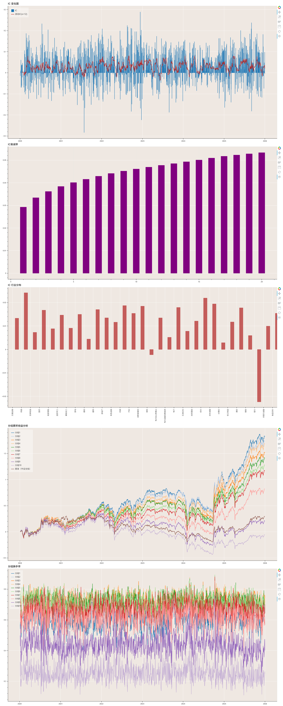

#### 日度 IC、滚动 IC 与累计 Rank IC

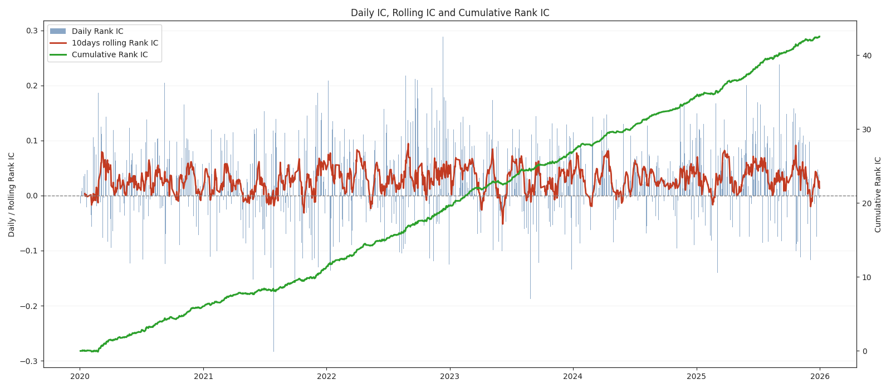

### 因子回测总结

#### IC 统计（中心与显著性）

| 指标          | Result    |
| ----------- | --------- |
| 样本天数        | 1,454     |
| 平均 Rank IC  | 0.029     |
| Rank IC 标准差 | 0.072     |
| ICIR        | 0.405     |
| 年化 ICIR     | 6.434     |
| IC t 值      | 15.454    |
| IC p 值      | 5.381e-50 |

#### IC 统计（分布与持久性）

| 指标         | Result |
| ---------- | ------ |
| 正 IC 占比    | 0.671  |
| 负 IC 占比    | 0.329  |
| IC 偏度      | -0.110 |
| IC 峰度      | 0.150  |
| IC 一阶自相关   | -0.019 |
| 累计 Rank IC | 42.529 |

- 本次绩效计算使用的基准区间： 2020-01-06 至 2025-12-31
- 策略与基准共同样本天数： 1453

#### 分组绝对收益与风险

| 分组               | 累计收益率  | 年化收益率  | 年化波动率 | 夏普比率  | Sortino 比率 | 最大回撤   | Calmar 比率 |
| ---------------- | ------ | ------ | ----- | ----- | ---------- | ------ | --------- |
| q0               | 1.832  | 0.198  | 0.231 | 0.898 | 1.238      | -0.327 | 0.605     |
| q1               | 1.741  | 0.191  | 0.233 | 0.869 | 1.198      | -0.302 | 0.634     |
| q2               | 1.523  | 0.174  | 0.233 | 0.806 | 1.110      | -0.322 | 0.540     |
| q3               | 1.688  | 0.187  | 0.236 | 0.847 | 1.167      | -0.309 | 0.606     |
| q4               | 1.414  | 0.165  | 0.238 | 0.762 | 1.044      | -0.315 | 0.524     |
| q5               | 1.275  | 0.153  | 0.240 | 0.715 | 0.981      | -0.315 | 0.486     |
| q6               | 1.170  | 0.144  | 0.244 | 0.674 | 0.922      | -0.310 | 0.464     |
| q7               | 0.820  | 0.109  | 0.249 | 0.542 | 0.738      | -0.391 | 0.280     |
| q8               | 0.202  | 0.032  | 0.251 | 0.254 | 0.343      | -0.457 | 0.071     |
| q9               | -0.054 | -0.010 | 0.273 | 0.102 | 0.138      | -0.574 | -0.017    |
| total（十组等权）      | 1.056  | 0.133  | 0.240 | 0.641 | 0.876      | -0.329 | 0.405     |
| long_short_q0_q9 | 1.733  | 0.190  | 0.101 | 1.772 | 2.753      | -0.134 | 1.426     |

#### 分组日收益分布

| 分组               | 日胜率   | 平均日收益 | 日收益偏度  | 日收益峰度 |
| ---------------- | ----- | ----- | ------ | ----- |
| q0               | 0.557 | 0.001 | -0.651 | 9.734 |
| q1               | 0.560 | 0.001 | -0.669 | 9.744 |
| q2               | 0.560 | 0.001 | -0.640 | 8.842 |
| q3               | 0.555 | 0.001 | -0.655 | 9.111 |
| q4               | 0.546 | 0.001 | -0.703 | 8.547 |
| q5               | 0.545 | 0.001 | -0.641 | 8.400 |
| q6               | 0.542 | 0.001 | -0.728 | 8.546 |
| q7               | 0.544 | 0.001 | -0.677 | 7.793 |
| q8               | 0.528 | 0.000 | -0.601 | 5.776 |
| q9               | 0.518 | 0.000 | -0.595 | 7.472 |
| total（十组等权）      | 0.545 | 0.001 | -0.673 | 8.571 |
| long_short_q0_q9 | 0.546 | 0.001 | 0.046  | 1.147 |

#### 分组相对基准绩效

| 分组               | 基准年化收益率 | 年化超额收益（几何） | 年化收益差（算术） | Alpha（年化） | Beta   | 跟踪误差  | 信息比率   |
| ---------------- | ------- | ---------- | --------- | --------- | ------ | ----- | ------ |
| q0               | 0.046   | 0.146      | 0.152     | 0.141     | 1.022  | 0.107 | 1.329  |
| q1               | 0.046   | 0.139      | 0.145     | 0.135     | 1.030  | 0.108 | 1.277  |
| q2               | 0.046   | 0.123      | 0.129     | 0.121     | 1.034  | 0.107 | 1.148  |
| q3               | 0.046   | 0.135      | 0.141     | 0.131     | 1.050  | 0.106 | 1.267  |
| q4               | 0.046   | 0.114      | 0.120     | 0.113     | 1.062  | 0.107 | 1.090  |
| q5               | 0.046   | 0.103      | 0.108     | 0.102     | 1.079  | 0.106 | 1.012  |
| q6               | 0.046   | 0.094      | 0.098     | 0.093     | 1.099  | 0.106 | 0.939  |
| q7               | 0.046   | 0.061      | 0.064     | 0.062     | 1.122  | 0.110 | 0.639  |
| q8               | 0.046   | -0.013     | -0.013    | -0.009    | 1.119  | 0.116 | -0.009 |
| q9               | 0.046   | -0.053     | -0.055    | -0.050    | 1.204  | 0.135 | -0.274 |
| total（十组等权）      | 0.046   | 0.084      | 0.088     | 0.084     | 1.082  | 0.105 | 0.850  |
| long_short_q0_q9 | 0.046   | 0.139      | 0.145     | 0.191     | -0.183 | 0.255 | 0.450  |

#### 分组换手率

| 分组               | 平均日换手率 | 中位数日换手率 | 年化换手率   | 最大单日换手率 |
| ---------------- | ------ | ------- | ------- | ------- |
| q0               | 0.595  | 0.595   | 149.995 | 0.854   |
| q1               | 0.700  | 0.701   | 176.489 | 0.842   |
| q2               | 0.726  | 0.728   | 182.835 | 0.860   |
| q3               | 0.729  | 0.731   | 183.740 | 0.878   |
| q4               | 0.720  | 0.722   | 181.402 | 0.870   |
| q5               | 0.702  | 0.703   | 176.818 | 0.894   |
| q6               | 0.668  | 0.669   | 168.426 | 0.882   |
| q7               | 0.611  | 0.610   | 153.891 | 0.856   |
| q8               | 0.434  | 0.432   | 109.417 | 0.762   |
| q9               | 0.249  | 0.244   | 62.739  | 0.649   |
| total（十组等权）      | 0.613  | 0.614   | 154.575 | 0.834   |
| long_short_q0_q9 | 0.844  | 0.840   | 212.733 | 1.503   |

## 06. CSAD 模型（基于“小型”板块）

### 因子公式

**用于构建羊群效应因子的行为金融模型**

① 每个月末，提取当前可交易股票过去 120 个交易日的涨跌幅数据，计算目标股票 $S_t$ 与其他股票（不活跃交易日不超过 20 天）之间的日涨跌幅相关系数；

② 选取与 $S_t$ 相关系数最大的 9 只股票，连同 $S_t$ 一起构成一个包含 10 只股票的“小型”板块：

$$
S_i,\quad i = 1, 2, \dots, 10
$$

③ 计算该板块过去 120 个交易日的横截面绝对偏差（CSAD）：

$$
\text{CSAD}_t = \frac{1}{10} \sum_{i=1}^{10} \left| r_{i,t} - \bar{r}_t \right|
$$

其中，$r_{i,t}$ 为板块内第 $i$ 只股票在交易日 $t$ 的收益率，$\bar{r}_t$ 为板块内所有股票在交易日 $t$ 的平均收益率。

④ 对 CSAD 进行时序标准化，并计算过去 20 个交易日的均值，作为羊群效应因子：

$$
Z_{jt} = \frac{\text{CSAD}_{jt} - \mu_{\text{CSAD}_j}}{\sigma_{\text{CSAD}_j}}
$$

$$
f_{jt} = -\frac{1}{20} \sum_{k=1}^{20} Z_{j,t-k+1}
$$

其中，$j$ 表示第 $j$ 个“小型”板块，$\mu_{\text{CSAD}_j}$ 和 $\sigma_{\text{CSAD}_j}$ 分别为该板块 CSAD 在样本期内的均值和标准差，$Z_{jt}$ 为标准化后的 CSAD，$f_{jt}$ 为最终的羊群效应因子。

### 因子描述

CSAD 利用股票收益在横截面上的分散度来衡量市场羊群效应的强弱。为使因子对个股具备选股能力，该模型将与目标个股走势最为相近的股票组成“小型”板块，借助该小板块上的羊群效应强弱来近似反映该股票近期的关注度变化。

因子值 $f_{jt}$ 越大（由于负号处理，对应近期 CSAD 显著偏低），表明板块近期的羊群效应越强，板块内个股收益趋于一致，该板块受市场关注的程度提升越明显，未来收益预期也越高。

数据：日度收盘价

### 因子米筐回测图表

#### 米筐完整回测报告

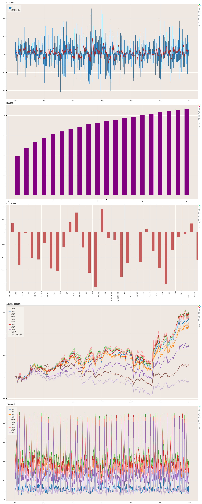

#### 日度 IC、滚动 IC 与累计 Rank IC

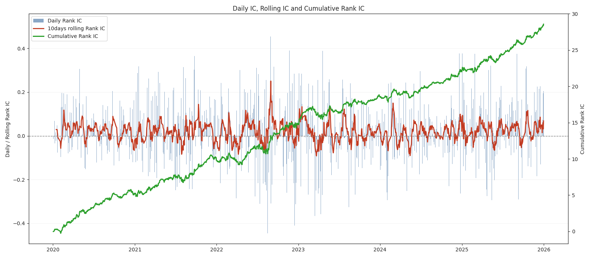

### 因子回测总结

#### IC 统计（中心与显著性）

| 指标          | Result    |
| ----------- | --------- |
| 样本天数        | 1,454     |
| 平均 Rank IC  | 0.020     |
| Rank IC 标准差 | 0.138     |
| ICIR        | 0.142     |
| 年化 ICIR     | 2.260     |
| IC t 值      | 5.428     |
| IC p 值      | 6.659e-08 |

#### IC 统计（分布与持久性）

| 指标         | Result |
| ---------- | ------ |
| 正 IC 占比    | 0.556  |
| 负 IC 占比    | 0.444  |
| IC 偏度      | 0.064  |
| IC 峰度      | 0.439  |
| IC 一阶自相关   | -0.014 |
| 累计 Rank IC | 28.566 |

- 本次绩效计算使用的基准区间： 2020-01-06 至 2025-12-31
- 策略与基准共同样本天数： 1453

#### 分组绝对收益与风险

| 分组               | 累计收益率  | 年化收益率  | 年化波动率 | 夏普比率  | Sortino 比率 | 最大回撤   | Calmar 比率 |
| ---------------- | ------ | ------ | ----- | ----- | ---------- | ------ | --------- |
| q0               | 1.366  | 0.161  | 0.261 | 0.704 | 0.982      | -0.381 | 0.423     |
| q1               | 1.474  | 0.170  | 0.245 | 0.765 | 1.061      | -0.365 | 0.466     |
| q2               | 1.206  | 0.147  | 0.239 | 0.695 | 0.954      | -0.368 | 0.400     |
| q3               | 1.285  | 0.154  | 0.236 | 0.726 | 0.999      | -0.336 | 0.459     |
| q4               | 1.532  | 0.175  | 0.236 | 0.802 | 1.103      | -0.337 | 0.520     |
| q5               | 1.475  | 0.170  | 0.237 | 0.784 | 1.074      | -0.328 | 0.519     |
| q6               | 1.485  | 0.171  | 0.237 | 0.785 | 1.080      | -0.299 | 0.572     |
| q7               | 1.420  | 0.166  | 0.245 | 0.749 | 1.029      | -0.298 | 0.556     |
| q8               | 0.743  | 0.101  | 0.254 | 0.508 | 0.691      | -0.328 | 0.308     |
| q9               | -0.102 | -0.018 | 0.276 | 0.071 | 0.096      | -0.510 | -0.036    |
| total（十组等权）      | 1.132  | 0.140  | 0.239 | 0.670 | 0.918      | -0.331 | 0.424     |
| long_short_q0_q9 | 1.337  | 0.159  | 0.183 | 0.895 | 1.361      | -0.180 | 0.881     |

#### 分组日收益分布

| 分组               | 日胜率   | 平均日收益 | 日收益偏度  | 日收益峰度  |
| ---------------- | ----- | ----- | ------ | ------ |
| q0               | 0.543 | 0.001 | -0.512 | 9.468  |
| q1               | 0.545 | 0.001 | -0.633 | 10.040 |
| q2               | 0.536 | 0.001 | -0.697 | 9.396  |
| q3               | 0.548 | 0.001 | -0.664 | 9.110  |
| q4               | 0.544 | 0.001 | -0.679 | 9.193  |
| q5               | 0.547 | 0.001 | -0.717 | 8.890  |
| q6               | 0.549 | 0.001 | -0.656 | 8.043  |
| q7               | 0.540 | 0.001 | -0.605 | 7.030  |
| q8               | 0.542 | 0.001 | -0.607 | 5.995  |
| q9               | 0.538 | 0.000 | -0.434 | 4.438  |
| total（十组等权）      | 0.545 | 0.001 | -0.648 | 8.682  |
| long_short_q0_q9 | 0.510 | 0.001 | 0.210  | 1.306  |

#### 分组相对基准绩效

| 分组               | 基准年化收益率 | 年化超额收益（几何） | 年化收益差（算术） | Alpha（年化） | Beta   | 跟踪误差  | 信息比率   |
| ---------------- | ------- | ---------- | --------- | --------- | ------ | ----- | ------ |
| q0               | 0.046   | 0.110      | 0.115     | 0.112     | 1.099  | 0.141 | 0.842  |
| q1               | 0.046   | 0.119      | 0.125     | 0.118     | 1.071  | 0.119 | 1.027  |
| q2               | 0.046   | 0.097      | 0.101     | 0.097     | 1.059  | 0.110 | 0.919  |
| q3               | 0.046   | 0.104      | 0.108     | 0.103     | 1.060  | 0.104 | 1.027  |
| q4               | 0.046   | 0.124      | 0.129     | 0.120     | 1.063  | 0.103 | 1.212  |
| q5               | 0.046   | 0.119      | 0.125     | 0.116     | 1.069  | 0.102 | 1.186  |
| q6               | 0.046   | 0.120      | 0.125     | 0.117     | 1.066  | 0.104 | 1.166  |
| q7               | 0.046   | 0.115      | 0.120     | 0.113     | 1.084  | 0.115 | 1.032  |
| q8               | 0.046   | 0.053      | 0.056     | 0.058     | 1.096  | 0.128 | 0.499  |
| q9               | 0.046   | -0.061     | -0.064    | -0.052    | 1.113  | 0.164 | -0.275 |
| total（十组等权）      | 0.046   | 0.091      | 0.095     | 0.090     | 1.078  | 0.104 | 0.919  |
| long_short_q0_q9 | 0.046   | 0.108      | 0.113     | 0.165     | -0.014 | 0.274 | 0.363  |

#### 分组换手率

| 分组               | 平均日换手率 | 中位数日换手率 | 年化换手率   | 最大单日换手率 |
| ---------------- | ------ | ------- | ------- | ------- |
| q0               | 0.134  | 0.111   | 33.661  | 0.685   |
| q1               | 0.300  | 0.273   | 75.551  | 0.883   |
| q2               | 0.377  | 0.355   | 95.031  | 0.897   |
| q3               | 0.414  | 0.393   | 104.430 | 0.929   |
| q4               | 0.427  | 0.406   | 107.521 | 0.926   |
| q5               | 0.419  | 0.394   | 105.669 | 0.933   |
| q6               | 0.393  | 0.367   | 98.938  | 0.937   |
| q7               | 0.344  | 0.316   | 86.563  | 0.904   |
| q8               | 0.261  | 0.229   | 65.698  | 0.886   |
| q9               | 0.117  | 0.089   | 29.528  | 0.767   |
| total（十组等权）      | 0.318  | 0.292   | 80.259  | 0.848   |
| long_short_q0_q9 | 0.251  | 0.200   | 63.188  | 1.368   |

## 07. 每日平均异常成交（ABNVOLAVG）

### 因子公式

**行为金融因子 —— 投资者注意力**

$$
\text{ABNVOLAVG} = \frac{1}{m} \sum_{t=1}^{m} \left( \frac{VOL_{i,t}}{\overline{VOL}_{i,t}} \right)
$$

其中：

- $VOL_{i,t}$ 为股票 $i$ 在交易日 $t$ 的成交量；
- $\overline{VOL}_{i,t}$ 为股票 $i$ 在交易日 $t$ 滚动 1 年的平均成交量；
- $m$ 为交易日窗口，一般取为月度。

### 因子描述

每日平均异常成交（ABNVOLAVG）为日频成交量除以过去一年平均成交量的均值，属于**极端交易量类因子**。异常成交量是投资者注意力的常用代理指标之一。因子取值越高，表明该股票在当月平均异常成交水平越高，投资者的关注度也就越高。然而，投资者的注意力是有限的，他们更倾向于交易那些引起自己注意的股票。通常情况下，关注度较高的股票会伴随更多的买入行为。但在 A 股市场中，由于**做多与做空机制不对称**，投资者非理性买入的倾向强于非理性卖出，导致高关注度股票因净买入力量而出现短期价格溢价，这种过度反应往往会在未来引发价格反转。

数据：日度成交量

### 因子米筐回测图表

#### 米筐完整回测报告

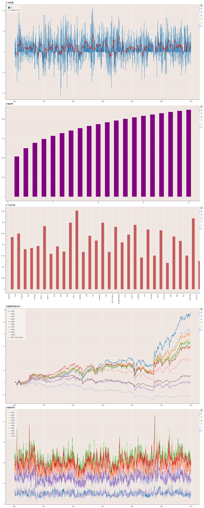

#### 日度 IC、滚动 IC 与累计 Rank IC

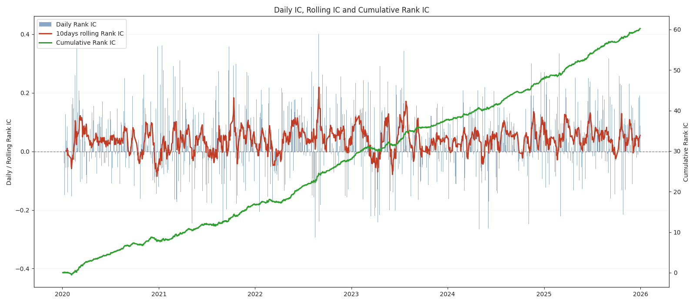

### 因子回测总结

#### IC 统计（中心与显著性）

| 指标          | Result    |
| ----------- | --------- |
| 样本天数        | 1,454     |
| 平均 Rank IC  | 0.041     |
| Rank IC 标准差 | 0.120     |
| ICIR        | 0.344     |
| 年化 ICIR     | 5.469     |
| IC t 值      | 13.136    |
| IC p 值      | 2.509e-37 |

#### IC 统计（分布与持久性）

| 指标         | Result |
| ---------- | ------ |
| 正 IC 占比    | 0.636  |
| 负 IC 占比    | 0.364  |
| IC 偏度      | -0.046 |
| IC 峰度      | 0.101  |
| IC 一阶自相关   | -0.026 |
| 累计 Rank IC | 60.240 |

- 本次绩效计算使用的基准区间： 2020-01-06 至 2025-12-31
- 策略与基准共同样本天数： 1453

#### 分组绝对收益与风险

| 分组               | 累计收益率  | 年化收益率  | 年化波动率 | 夏普比率   | Sortino 比率 | 最大回撤   | Calmar 比率 |
| ---------------- | ------ | ------ | ----- | ------ | ---------- | ------ | --------- |
| q0               | 2.900  | 0.266  | 0.249 | 1.073  | 1.480      | -0.331 | 0.803     |
| q1               | 2.239  | 0.226  | 0.242 | 0.965  | 1.335      | -0.327 | 0.690     |
| q2               | 2.064  | 0.214  | 0.235 | 0.945  | 1.312      | -0.331 | 0.648     |
| q3               | 1.799  | 0.195  | 0.232 | 0.888  | 1.232      | -0.309 | 0.632     |
| q4               | 1.689  | 0.187  | 0.231 | 0.860  | 1.189      | -0.304 | 0.617     |
| q5               | 1.515  | 0.173  | 0.231 | 0.809  | 1.115      | -0.297 | 0.584     |
| q6               | 1.512  | 0.173  | 0.236 | 0.797  | 1.096      | -0.298 | 0.582     |
| q7               | 0.998  | 0.128  | 0.244 | 0.614  | 0.836      | -0.332 | 0.384     |
| q8               | 0.027  | 0.005  | 0.261 | 0.149  | 0.201      | -0.491 | 0.010     |
| q9               | -0.537 | -0.125 | 0.293 | -0.308 | -0.411     | -0.701 | -0.178    |
| total（十组等权）      | 1.131  | 0.140  | 0.239 | 0.669  | 0.915      | -0.325 | 0.431     |
| long_short_q0_q9 | 6.270  | 0.411  | 0.164 | 2.177  | 3.449      | -0.161 | 2.553     |

#### 分组日收益分布

| 分组               | 日胜率   | 平均日收益  | 日收益偏度  | 日收益峰度 |
| ---------------- | ----- | ------ | ------ | ----- |
| q0               | 0.558 | 0.001  | -0.909 | 9.733 |
| q1               | 0.557 | 0.001  | -0.750 | 9.442 |
| q2               | 0.555 | 0.001  | -0.624 | 9.369 |
| q3               | 0.549 | 0.001  | -0.616 | 9.273 |
| q4               | 0.546 | 0.001  | -0.656 | 9.292 |
| q5               | 0.551 | 0.001  | -0.638 | 8.805 |
| q6               | 0.550 | 0.001  | -0.648 | 8.504 |
| q7               | 0.555 | 0.001  | -0.707 | 7.710 |
| q8               | 0.538 | 0.000  | -0.577 | 5.739 |
| q9               | 0.522 | -0.000 | -0.392 | 4.486 |
| total（十组等权）      | 0.548 | 0.001  | -0.675 | 8.620 |
| long_short_q0_q9 | 0.557 | 0.001  | 0.023  | 1.177 |

#### 分组相对基准绩效

| 分组               | 基准年化收益率 | 年化超额收益（几何） | 年化收益差（算术） | Alpha（年化） | Beta   | 跟踪误差  | 信息比率   |
| ---------------- | ------- | ---------- | --------- | --------- | ------ | ----- | ------ |
| q0               | 0.046   | 0.211      | 0.221     | 0.200     | 1.040  | 0.137 | 1.478  |
| q1               | 0.046   | 0.173      | 0.180     | 0.166     | 1.038  | 0.123 | 1.368  |
| q2               | 0.046   | 0.161      | 0.169     | 0.155     | 1.033  | 0.111 | 1.412  |
| q3               | 0.046   | 0.143      | 0.150     | 0.139     | 1.035  | 0.103 | 1.362  |
| q4               | 0.046   | 0.135      | 0.142     | 0.131     | 1.047  | 0.097 | 1.382  |
| q5               | 0.046   | 0.122      | 0.128     | 0.119     | 1.054  | 0.094 | 1.296  |
| q6               | 0.046   | 0.122      | 0.128     | 0.118     | 1.079  | 0.095 | 1.293  |
| q7               | 0.046   | 0.078      | 0.082     | 0.078     | 1.110  | 0.104 | 0.825  |
| q8               | 0.046   | -0.039     | -0.041    | -0.035    | 1.140  | 0.130 | -0.197 |
| q9               | 0.046   | -0.163     | -0.171    | -0.168    | 1.196  | 0.174 | -0.892 |
| total（十组等权）      | 0.046   | 0.090      | 0.095     | 0.090     | 1.077  | 0.104 | 0.914  |
| long_short_q0_q9 | 0.046   | 0.349      | 0.365     | 0.368     | -0.155 | 0.282 | 1.039  |

#### 分组换手率

| 分组               | 平均日换手率 | 中位数日换手率 | 年化换手率  | 最大单日换手率 |
| ---------------- | ------ | ------- | ------ | ------- |
| q0               | 0.051  | 0.050   | 12.799 | 0.098   |
| q1               | 0.131  | 0.129   | 32.911 | 0.260   |
| q2               | 0.180  | 0.177   | 45.277 | 0.371   |
| q3               | 0.209  | 0.207   | 52.570 | 0.397   |
| q4               | 0.222  | 0.221   | 56.024 | 0.433   |
| q5               | 0.222  | 0.220   | 55.888 | 0.439   |
| q6               | 0.206  | 0.203   | 51.972 | 0.428   |
| q7               | 0.173  | 0.171   | 43.667 | 0.357   |
| q8               | 0.127  | 0.127   | 32.109 | 0.235   |
| q9               | 0.052  | 0.051   | 13.149 | 0.104   |
| total（十组等权）      | 0.157  | 0.156   | 39.637 | 0.309   |
| long_short_q0_q9 | 0.103  | 0.102   | 25.948 | 0.178   |

## 08. 未实现盈利量（CGO）

### 因子公式

**行为金融因子 —— 投资者参考点与盈亏状态**

当前未实现盈利量定义为当前价格相对于参考价格的相对偏离程度：

$$
\text{CGO}_t = \frac{P_t - RP_t}{RP_t}
$$

其中，参考价格 $RP_t$ 采用换手率加权的历史价格进行构造：

$$
RP_t = \frac{1}{k} \sum_{n=1}^{N} V_{t-n} \prod_{\tau=1}^{n-1} \left( 1 - V_{t-\tau} \right) P_{t-n}
$$

各变量定义如下：

- $P_t$ 为股票在 $t$ 时刻的价格；
- $P_{t-n}$ 为股票在 $t-n$ 时刻的价格；
- $V_t$ 为股票在 $t$ 时刻的换手率；
- $V_{t-n}$ 为股票在 $t-n$ 时刻的换手率；
- $\frac{1}{k}$ 为权重归一化参数，确保所有权重之和为 1；
- $N$ 为截断时间长度，通常可取 $N = 40$ 或 $60$ 个交易日。

### 因子描述

未实现盈利量（Capital Gain Overhang，CGO）衡量了当前投资者整体的盈亏水平，其核心逻辑在于通过比较当前价格与参考价格（即投资者的平均持仓成本）来判断市场参与者的盈利或亏损状态。

该因子通常与股票未来收益呈正相关关系：

- 当投资者处于**盈利状态**（$\text{CGO} > 0$）时，由于厌恶风险，他们更倾向于卖出股票以锁定利润，从而形成卖盘压力，导致股价被低估，未来预期收益上升；
- 当投资者处于**亏损状态**（$\text{CGO} < 0$）时，由于偏好风险（即“赌徒心态”或“处置效应”），他们更倾向于继续持有股票而非止损卖出，导致股价被高估，未来预期收益下降。

长期来看，上述现象在 A 股市场是成立的。但在短期内，浮盈股票面临的卖盘压力可能大于其被低估的幅度，从而出现浮盈股票未来表现反而更差的情况。

数据：日度收盘价、日度换手率

### 因子米筐回测图表

#### 米筐完整回测报告

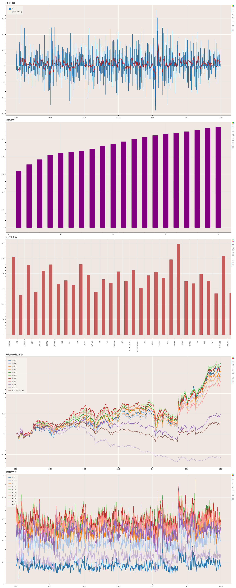

#### 日度 IC、滚动 IC 与累计 Rank IC

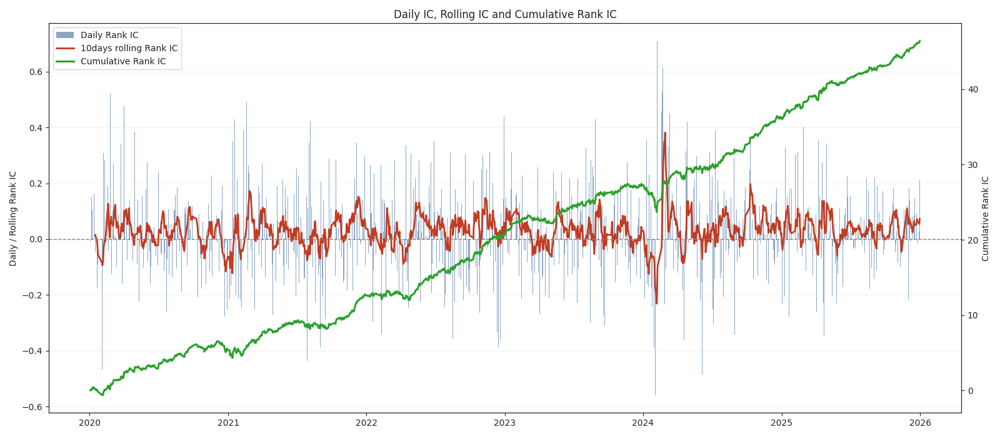

### 因子回测总结

#### IC 统计（中心与显著性）

| 指标          | Result    |
| ----------- | --------- |
| 样本天数        | 1,454     |
| 平均 Rank IC  | 0.032     |
| Rank IC 标准差 | 0.169     |
| ICIR        | 0.189     |
| 年化 ICIR     | 2.996     |
| IC t 值      | 7.196     |
| IC p 值      | 9.901e-13 |

#### IC 统计（分布与持久性）

| 指标         | Result |
| ---------- | ------ |
| 正 IC 占比    | 0.586  |
| 负 IC 占比    | 0.414  |
| IC 偏度      | 0.119  |
| IC 峰度      | 0.459  |
| IC 一阶自相关   | -0.002 |
| 累计 Rank IC | 46.400 |

- 本次绩效计算使用的基准区间： 2020-01-06 至 2025-12-31
- 策略与基准共同样本天数： 1453

#### 分组绝对收益与风险

| 分组               | 累计收益率  | 年化收益率  | 年化波动率 | 夏普比率   | Sortino 比率 | 最大回撤   | Calmar 比率 |
| ---------------- | ------ | ------ | ----- | ------ | ---------- | ------ | --------- |
| q0               | 1.735  | 0.191  | 0.296 | 0.738  | 1.049      | -0.415 | 0.459     |
| q1               | 1.459  | 0.169  | 0.272 | 0.711  | 0.997      | -0.391 | 0.432     |
| q2               | 1.536  | 0.175  | 0.259 | 0.754  | 1.046      | -0.388 | 0.452     |
| q3               | 1.409  | 0.165  | 0.248 | 0.740  | 1.018      | -0.365 | 0.452     |
| q4               | 1.638  | 0.183  | 0.243 | 0.816  | 1.118      | -0.344 | 0.532     |
| q5               | 1.734  | 0.191  | 0.238 | 0.854  | 1.166      | -0.325 | 0.586     |
| q6               | 1.653  | 0.184  | 0.234 | 0.842  | 1.145      | -0.304 | 0.607     |
| q7               | 1.289  | 0.154  | 0.232 | 0.736  | 0.999      | -0.289 | 0.535     |
| q8               | 0.495  | 0.072  | 0.235 | 0.415  | 0.563      | -0.376 | 0.192     |
| q9               | -0.573 | -0.137 | 0.256 | -0.446 | -0.593     | -0.757 | -0.181    |
| total（十组等权）      | 1.057  | 0.133  | 0.240 | 0.642  | 0.877      | -0.329 | 0.405     |
| long_short_q0_q9 | 4.823  | 0.357  | 0.234 | 1.422  | 2.218      | -0.289 | 1.235     |

#### 分组日收益分布

| 分组               | 日胜率   | 平均日收益  | 日收益偏度  | 日收益峰度 |
| ---------------- | ----- | ------ | ------ | ----- |
| q0               | 0.536 | 0.001  | -0.317 | 7.689 |
| q1               | 0.538 | 0.001  | -0.464 | 8.955 |
| q2               | 0.543 | 0.001  | -0.618 | 9.824 |
| q3               | 0.542 | 0.001  | -0.679 | 9.338 |
| q4               | 0.546 | 0.001  | -0.751 | 9.385 |
| q5               | 0.559 | 0.001  | -0.788 | 8.631 |
| q6               | 0.560 | 0.001  | -0.816 | 8.084 |
| q7               | 0.544 | 0.001  | -0.758 | 7.645 |
| q8               | 0.540 | 0.000  | -0.594 | 6.781 |
| q9               | 0.509 | -0.000 | -0.374 | 4.943 |
| total（十组等权）      | 0.544 | 0.001  | -0.672 | 8.562 |
| long_short_q0_q9 | 0.537 | 0.001  | 0.215  | 4.999 |

#### 分组相对基准绩效

| 分组               | 基准年化收益率 | 年化超额收益（几何） | 年化收益差（算术） | Alpha（年化） | Beta  | 跟踪误差  | 信息比率   |
| ---------------- | ------- | ---------- | --------- | --------- | ----- | ----- | ------ |
| q0               | 0.046   | 0.139      | 0.145     | 0.139     | 1.225 | 0.172 | 0.895  |
| q1               | 0.046   | 0.118      | 0.123     | 0.119     | 1.151 | 0.147 | 0.874  |
| q2               | 0.046   | 0.124      | 0.129     | 0.123     | 1.111 | 0.134 | 0.972  |
| q3               | 0.046   | 0.114      | 0.119     | 0.114     | 1.072 | 0.125 | 0.952  |
| q4               | 0.046   | 0.132      | 0.138     | 0.129     | 1.059 | 0.118 | 1.127  |
| q5               | 0.046   | 0.139      | 0.145     | 0.135     | 1.046 | 0.112 | 1.231  |
| q6               | 0.046   | 0.133      | 0.139     | 0.130     | 1.036 | 0.108 | 1.225  |
| q7               | 0.046   | 0.104      | 0.109     | 0.104     | 1.033 | 0.105 | 1.005  |
| q8               | 0.046   | 0.026      | 0.027     | 0.030     | 1.039 | 0.109 | 0.301  |
| q9               | 0.046   | -0.175     | -0.183    | -0.182    | 1.050 | 0.147 | -1.218 |
| total（十组等权）      | 0.046   | 0.084      | 0.088     | 0.084     | 1.082 | 0.105 | 0.851  |
| long_short_q0_q9 | 0.046   | 0.298      | 0.312     | 0.322     | 0.175 | 0.284 | 0.943  |

#### 分组换手率

| 分组               | 平均日换手率 | 中位数日换手率 | 年化换手率   | 最大单日换手率 |
| ---------------- | ------ | ------- | ------- | ------- |
| q0               | 0.173  | 0.166   | 43.655  | 0.489   |
| q1               | 0.400  | 0.390   | 100.822 | 0.897   |
| q2               | 0.504  | 0.496   | 126.955 | 0.955   |
| q3               | 0.558  | 0.552   | 140.723 | 0.966   |
| q4               | 0.588  | 0.582   | 148.082 | 0.974   |
| q5               | 0.599  | 0.594   | 150.967 | 0.897   |
| q6               | 0.593  | 0.591   | 149.528 | 0.929   |
| q7               | 0.566  | 0.567   | 142.596 | 0.899   |
| q8               | 0.487  | 0.488   | 122.845 | 0.794   |
| q9               | 0.244  | 0.242   | 61.368  | 0.480   |
| total（十组等权）      | 0.471  | 0.465   | 118.754 | 0.750   |
| long_short_q0_q9 | 0.417  | 0.407   | 105.024 | 0.840   |

## 09. 衰减加权月频成交量（ATTN）

### 因子公式

**行为金融因子 —— 投资者注意力**

衰减加权月频成交量因子通过对过去 12 个月的成交量按月线性衰减加权求和得到，赋予近期成交量更高的权重：

$$
\text{ATTN}_t = \sum_{m=1}^{11} \frac{12 - m}{\sum_{k=1}^{11} k} \cdot VOL_{i, t-m}
$$

其中，分母为权重归一化常数：

$$
\sum_{k=1}^{11} k = \frac{11 \times 12}{2} = 66
$$

因此，因子可简化为：

$$
\text{ATTN}_t = \sum_{m=1}^{11} \frac{12 - m}{66} \cdot VOL_{i, t-m}
$$

各变量定义如下：

- $VOL_{i, t-m}$ 为股票 $i$ 在 $t-m$ 月的月频成交量（共取过去 11 个月，加上当月共覆盖 12 个月度窗口）；
- $m$ 为月份滞后阶数，从 1 到 11，取值越大，对应的成交量越早，权重越低；
- $\frac{12 - m}{66}$ 为线性衰减权重，权重随 $m$ 增大而递减（即近期权重高、远期权重低）。

### 因子描述

衰减加权月频成交量因子通过对股票历史成交量进行时间衰减加权得到，属于**极端交易量类因子**。

异常成交量是投资者注意力的常用代理指标之一。因子取值越高，表明该股票近期成交量持续活跃，投资者的关注度也就越高。

然而，投资者的注意力是有限的，他们更倾向于交易那些引起自己注意的股票。通常情况下，关注度较高的股票会伴随更多的买入行为。但在 A 股市场中，由于**做多与做空机制不对称**，投资者非理性买入的倾向强于非理性卖出，导致高关注度股票因净买入力量而出现短期价格溢价，这种过度反应往往会在未来引发价格反转。

数据：日度成交量

### 因子米筐回测图表

#### 米筐完整回测报告

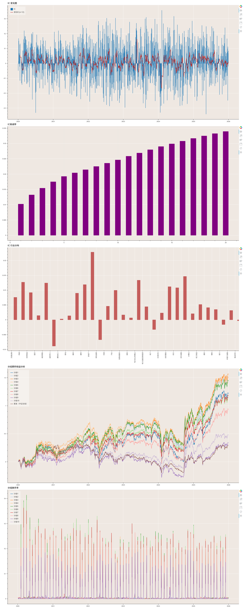

#### 日度 IC、滚动 IC 与累计 Rank IC

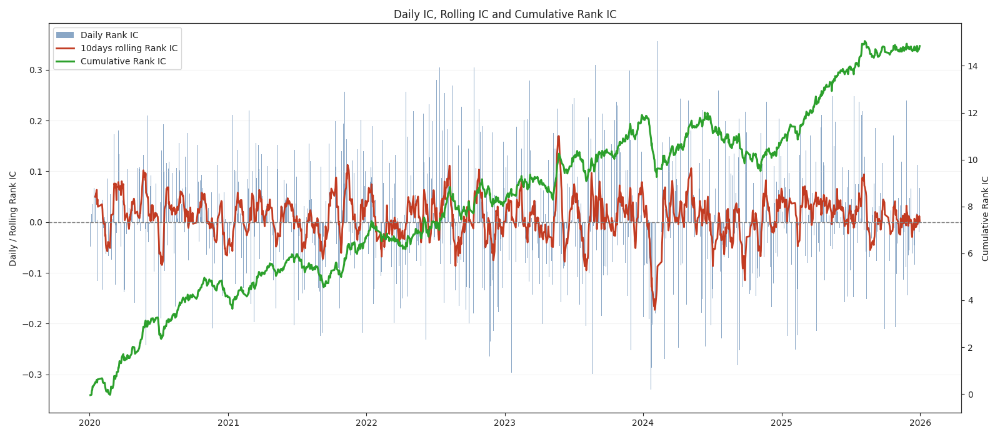

### 因子回测总结

#### IC 统计（中心与显著性）

| 指标          | Result    |
| ----------- | --------- |
| 样本天数        | 1,454     |
| 平均 Rank IC  | 0.010     |
| Rank IC 标准差 | 0.115     |
| ICIR        | 0.089     |
| 年化 ICIR     | 1.414     |
| IC t 值      | 3.395     |
| IC p 值      | 7.036e-04 |

#### IC 统计（分布与持久性）

| 指标         | Result |
| ---------- | ------ |
| 正 IC 占比    | 0.541  |
| 负 IC 占比    | 0.459  |
| IC 偏度      | -0.098 |
| IC 峰度      | -0.154 |
| IC 一阶自相关   | 0.058  |
| 累计 Rank IC | 14.845 |

- 本次绩效计算使用的基准区间： 2020-01-06 至 2025-12-31
- 策略与基准共同样本天数： 1453

#### 分组绝对收益与风险

| 分组               | 累计收益率 | 年化收益率 | 年化波动率 | 夏普比率  | Sortino 比率 | 最大回撤   | Calmar 比率 |
| ---------------- | ----- | ----- | ----- | ----- | ---------- | ------ | --------- |
| q0               | 1.230 | 0.149 | 0.253 | 0.678 | 0.933      | -0.374 | 0.399     |
| q1               | 1.513 | 0.173 | 0.251 | 0.763 | 1.051      | -0.368 | 0.471     |
| q2               | 1.570 | 0.178 | 0.246 | 0.789 | 1.089      | -0.334 | 0.533     |
| q3               | 1.497 | 0.172 | 0.245 | 0.772 | 1.056      | -0.346 | 0.497     |
| q4               | 1.449 | 0.168 | 0.240 | 0.768 | 1.052      | -0.326 | 0.516     |
| q5               | 1.143 | 0.141 | 0.238 | 0.676 | 0.921      | -0.312 | 0.453     |
| q6               | 1.178 | 0.145 | 0.239 | 0.684 | 0.933      | -0.310 | 0.466     |
| q7               | 0.931 | 0.121 | 0.241 | 0.595 | 0.815      | -0.336 | 0.360     |
| q8               | 0.344 | 0.053 | 0.246 | 0.332 | 0.453      | -0.444 | 0.119     |
| q9               | 0.482 | 0.071 | 0.238 | 0.407 | 0.562      | -0.404 | 0.175     |
| total（十组等权）      | 1.102 | 0.137 | 0.239 | 0.659 | 0.901      | -0.325 | 0.423     |
| long_short_q0_q9 | 0.461 | 0.068 | 0.132 | 0.563 | 0.815      | -0.259 | 0.263     |

#### 分组日收益分布

| 分组               | 日胜率   | 平均日收益 | 日收益偏度  | 日收益峰度  |
| ---------------- | ----- | ----- | ------ | ------ |
| q0               | 0.536 | 0.001 | -0.553 | 12.125 |
| q1               | 0.548 | 0.001 | -0.623 | 10.992 |
| q2               | 0.547 | 0.001 | -0.618 | 9.755  |
| q3               | 0.545 | 0.001 | -0.751 | 9.232  |
| q4               | 0.552 | 0.001 | -0.711 | 8.544  |
| q5               | 0.551 | 0.001 | -0.728 | 7.459  |
| q6               | 0.557 | 0.001 | -0.710 | 6.787  |
| q7               | 0.546 | 0.001 | -0.596 | 6.807  |
| q8               | 0.526 | 0.000 | -0.567 | 4.831  |
| q9               | 0.520 | 0.000 | -0.476 | 7.419  |
| total（十组等权）      | 0.546 | 0.001 | -0.672 | 8.611  |
| long_short_q0_q9 | 0.512 | 0.000 | 0.065  | 2.193  |

#### 分组相对基准绩效

| 分组               | 基准年化收益率 | 年化超额收益（几何） | 年化收益差（算术） | Alpha（年化） | Beta   | 跟踪误差  | 信息比率  |
| ---------------- | ------- | ---------- | --------- | --------- | ------ | ----- | ----- |
| q0               | 0.046   | 0.099      | 0.104     | 0.103     | 1.056  | 0.139 | 0.768 |
| q1               | 0.046   | 0.122      | 0.128     | 0.122     | 1.075  | 0.130 | 0.975 |
| q2               | 0.046   | 0.126      | 0.132     | 0.125     | 1.075  | 0.120 | 1.077 |
| q3               | 0.046   | 0.121      | 0.126     | 0.119     | 1.074  | 0.117 | 1.058 |
| q4               | 0.046   | 0.117      | 0.122     | 0.116     | 1.064  | 0.111 | 1.074 |
| q5               | 0.046   | 0.091      | 0.096     | 0.092     | 1.058  | 0.108 | 0.887 |
| q6               | 0.046   | 0.095      | 0.099     | 0.094     | 1.074  | 0.106 | 0.936 |
| q7               | 0.046   | 0.072      | 0.075     | 0.073     | 1.091  | 0.104 | 0.758 |
| q8               | 0.046   | 0.007      | 0.007     | 0.009     | 1.120  | 0.103 | 0.164 |
| q9               | 0.046   | 0.024      | 0.025     | 0.026     | 1.091  | 0.095 | 0.335 |
| total（十组等权）      | 0.046   | 0.088      | 0.092     | 0.088     | 1.078  | 0.104 | 0.890 |
| long_short_q0_q9 | 0.046   | 0.021      | 0.022     | 0.077     | -0.035 | 0.246 | 0.040 |

#### 分组换手率

| 分组               | 平均日换手率 | 中位数日换手率 | 年化换手率 | 最大单日换手率 |
| ---------------- | ------ | ------- | ----- | ------- |
| q0               | 0.004  | 0.000   | 1.005 | 0.122   |
| q1               | 0.009  | 0.000   | 2.227 | 0.230   |
| q2               | 0.011  | 0.000   | 2.832 | 0.305   |
| q3               | 0.013  | 0.002   | 3.185 | 0.378   |
| q4               | 0.013  | 0.002   | 3.370 | 0.414   |
| q5               | 0.014  | 0.002   | 3.422 | 0.394   |
| q6               | 0.013  | 0.002   | 3.309 | 0.363   |
| q7               | 0.012  | 0.002   | 2.950 | 0.299   |
| q8               | 0.008  | 0.000   | 2.141 | 0.203   |
| q9               | 0.004  | 0.000   | 1.055 | 0.110   |
| total（十组等权）      | 0.010  | 0.001   | 2.550 | 0.273   |
| long_short_q0_q9 | 0.008  | 0.000   | 2.061 | 0.204   |

## 10. CSAD 模型（基于板块中地位）

### 因子公式

**用于构建羊群效应因子的行为金融模型**

① 每个月末，提取当前可交易股票过去 120 个交易日的涨跌幅数据，计算目标股票 $S_*$ 与其他股票（不活跃交易日不超过 20 天）之间的日涨跌幅相关系数；

② 选取与 $S_*$ 相关系数最大的 9 只股票，连同 $S_*$ 一起构成一个包含 10 只股票的“小型”板块：

$$
S_i, \quad i = 1, 2, \dots, 10
$$

③ 以 $S_*$ 为中心股票，计算该板块过去 120 个交易日的横截面绝对偏差（CSAD）：

$$
\text{CSAD}_t = \frac{1}{10} \sum_{i=1}^{10} \left| r_{i,t} - r_{*,t} \right|
$$

其中，$r_{i,t}$ 为板块内第 $i$ 只股票在交易日 $t$ 的收益率，$r_{*,t}$ 为中心股票 $S_*$ 在交易日 $t$ 的收益率。

④ 对 CSAD 进行时序标准化，并计算过去 20 个交易日的均值，作为羊群效应因子：

$$
Z_{jt} = \frac{\text{CSAD}_{jt} - \mu_{\text{CSAD}_j}}{\sigma_{\text{CSAD}_j}}
$$

$$
f_{jt} = -\frac{1}{20} \sum_{k=1}^{20} Z_{j,t-k+1}
$$

其中，$j$ 表示第 $j$ 个“小型”板块，$\mu_{\text{CSAD}_j}$ 和 $\sigma_{\text{CSAD}_j}$ 分别为该板块 CSAD 在样本期内的均值和标准差，$Z_{jt}$ 为标准化后的 CSAD，$f_{jt}$ 为最终的羊群效应因子。

### 因子描述

CSAD 利用股票收益在横截面上的分散度来衡量市场羊群效应的强弱。为使因子对个股具备选股能力，该模型将与目标个股走势最为相近的股票组成“小型”板块，借助该小板块上的羊群效应强弱来近似反映该股票近期的关注度变化。

与基于板块均值的 CSAD 模型不同，本模型以中心股票 $S_*$ 的收益为参照基准，计算板块内其他股票相对于该中心股票的偏离程度。因子值 $f_{jt}$ 越大（由于负号处理，对应近期 CSAD 显著偏低），表明中心股票收益越接近板块内其他股票的中位数水平，板块近期的羊群效应越强，该板块受市场关注的程度提升越明显，未来收益预期也越高。

数据：日度收盘价

### 因子米筐回测图表

#### 米筐完整回测报告

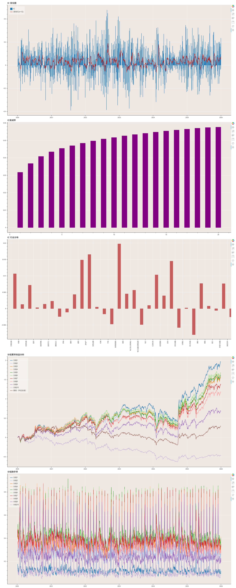

#### 日度 IC、滚动 IC 与累计 Rank IC

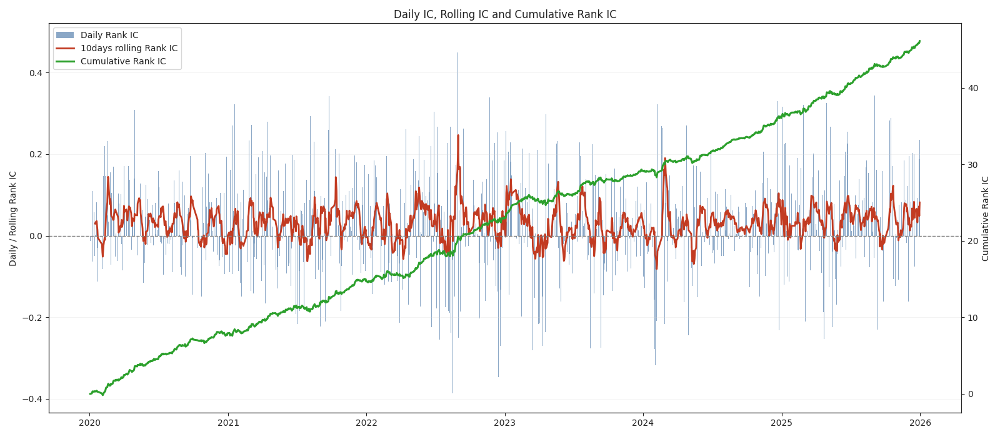

### 因子回测总结

#### IC 统计（中心与显著性）

| 指标          | Result    |
| ----------- | --------- |
| 样本天数        | 1,454     |
| 平均 Rank IC  | 0.032     |
| Rank IC 标准差 | 0.124     |
| ICIR        | 0.255     |
| 年化 ICIR     | 4.054     |
| IC t 值      | 9.737     |
| IC p 值      | 9.498e-22 |

#### IC 统计（分布与持久性）

| 指标         | Result |
| ---------- | ------ |
| 正 IC 占比    | 0.605  |
| 负 IC 占比    | 0.395  |
| IC 偏度      | 0.015  |
| IC 峰度      | 0.422  |
| IC 一阶自相关   | -0.007 |
| 累计 Rank IC | 46.127 |

- 本次绩效计算使用的基准区间： 2020-01-06 至 2025-12-31
- 策略与基准共同样本天数： 1453

#### 分组绝对收益与风险

| 分组               | 累计收益率  | 年化收益率  | 年化波动率 | 夏普比率   | Sortino 比率 | 最大回撤   | Calmar 比率                         |
| ---------------- | ------ | ------ | ----- | ------ | ---------- | ------ | --------------------------------- |
| q0               | 1.959  | 0.207  | 0.262 | 0.850  | 1.191      | -0.381 | 0.543                             |
| q1               | 1.641  | 0.183  | 0.249 | 0.803  | 1.109      | -0.373 | 0.492                             |
| q2               | 1.570  | 0.178  | 0.243 | 0.796  | 1.096      | -0.359 | 0.495                             |
| q3               | 1.678  | 0.186  | 0.238 | 0.839  | 1.160      | -0.336 | 0.554                             |
| q4               | 1.611  | 0.181  | 0.237 | 0.823  | 1.138      | -0.340 | 0.533                             |
| q5               | 1.678  | 0.186  | 0.235 | 0.846  | 1.167      | -0.306 | 0.609                             |
| q6               | 1.381  | 0.162  | 0.235 | 0.758  | 1.043      | -0.297 | 0.547                             |
| q7               | 1.178  | 0.145  | 0.239 | 0.684  | 0.936      | -0.297 | 0.486                             |
| q8               | 0.689  | 0.095  | 0.246 | 0.493  | 0.668      | -0.308 | 0.309                             |
| q9               | -0.465 | -0.103 | 0.272 | -0.262 | -0.350     | -0.657 | -0.156                            |
| total（十组等权）      | 1.132  | 0.140  | 0.239 | 0.669  | 0.917      | -0.331 | 0.424                             |
| long_short_q0_q9 | 3.996  | 0.322  | 0.173 | 1.703  | 2.688      | -0.136 | 2.358 |

#### 分组日收益分布

| 分组               | 日胜率   | 平均日收益  | 日收益偏度  | 日收益峰度 |
| ---------------- | ----- | ------ | ------ | ----- |
| q0               | 0.545 | 0.001  | -0.532 | 9.135 |
| q1               | 0.552 | 0.001  | -0.689 | 9.887 |
| q2               | 0.551 | 0.001  | -0.721 | 9.991 |
| q3               | 0.555 | 0.001  | -0.646 | 9.365 |
| q4               | 0.550 | 0.001  | -0.603 | 9.326 |
| q5               | 0.553 | 0.001  | -0.636 | 8.964 |
| q6               | 0.544 | 0.001  | -0.624 | 8.148 |
| q7               | 0.543 | 0.001  | -0.672 | 7.533 |
| q8               | 0.544 | 0.000  | -0.685 | 6.367 |
| q9               | 0.521 | -0.000 | -0.418 | 4.442 |
| total（十组等权）      | 0.545 | 0.001  | -0.648 | 8.682 |
| long_short_q0_q9 | 0.540 | 0.001  | 0.180  | 1.411 |

#### 分组相对基准绩效

| 分组               | 基准年化收益率 | 年化超额收益（几何） | 年化收益差（算术） | Alpha（年化） | Beta   | 跟踪误差  | 信息比率   |
| ---------------- | ------- | ---------- | --------- | --------- | ------ | ----- | ------ |
| q0               | 0.046   | 0.154      | 0.161     | 0.151     | 1.103  | 0.142 | 1.112  |
| q1               | 0.046   | 0.132      | 0.138     | 0.130     | 1.079  | 0.124 | 1.089  |
| q2               | 0.046   | 0.126      | 0.132     | 0.124     | 1.076  | 0.113 | 1.138  |
| q3               | 0.046   | 0.135      | 0.141     | 0.130     | 1.063  | 0.106 | 1.270  |
| q4               | 0.046   | 0.130      | 0.135     | 0.125     | 1.069  | 0.101 | 1.284  |
| q5               | 0.046   | 0.135      | 0.141     | 0.130     | 1.066  | 0.098 | 1.362  |
| q6               | 0.046   | 0.112      | 0.117     | 0.109     | 1.063  | 0.101 | 1.129  |
| q7               | 0.046   | 0.095      | 0.099     | 0.094     | 1.072  | 0.107 | 0.929  |
| q8               | 0.046   | 0.047      | 0.050     | 0.051     | 1.081  | 0.118 | 0.480  |
| q9               | 0.046   | -0.142     | -0.148    | -0.143    | 1.107  | 0.158 | -0.859 |
| total（十组等权）      | 0.046   | 0.091      | 0.095     | 0.090     | 1.078  | 0.104 | 0.918  |
| long_short_q0_q9 | 0.046   | 0.264      | 0.276     | 0.294     | -0.005 | 0.265 | 0.864  |

#### 分组换手率

| 分组               | 平均日换手率 | 中位数日换手率 | 年化换手率   | 最大单日换手率 |
| ---------------- | ------ | ------- | ------- | ------- |
| q0               | 0.133  | 0.116   | 33.462  | 0.574   |
| q1               | 0.300  | 0.280   | 75.722  | 0.815   |
| q2               | 0.377  | 0.357   | 94.962  | 0.865   |
| q3               | 0.414  | 0.392   | 104.217 | 0.875   |
| q4               | 0.426  | 0.406   | 107.415 | 0.916   |
| q5               | 0.421  | 0.400   | 106.096 | 0.876   |
| q6               | 0.395  | 0.375   | 99.616  | 0.869   |
| q7               | 0.345  | 0.323   | 86.941  | 0.878   |
| q8               | 0.261  | 0.239   | 65.800  | 0.790   |
| q9               | 0.108  | 0.092   | 27.228  | 0.548   |
| total（十组等权）      | 0.318  | 0.298   | 80.146  | 0.781   |
| long_short_q0_q9 | 0.241  | 0.209   | 60.690  | 1.100   |

## 11. 平均换手率（TURNAVG）

### 因子公式

**行为金融因子 —— 投资者注意力**

$$
\text{TURNAVG} = \frac{1}{m} \sum_{t=1}^{m} \text{TURN}_{i,t}
$$

其中：

- $\text{TURN}_{i,t}$ 为股票 $i$ 在交易日 $t$ 的换手率；
- $m$ 为交易日窗口，一般取为月度（即当月所有交易日）。

### 因子描述

平均换手率（TURNAVG）属于**股票交易活跃度类因子**，通过衡量股票在月度内的平均交易活跃度来反映投资者对该股票的关注程度。股票交易越活跃，说明市场参与者对该股票的买卖意愿越强，投资者对该股票的关注度也就越高。然而，投资者的注意力是有限的，他们更倾向于交易那些引起自己注意的股票。高关注度往往伴随着更多的非理性买入行为，在 A 股市场做多与做空不对称的背景下，这种非理性净买入会推动股价产生短期溢价，进而在未来引发价格反转。

数据：日度换手率

### 因子米筐回测图表

#### 米筐完整回测报告

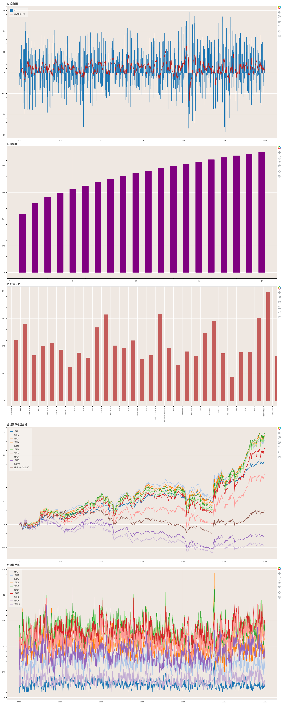

#### 日度 IC、滚动 IC 与累计 Rank IC

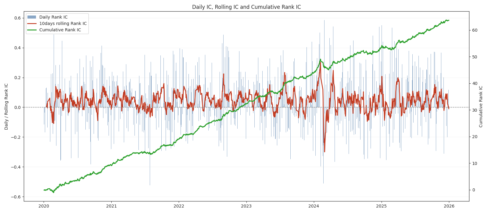

### 因子回测总结

#### IC 统计（中心与显著性）

| 指标          | Result    |
| ----------- | --------- |
| 样本天数        | 1,454     |
| 平均 Rank IC  | 0.044     |
| Rank IC 标准差 | 0.189     |
| ICIR        | 0.232     |
| 年化 ICIR     | 3.684     |
| IC t 值      | 8.848     |
| IC p 值      | 2.525e-18 |

#### IC 统计（分布与持久性）

| 指标         | Result |
| ---------- | ------ |
| 正 IC 占比    | 0.589  |
| 负 IC 占比    | 0.411  |
| IC 偏度      | -0.078 |
| IC 峰度      | -0.197 |
| IC 一阶自相关   | -0.011 |
| 累计 Rank IC | 63.662 |

- 本次绩效计算使用的基准区间： 2020-01-06 至 2025-12-31
- 策略与基准共同样本天数： 1453

#### 分组绝对收益与风险

| 分组               | 累计收益率  | 年化收益率  | 年化波动率 | 夏普比率   | Sortino 比率 | 最大回撤   | Calmar 比率 |
| ---------------- | ------ | ------ | ----- | ------ | ---------- | ------ | --------- |
| q0               | 1.348  | 0.160  | 0.170 | 0.958  | 1.349      | -0.207 | 0.769     |
| q1               | 1.810  | 0.196  | 0.195 | 1.016  | 1.412      | -0.262 | 0.749     |
| q2               | 1.928  | 0.205  | 0.212 | 0.984  | 1.367      | -0.280 | 0.730     |
| q3               | 1.889  | 0.202  | 0.226 | 0.927  | 1.279      | -0.309 | 0.654     |
| q4               | 1.973  | 0.208  | 0.243 | 0.900  | 1.245      | -0.332 | 0.627     |
| q5               | 1.914  | 0.204  | 0.255 | 0.856  | 1.181      | -0.352 | 0.580     |
| q6               | 1.650  | 0.184  | 0.268 | 0.766  | 1.051      | -0.366 | 0.503     |
| q7               | 1.084  | 0.136  | 0.282 | 0.594  | 0.810      | -0.398 | 0.341     |
| q8               | -0.233 | -0.045 | 0.299 | -0.003 | -0.004     | -0.613 | -0.073    |
| q9               | -0.429 | -0.093 | 0.328 | -0.130 | -0.174     | -0.681 | -0.136    |
| total（十组等权）      | 1.062  | 0.134  | 0.240 | 0.643  | 0.879      | -0.328 | 0.407     |
| long_short_q0_q9 | 1.784  | 0.194  | 0.235 | 0.872  | 1.348      | -0.304 | 0.639     |

#### 分组日收益分布

| 分组               | 日胜率   | 平均日收益  | 日收益偏度  | 日收益峰度  |
| ---------------- | ----- | ------ | ------ | ------ |
| q0               | 0.544 | 0.001  | -0.637 | 13.840 |
| q1               | 0.551 | 0.001  | -0.770 | 10.374 |
| q2               | 0.560 | 0.001  | -0.693 | 9.079  |
| q3               | 0.557 | 0.001  | -0.735 | 8.890  |
| q4               | 0.549 | 0.001  | -0.670 | 8.930  |
| q5               | 0.549 | 0.001  | -0.660 | 8.249  |
| q6               | 0.549 | 0.001  | -0.689 | 8.131  |
| q7               | 0.548 | 0.001  | -0.645 | 7.507  |
| q8               | 0.524 | -0.000 | -0.486 | 5.012  |
| q9               | 0.522 | -0.000 | -0.510 | 6.710  |
| total（十组等权）      | 0.544 | 0.001  | -0.672 | 8.562  |
| long_short_q0_q9 | 0.507 | 0.001  | 0.440  | 3.373  |

#### 分组相对基准绩效

| 分组               | 基准年化收益率 | 年化超额收益（几何） | 年化收益差（算术） | Alpha（年化） | Beta   | 跟踪误差  | 信息比率   |
| ---------------- | ------- | ---------- | --------- | --------- | ------ | ----- | ------ |
| q0               | 0.046   | 0.109      | 0.114     | 0.114     | 0.746  | 0.095 | 1.026  |
| q1               | 0.046   | 0.144      | 0.151     | 0.142     | 0.876  | 0.089 | 1.503  |
| q2               | 0.046   | 0.152      | 0.159     | 0.147     | 0.959  | 0.091 | 1.584  |
| q3               | 0.046   | 0.150      | 0.156     | 0.144     | 1.015  | 0.100 | 1.458  |
| q4               | 0.046   | 0.155      | 0.162     | 0.149     | 1.082  | 0.111 | 1.390  |
| q5               | 0.046   | 0.151      | 0.158     | 0.145     | 1.126  | 0.122 | 1.263  |
| q6               | 0.046   | 0.132      | 0.139     | 0.129     | 1.178  | 0.132 | 1.066  |
| q7               | 0.046   | 0.086      | 0.090     | 0.088     | 1.222  | 0.147 | 0.699  |
| q8               | 0.046   | -0.087     | -0.091    | -0.082    | 1.258  | 0.169 | -0.388 |
| q9               | 0.046   | -0.132     | -0.138    | -0.131    | 1.360  | 0.197 | -0.546 |
| total（十组等权）      | 0.046   | 0.084      | 0.088     | 0.085     | 1.082  | 0.105 | 0.855  |
| long_short_q0_q9 | 0.046   | 0.142      | 0.149     | 0.245     | -0.615 | 0.381 | 0.369  |

#### 分组换手率

| 分组               | 平均日换手率 | 中位数日换手率 | 年化换手率  | 最大单日换手率 |
| ---------------- | ------ | ------- | ------ | ------- |
| q0               | 0.026  | 0.025   | 6.546  | 0.071   |
| q1               | 0.069  | 0.068   | 17.407 | 0.168   |
| q2               | 0.099  | 0.098   | 24.941 | 0.219   |
| q3               | 0.119  | 0.117   | 29.878 | 0.243   |
| q4               | 0.129  | 0.129   | 32.625 | 0.213   |
| q5               | 0.133  | 0.133   | 33.542 | 0.216   |
| q6               | 0.129  | 0.128   | 32.388 | 0.206   |
| q7               | 0.114  | 0.113   | 28.720 | 0.194   |
| q8               | 0.085  | 0.084   | 21.514 | 0.180   |
| q9               | 0.036  | 0.034   | 8.988  | 0.104   |
| total（十组等权）      | 0.094  | 0.093   | 23.655 | 0.155   |
| long_short_q0_q9 | 0.062  | 0.061   | 15.533 | 0.126   |

## 12. 基于 PE 的分析师锚定效应偏差（CAF_EP）

### 因子公式

**行为金融因子 —— 分析师预测锚定效应**

$$
\text{CAF\_EP}_{i,t} = \frac{\text{FEP}_{i,t} - \text{IFEP}_t}{\text{IFEP}_t}
$$

其中，$\text{FEP}_{i,t}$ 为分析师在时间 $t$ 对股票 $i$ 的 PE 预测值所对应的盈利预测（即 PE 的倒数）：

$$
\text{FEP}_{i,t} = \frac{1}{\text{FPE}_{i,t}}
$$

各变量定义如下：

- $\text{FPE}_{i,t}$ 为分析师在时间 $t$ 对股票 $i$ 的 PE 指标的预测值；
- $\text{FEP}_{i,t}$ 为股票 $i$ 在时间 $t$ 的预期盈利水平（PE 的倒数），用于衡量估值水平的高低；
- $\text{IFEP}_t$ 为股票 $i$ 所属行业中所有成分股的 $\text{FPE}_{i,t}$ 的中位数（即行业中位数 PE 的倒数）。

### 因子描述

**锚定效应**指人们在做出判断时，会将最初接触到的信息（即“锚点”）作为参考依据，并在其基础上进行调整，但调整往往不充分，从而导致判断偏差。在分析师预测场景中，锚定效应表现为：分析师会以公司所在行业的估值水平（行业中位数 PE）作为定价的“锚点”。当某只股票的估值指标超出行业中位数时（即 $\text{CAF\_EP}_{i,t} > 0$），分析师会倾向于做出**悲观预测**，将预测值向行业中位数靠拢；反之，当估值低于行业中位数时（即 $\text{CAF\_EP}_{i,t} < 0$），分析师会倾向于做出**乐观预测**。财报公布后，实际财务指标将与分析师预测形成反向修正：被悲观预测的公司，其实际财务指标将高于预测值，股价表现更优；被乐观预测的公司，其实际财务指标将低于预测值，股价表现更差。因此，该因子可用于预测未来股价的走势方向。

数据：PE分析师预测值（米筐存在，但需要权限）、行业分类数据、PE

### 因子米筐回测图表

#### 米筐完整回测报告

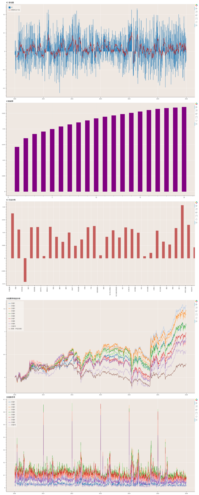

#### 日度 IC、滚动 IC 与累计 Rank IC

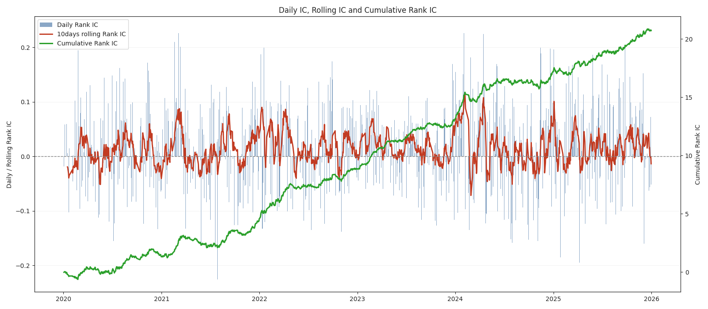

### 因子回测总结

#### IC 统计（中心与显著性）

| 指标          | Result    |
| ----------- | --------- |
| 样本天数        | 1,454     |
| 平均 Rank IC  | 0.014     |
| Rank IC 标准差 | 0.080     |
| ICIR        | 0.177     |
| 年化 ICIR     | 2.814     |
| IC t 值      | 6.760     |
| IC p 值      | 1.989e-11 |

#### IC 统计（分布与持久性）

| 指标         | Result |
| ---------- | ------ |
| 正 IC 占比    | 0.568  |
| 负 IC 占比    | 0.432  |
| IC 偏度      | 0.020  |
| IC 峰度      | -0.507 |
| IC 一阶自相关   | 0.047  |
| 累计 Rank IC | 20.728 |

- 本次绩效计算使用的基准区间： 2020-01-06 至 2025-12-31
- 策略与基准共同样本天数： 1453

#### 分组绝对收益与风险

| 分组               | 累计收益率 | 年化收益率 | 年化波动率 | 夏普比率  | Sortino 比率 | 最大回撤   | Calmar 比率 |
| ---------------- | ----- | ----- | ----- | ----- | ---------- | ------ | --------- |
| q0               | 1.138 | 0.141 | 0.228 | 0.692 | 0.956      | -0.305 | 0.461     |
| q1               | 1.570 | 0.178 | 0.224 | 0.844 | 1.168      | -0.277 | 0.642     |
| q2               | 1.469 | 0.170 | 0.226 | 0.808 | 1.117      | -0.298 | 0.570     |
| q3               | 1.378 | 0.162 | 0.230 | 0.769 | 1.065      | -0.301 | 0.539     |
| q4               | 1.166 | 0.143 | 0.234 | 0.692 | 0.950      | -0.314 | 0.457     |
| q5               | 1.148 | 0.142 | 0.237 | 0.678 | 0.934      | -0.340 | 0.417     |
| q6               | 0.975 | 0.125 | 0.245 | 0.605 | 0.831      | -0.395 | 0.317     |
| q7               | 0.793 | 0.107 | 0.254 | 0.527 | 0.722      | -0.430 | 0.248     |
| q8               | 0.866 | 0.114 | 0.261 | 0.545 | 0.748      | -0.439 | 0.260     |
| q9               | 0.582 | 0.083 | 0.266 | 0.433 | 0.594      | -0.435 | 0.190     |
| total（十组等权）      | 1.097 | 0.137 | 0.237 | 0.661 | 0.908      | -0.335 | 0.410     |
| long_short_q0_q9 | 0.247 | 0.039 | 0.096 | 0.445 | 0.664      | -0.190 | 0.205     |

#### 分组日收益分布

| 分组               | 日胜率   | 平均日收益 | 日收益偏度  | 日收益峰度 |
| ---------------- | ----- | ----- | ------ | ----- |
| q0               | 0.550 | 0.001 | -0.606 | 8.836 |
| q1               | 0.551 | 0.001 | -0.634 | 8.579 |
| q2               | 0.555 | 0.001 | -0.625 | 8.733 |
| q3               | 0.544 | 0.001 | -0.591 | 8.584 |
| q4               | 0.546 | 0.001 | -0.617 | 8.309 |
| q5               | 0.551 | 0.001 | -0.599 | 8.446 |
| q6               | 0.540 | 0.001 | -0.614 | 8.172 |
| q7               | 0.535 | 0.001 | -0.595 | 8.118 |
| q8               | 0.546 | 0.001 | -0.564 | 8.077 |
| q9               | 0.540 | 0.000 | -0.509 | 7.796 |
| total（十组等权）      | 0.542 | 0.001 | -0.611 | 8.650 |
| long_short_q0_q9 | 0.496 | 0.000 | 0.239  | 1.347 |

#### 分组相对基准绩效

| 分组               | 基准年化收益率 | 年化超额收益（几何） | 年化收益差（算术） | Alpha（年化） | Beta   | 跟踪误差  | 信息比率   |
| ---------------- | ------- | ---------- | --------- | --------- | ------ | ----- | ------ |
| q0               | 0.046   | 0.091      | 0.095     | 0.092     | 1.024  | 0.100 | 0.932  |
| q1               | 0.046   | 0.126      | 0.132     | 0.123     | 1.019  | 0.092 | 1.347  |
| q2               | 0.046   | 0.119      | 0.124     | 0.115     | 1.037  | 0.089 | 1.327  |
| q3               | 0.046   | 0.111      | 0.116     | 0.108     | 1.061  | 0.089 | 1.260  |
| q4               | 0.046   | 0.094      | 0.098     | 0.092     | 1.075  | 0.091 | 1.059  |
| q5               | 0.046   | 0.092      | 0.096     | 0.090     | 1.092  | 0.094 | 1.028  |
| q6               | 0.046   | 0.076      | 0.080     | 0.076     | 1.117  | 0.102 | 0.819  |
| q7               | 0.046   | 0.058      | 0.061     | 0.059     | 1.158  | 0.107 | 0.643  |
| q8               | 0.046   | 0.066      | 0.069     | 0.066     | 1.187  | 0.115 | 0.678  |
| q9               | 0.046   | 0.036      | 0.037     | 0.038     | 1.194  | 0.122 | 0.413  |
| total（十组等权）      | 0.046   | 0.087      | 0.091     | 0.086     | 1.096  | 0.092 | 0.999  |
| long_short_q0_q9 | 0.046   | -0.006     | -0.007    | 0.054     | -0.170 | 0.251 | -0.087 |

#### 分组换手率

| 分组               | 平均日换手率 | 中位数日换手率 | 年化换手率  | 最大单日换手率 |
| ---------------- | ------ | ------- | ------ | ------- |
| q0               | 0.029  | 0.026   | 7.238  | 0.225   |
| q1               | 0.075  | 0.070   | 19.019 | 0.489   |
| q2               | 0.106  | 0.099   | 26.725 | 0.624   |
| q3               | 0.121  | 0.112   | 30.503 | 0.657   |
| q4               | 0.126  | 0.118   | 31.754 | 0.659   |
| q5               | 0.121  | 0.114   | 30.604 | 0.672   |
| q6               | 0.108  | 0.101   | 27.152 | 0.666   |
| q7               | 0.087  | 0.081   | 21.972 | 0.626   |
| q8               | 0.059  | 0.053   | 14.888 | 0.576   |
| q9               | 0.023  | 0.020   | 5.883  | 0.298   |
| total（十组等权）      | 0.086  | 0.079   | 21.574 | 0.544   |
| long_short_q0_q9 | 0.052  | 0.046   | 13.121 | 0.522   |

## 13. 基于异常收益的注意力溢出（SPILL）

### 因子公式

**行为金融因子 —— 投资者注意力溢出效应**

首先，计算每月平均异常日收益率作为个股层面的注意力代理指标：

$$
\text{ATTN}_{i,t} = \frac{1}{m} \sum_{t}^{t-m+1} \left( r_{i,t} - \bar{r}_t \right)^2
$$

其中，$r_{i,t}$ 为股票 $i$ 在交易日 $t$ 的收益率，$\bar{r}_t$ 为交易日 $t$ 的全市场收益率，$m$ 为交易日窗口，一般取为月度。进一步，计算当期相近股票的注意力均值与个股注意力之差，即为注意力溢出程度：

$$
\text{SPILL}_{i,t} = \text{ATTN}_{i,t} - \overline{\text{ATTN}}_{g(i),t}
$$

其中，$\overline{\text{ATTN}}_{g(i),t}$ 为股票 $i$ 所属分组 $g(i)$ 内所有股票在 $t$ 期的注意力均值（不含股票 $i$ 自身）。

#### 分组标准

相近股票的确定标准如下：

1. 先以中信一级行业作为分类标准，将全市场股票划分为不同行业；
2. 在每个行业内，按市值规模从大到小排序，以 **3:4:3** 的比例将股票分为**大市值、中市值、小市值**三组；
3. 同一行业同一市值组内的股票即被定义为“相近股票”。

### 因子描述

投资者注意力存在**溢出效应**：当某只股票受到高度关注时，投资者往往会同时注意到与其特征相似（同行业、同市值规模）的“邻居”股票，从而导致这些相近股票也获得一定的关注度提升，并享有注意力溢价。上述因子以异常收益（收益相对于市场的偏离程度）作为注意力的代理指标，通过计算个股注意力与其相近股票平均注意力之间的差值来衡量溢出程度。$\text{SPILL}_{i,t}$ 越大，表明个股当前受到的关注显著高于其同类股票，未来注意力向相近股票溢出的效应越显著，相近股票预期将取得正向超额收益。

数据：中信一级行业、日度市值、日度收盘价

### 因子米筐回测图表

#### 米筐完整回测报告

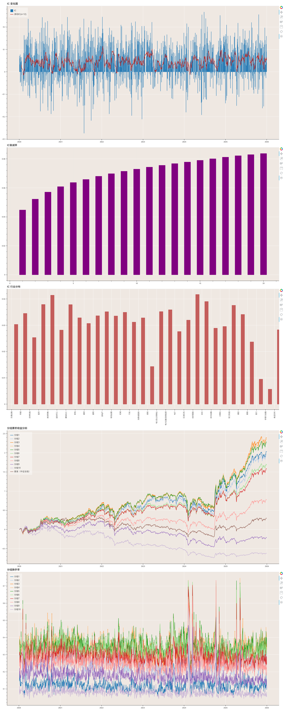

#### 日度 IC、滚动 IC 与累计 Rank IC

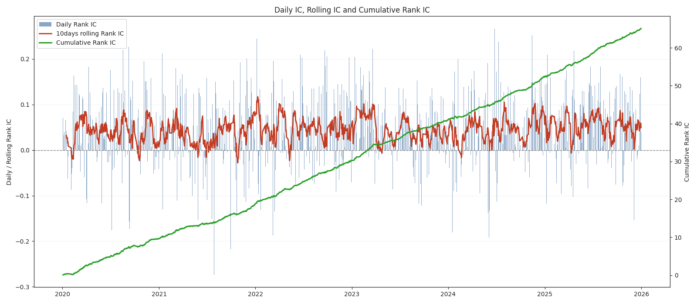

### 因子回测总结

#### IC 统计（中心与显著性）

| 指标          | Result    |
| ----------- | --------- |
| 样本天数        | 1,454     |
| 平均 Rank IC  | 0.045     |
| Rank IC 标准差 | 0.079     |
| ICIR        | 0.566     |
| 年化 ICIR     | 8.992     |
| IC t 值      | 21.599    |
| IC p 值      | 5.920e-90 |

#### IC 统计（分布与持久性）

| 指标         | Result |
| ---------- | ------ |
| 正 IC 占比    | 0.722  |
| 负 IC 占比    | 0.278  |
| IC 偏度      | -0.239 |
| IC 峰度      | 0.180  |
| IC 一阶自相关   | 0.004  |
| 累计 Rank IC | 65.079 |

- 本次绩效计算使用的基准区间： 2020-01-06 至 2025-12-31
- 策略与基准共同样本天数： 1453

#### 分组绝对收益与风险

| 分组               | 累计收益率  | 年化收益率  | 年化波动率 | 夏普比率   | Sortino 比率 | 最大回撤   | Calmar 比率 |
| ---------------- | ------ | ------ | ----- | ------ | ---------- | ------ | --------- |
| q0               | 2.038  | 0.213  | 0.253 | 0.890  | 1.218      | -0.338 | 0.629     |
| q1               | 1.947  | 0.206  | 0.246 | 0.887  | 1.217      | -0.338 | 0.610     |
| q2               | 2.395  | 0.236  | 0.241 | 1.002  | 1.380      | -0.329 | 0.717     |
| q3               | 2.351  | 0.233  | 0.237 | 1.005  | 1.384      | -0.317 | 0.736     |
| q4               | 2.283  | 0.229  | 0.233 | 1.002  | 1.383      | -0.311 | 0.736     |
| q5               | 1.694  | 0.188  | 0.228 | 0.868  | 1.195      | -0.296 | 0.633     |
| q6               | 1.582  | 0.179  | 0.226 | 0.842  | 1.169      | -0.279 | 0.642     |
| q7               | 0.784  | 0.106  | 0.236 | 0.545  | 0.747      | -0.337 | 0.313     |
| q8               | -0.216 | -0.041 | 0.257 | -0.035 | -0.047     | -0.558 | -0.074    |
| q9               | -0.620 | -0.154 | 0.300 | -0.409 | -0.547     | -0.763 | -0.202    |
| total（十组等权）      | 1.056  | 0.133  | 0.240 | 0.641  | 0.876      | -0.329 | 0.405     |
| long_short_q0_q9 | 6.088  | 0.404  | 0.123 | 2.828  | 4.541      | -0.109 | 3.700     |

#### 分组日收益分布

| 分组               | 日胜率   | 平均日收益  | 日收益偏度  | 日收益峰度 |
| ---------------- | ----- | ------ | ------ | ----- |
| q0               | 0.561 | 0.001  | -0.737 | 8.645 |
| q1               | 0.561 | 0.001  | -0.774 | 9.867 |
| q2               | 0.562 | 0.001  | -0.754 | 9.572 |
| q3               | 0.560 | 0.001  | -0.795 | 9.462 |
| q4               | 0.568 | 0.001  | -0.772 | 9.608 |
| q5               | 0.560 | 0.001  | -0.728 | 9.503 |
| q6               | 0.547 | 0.001  | -0.603 | 8.962 |
| q7               | 0.537 | 0.001  | -0.587 | 7.537 |
| q8               | 0.524 | -0.000 | -0.523 | 4.691 |
| q9               | 0.507 | -0.000 | -0.332 | 5.773 |
| total（十组等权）      | 0.545 | 0.001  | -0.673 | 8.572 |
| long_short_q0_q9 | 0.584 | 0.001  | -0.117 | 1.359 |

#### 分组相对基准绩效

| 分组               | 基准年化收益率 | 年化超额收益（几何） | 年化收益差（算术） | Alpha（年化） | Beta   | 跟踪误差  | 信息比率   |
| ---------------- | ------- | ---------- | --------- | --------- | ------ | ----- | ------ |
| q0               | 0.046   | 0.160      | 0.167     | 0.155     | 1.087  | 0.129 | 1.238  |
| q1               | 0.046   | 0.154      | 0.161     | 0.149     | 1.065  | 0.122 | 1.253  |
| q2               | 0.046   | 0.182      | 0.191     | 0.173     | 1.048  | 0.118 | 1.493  |
| q3               | 0.046   | 0.180      | 0.188     | 0.171     | 1.032  | 0.116 | 1.496  |
| q4               | 0.046   | 0.175      | 0.183     | 0.167     | 1.026  | 0.110 | 1.535  |
| q5               | 0.046   | 0.136      | 0.142     | 0.132     | 1.026  | 0.100 | 1.340  |
| q6               | 0.046   | 0.127      | 0.133     | 0.123     | 1.039  | 0.089 | 1.414  |
| q7               | 0.046   | 0.057      | 0.060     | 0.058     | 1.090  | 0.090 | 0.703  |
| q8               | 0.046   | -0.083     | -0.087    | -0.083    | 1.140  | 0.120 | -0.614 |
| q9               | 0.046   | -0.191     | -0.200    | -0.205    | 1.270  | 0.167 | -1.118 |
| total（十组等权）      | 0.046   | 0.084      | 0.088     | 0.084     | 1.082  | 0.105 | 0.851  |
| long_short_q0_q9 | 0.046   | 0.343      | 0.359     | 0.359     | -0.183 | 0.264 | 1.069  |

#### 分组换手率

| 分组               | 平均日换手率 | 中位数日换手率 | 年化换手率  | 最大单日换手率 |
| ---------------- | ------ | ------- | ------ | ------- |
| q0               | 0.119  | 0.116   | 30.054 | 0.354   |
| q1               | 0.269  | 0.263   | 67.666 | 0.629   |
| q2               | 0.333  | 0.328   | 84.035 | 0.690   |
| q3               | 0.358  | 0.353   | 90.302 | 0.747   |
| q4               | 0.355  | 0.349   | 89.347 | 0.732   |
| q5               | 0.331  | 0.324   | 83.415 | 0.733   |
| q6               | 0.294  | 0.288   | 74.189 | 0.706   |
| q7               | 0.250  | 0.243   | 62.952 | 0.734   |
| q8               | 0.178  | 0.172   | 44.731 | 0.518   |
| q9               | 0.080  | 0.078   | 20.174 | 0.212   |
| total（十组等权）      | 0.257  | 0.252   | 64.687 | 0.584   |
| long_short_q0_q9 | 0.199  | 0.195   | 50.228 | 0.553   |

## 14. 前景价值（TK）

### 因子公式

**行为金融因子 —— 投资者前景理论偏好**

① 以个股过去 $N$ 日收益率序列作为未来收益分布的预测。将负收益率从小到大排列为 $r_{-m}, \dots, r_{-1}$，正收益率从小到大排列为 $r_1, \dots, r_n$，加上零收益 $r_0$，每个收益出现的概率均为 $1/N$，其中 $N = m + n + 1$：

$$
\left( r_{-m}, \frac{1}{N}; \dots; r_{-1}, \frac{1}{N}; r_0, \frac{1}{N}; r_1, \frac{1}{N}; \dots; r_n, \frac{1}{N} \right)
$$

② 利用价值函数和概率权重函数计算前景价值 TK：

$$
\text{TK} = \sum_{i=-m}^{-1} v(r_i) \left[ w\left(\frac{-i+m+1}{N}\right) - w\left(\frac{-i+m}{N}\right) \right] + \sum_{i=1}^{n} v(r_i) \left[ w\left(\frac{n-i+1}{N}\right) - w\left(\frac{n-i}{N}\right) \right]
$$

更紧凑地，前景价值可表达为：

$$
\text{TK} = \sum_{i=-m}^{n} v(r_i) \cdot \pi_i
$$

其中 $\pi_i$ 为对应于收益率 $r_i$ 的概率权重。

③ 价值函数 $v(x)$ 和概率权重函数 $w^+(P)$、$w^-(P)$ 如下所示，函数参数取值为 $\alpha = 0.88$，$\lambda = 2.25$，$\gamma = 0.61$，$\delta = 0.69$：

$$
v(x) =
\begin{cases}
x^{\alpha}, & x \geq 0 \\
-\lambda (-x)^{\alpha}, & x < 0
\end{cases}
$$

$$
w^+(P) = \frac{P^{\gamma}}{\left( P^{\gamma} + (1-P)^{\gamma} \right)^{1/\gamma}}
$$

$$
w^-(P) = \frac{P^{\delta}}{\left( P^{\delta} + (1-P)^{\delta} \right)^{1/\delta}}
$$

其中，$w^+(P)$ 用于盈利概率的权重处理，$w^-(P)$ 用于亏损概率的权重处理。

### 因子描述

前景价值（TK）代表了投资者对每只个股的“综合打分”，其理论基础源于行为金融学中的**前景理论**（Prospect Theory）。根据前景理论，投资者在决策时并非基于客观的期望效用，而是基于对收益和损失的主观价值评估，同时对小概率事件存在过度权重、对大概率事件存在权重不足的倾向。TK 因子通过将个股的历史收益率分布代入价值函数和权重函数，量化了投资者对该股票的主观偏好程度。由于价值量 TK 高的股票在投资者眼中更具吸引力，投资者倾向于买入那些 TK 值较高的股票，导致这些股票被过度追捧、价格被高估；而 TK 值较低的股票则因缺乏关注而被低估。因此，股票的未来预期收益率与当前的前景价值 TK 呈**负相关**关系，TK 越高，未来收益越低；TK 越低，未来收益越高。

数据：日度收盘价

### 因子米筐回测图表

#### 米筐完整回测报告

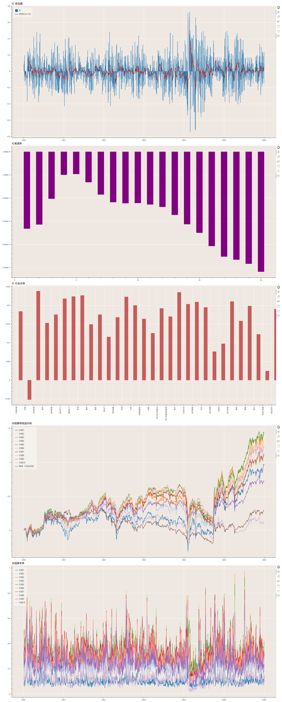

#### 日度 IC、滚动 IC 与累计 Rank IC

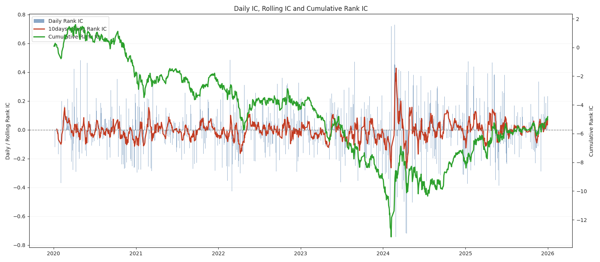

### 因子回测总结

#### IC 统计（中心与显著性）

| 指标          | Result    |
| ----------- | --------- |
| 样本天数        | 1,454     |
| 平均 Rank IC  | -0.003    |
| Rank IC 标准差 | 0.184     |
| ICIR        | -0.018    |
| 年化 ICIR     | -0.287    |
| IC t 值      | -0.689    |
| IC p 值      | 4.907e-01 |

#### IC 统计（分布与持久性）

| 指标         | Result |
| ---------- | ------ |
| 正 IC 占比    | 0.486  |
| 负 IC 占比    | 0.514  |
| IC 偏度      | 0.143  |
| IC 峰度      | 0.964  |
| IC 一阶自相关   | 0.059  |
| 累计 Rank IC | -4.825 |

- 本次绩效计算使用的基准区间： 2020-01-06 至 2025-12-31
- 策略与基准共同样本天数： 1453

#### 分组绝对收益与风险

| 分组               | 累计收益率 | 年化收益率 | 年化波动率 | 夏普比率  | Sortino 比率 | 最大回撤   | Calmar 比率 |
| ---------------- | ----- | ----- | ----- | ----- | ---------- | ------ | --------- |
| q0               | 0.965 | 0.124 | 0.319 | 0.528 | 0.744      | -0.487 | 0.255     |
| q1               | 1.244 | 0.151 | 0.289 | 0.631 | 0.875      | -0.421 | 0.357     |
| q2               | 1.439 | 0.167 | 0.275 | 0.701 | 0.972      | -0.391 | 0.427     |
| q3               | 1.321 | 0.157 | 0.262 | 0.689 | 0.943      | -0.390 | 0.404     |
| q4               | 1.424 | 0.166 | 0.250 | 0.741 | 1.015      | -0.346 | 0.479     |
| q5               | 1.098 | 0.137 | 0.238 | 0.659 | 0.896      | -0.332 | 0.412     |
| q6               | 1.110 | 0.138 | 0.228 | 0.684 | 0.924      | -0.306 | 0.452     |
| q7               | 1.225 | 0.149 | 0.216 | 0.750 | 1.021      | -0.299 | 0.497     |
| q8               | 0.724 | 0.099 | 0.205 | 0.564 | 0.760      | -0.274 | 0.362     |
| q9               | 0.125 | 0.021 | 0.206 | 0.203 | 0.274      | -0.390 | 0.053     |
| total（十组等权）      | 1.056 | 0.133 | 0.240 | 0.641 | 0.876      | -0.329 | 0.405     |
| long_short_q0_q9 | 0.770 | 0.104 | 0.234 | 0.541 | 0.786      | -0.341 | 0.305     |

#### 分组日收益分布

| 分组               | 日胜率   | 平均日收益 | 日收益偏度  | 日收益峰度 |
| ---------------- | ----- | ----- | ------ | ----- |
| q0               | 0.526 | 0.001 | -0.239 | 7.151 |
| q1               | 0.542 | 0.001 | -0.482 | 7.866 |
| q2               | 0.544 | 0.001 | -0.536 | 8.234 |
| q3               | 0.541 | 0.001 | -0.695 | 8.348 |
| q4               | 0.541 | 0.001 | -0.717 | 8.714 |
| q5               | 0.545 | 0.001 | -0.739 | 8.741 |
| q6               | 0.553 | 0.001 | -0.859 | 8.957 |
| q7               | 0.553 | 0.001 | -0.784 | 8.677 |
| q8               | 0.542 | 0.000 | -0.865 | 9.089 |
| q9               | 0.531 | 0.000 | -0.629 | 7.921 |
| total（十组等权）      | 0.544 | 0.001 | -0.671 | 8.574 |
| long_short_q0_q9 | 0.504 | 0.001 | -0.104 | 9.368 |

#### 分组相对基准绩效

| 分组               | 基准年化收益率 | 年化超额收益（几何） | 年化收益差（算术） | Alpha（年化） | Beta  | 跟踪误差  | 信息比率   |
| ---------------- | ------- | ---------- | --------- | --------- | ----- | ----- | ------ |
| q0               | 0.046   | 0.075      | 0.079     | 0.083     | 1.310 | 0.191 | 0.541  |
| q1               | 0.046   | 0.100      | 0.105     | 0.102     | 1.234 | 0.157 | 0.750  |
| q2               | 0.046   | 0.116      | 0.122     | 0.115     | 1.193 | 0.141 | 0.910  |
| q3               | 0.046   | 0.107      | 0.112     | 0.106     | 1.147 | 0.130 | 0.894  |
| q4               | 0.046   | 0.115      | 0.120     | 0.114     | 1.101 | 0.119 | 1.012  |
| q5               | 0.046   | 0.088      | 0.092     | 0.089     | 1.056 | 0.110 | 0.838  |
| q6               | 0.046   | 0.089      | 0.093     | 0.090     | 1.018 | 0.102 | 0.896  |
| q7               | 0.046   | 0.099      | 0.103     | 0.099     | 0.973 | 0.094 | 1.038  |
| q8               | 0.046   | 0.051      | 0.053     | 0.056     | 0.919 | 0.091 | 0.558  |
| q9               | 0.046   | -0.024     | -0.025    | -0.015    | 0.875 | 0.111 | -0.208 |
| total（十组等权）      | 0.046   | 0.084      | 0.088     | 0.084     | 1.083 | 0.105 | 0.851  |
| long_short_q0_q9 | 0.046   | 0.056      | 0.058     | 0.098     | 0.435 | 0.245 | 0.252  |

#### 分组换手率

| 分组               | 平均日换手率 | 中位数日换手率 | 年化换手率  | 最大单日换手率 |
| ---------------- | ------ | ------- | ------ | ------- |
| q0               | 0.102  | 0.094   | 25.734 | 0.733   |
| q1               | 0.240  | 0.223   | 60.361 | 0.969   |
| q2               | 0.306  | 0.289   | 77.030 | 0.973   |
| q3               | 0.342  | 0.324   | 86.282 | 0.963   |
| q4               | 0.359  | 0.344   | 90.522 | 0.932   |
| q5               | 0.361  | 0.346   | 91.007 | 0.853   |
| q6               | 0.347  | 0.332   | 87.410 | 0.832   |
| q7               | 0.314  | 0.298   | 79.015 | 0.787   |
| q8               | 0.251  | 0.238   | 63.160 | 0.746   |
| q9               | 0.114  | 0.108   | 28.825 | 0.586   |
| total（十组等权）      | 0.274  | 0.260   | 68.935 | 0.831   |
| long_short_q0_q9 | 0.217  | 0.203   | 54.560 | 1.319   |

## 15. CSAD 模型（基于时序回归变形）

### 因子公式

**用于构建羊群效应因子的行为金融模型**

- 每个月末，提取当前可交易股票过去 120 个交易日的涨跌幅数据，计算目标股票 $S_*$ 与其他股票（不活跃交易日不超过 20 天）之间的日涨跌幅相关系数；

- 选取与 $S_*$ 相关系数最大的 9 只股票，连同 $S_*$ 一起构成一个包含 10 只股票的"小型"板块：

$$
S_i, \quad i = 1, 2, \dots, 10
$$

- 以 $S_*$ 为中心股票，计算该板块过去 120 个交易日的横截面绝对偏差（CSAD）：

$$
\text{CSAD}_t = \frac{1}{10} \sum_{i=1}^{10} \left| r_{i,t} - r_{*,t} \right|
$$

其中，$r_{i,t}$ 为板块内第 $i$ 只股票在交易日 $t$ 的收益率，$r_{*,t}$ 为中心股票 $S_*$ 在交易日 $t$ 的收益率。

- 以 CSAD 波动率相对于个股波动率的比值变化作为羊群效应因子，分别计算短期比值和长期比值：

$$
\text{ratio}[t_1, t_2] = \frac{\sigma[t_1, t_2](\text{CSAD})}{\sigma[t_1, t_2](r_*)}
$$

其中，$\sigma[t_1, t_2](\text{CSAD})$ 为 CSAD 在时间段 $[t_1, t_2]$ 内的波动率（标准差），$\sigma[t_1, t_2](r_*)$ 为中心股票收益率在同一时间段内的波动率。

最终的羊群效应因子定义为近期比值与长期比值的比率：

$$
f_{jt} = \frac{\text{ratio}[t - 19, t]}{\text{ratio}[t - 119, t]}
$$

其中，分子 $\text{ratio}[t - 19, t]$ 为过去 20 个交易日的短期 CSAD 相对波动率比值，分母 $\text{ratio}[t - 119, t]$ 为过去 120 个交易日的长期 CSAD 相对波动率比值。

### 因子描述

标准的 CSAD 时序回归模型通过回归系数 $\beta_2$ 的显著性来检验羊群效应（$\beta_2$ 显著为负表明羊群效应存在），核心逻辑是：当羊群效应存在时，股票收益率的分散度（CSAD）随市场极端行情而减小的幅度，大于市场收益水平本身的变化幅度。

考虑到时序长度不足和滞后误差等因素的影响，本模型对标准时序回归方法进行了变形处理。通过比较 CSAD 波动率与中心股票波动率的比值在短期和长期的变化情况，避免了直接进行时序回归可能带来的估计偏差。当 $f_{jt} < 1$ 时，表明近期 CSAD 的相对波动率较长期水平有所下降，即板块内个股收益趋于一致，羊群效应增强，该板块受关注程度提升；反之，当 $f_{jt} > 1$ 时，表明羊群效应减弱。

### 因子米筐回测图表

#### 米筐完整回测报告

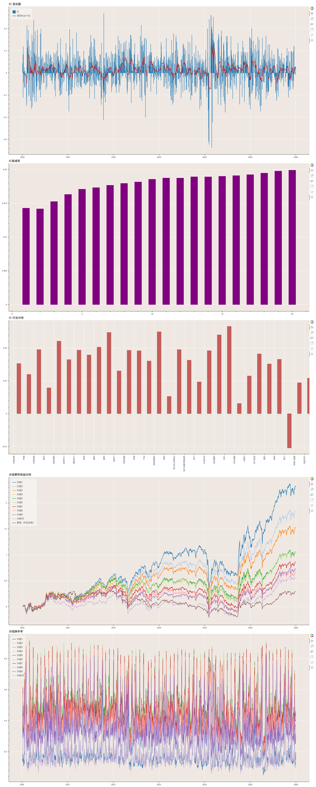

#### 日度 IC、滚动 IC 与累计 Rank IC

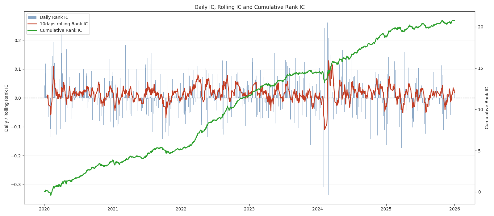

### 因子回测总结

#### IC 统计（中心与显著性）

| 指标          | Result    |
| ----------- | --------- |
| 样本天数        | 1,454     |
| 平均 Rank IC  | 0.014     |
| Rank IC 标准差 | 0.072     |
| ICIR        | 0.198     |
| 年化 ICIR     | 3.136     |
| IC t 值      | 7.534     |
| IC p 值      | 8.612e-14 |

#### IC 统计（分布与持久性）

| 指标         | Result |
| ---------- | ------ |
| 正 IC 占比    | 0.591  |
| 负 IC 占比    | 0.409  |
| IC 偏度      | -0.064 |
| IC 峰度      | 1.261  |
| IC 一阶自相关   | 0.066  |
| 累计 Rank IC | 20.762 |

- 本次绩效计算使用的基准区间： 2020-01-06 至 2025-12-31
- 策略与基准共同样本天数： 1453

#### 分组绝对收益与风险

| 分组               | 累计收益率 | 年化收益率 | 年化波动率 | 夏普比率  | Sortino 比率 | 最大回撤   | Calmar 比率 |
| ---------------- | ----- | ----- | ----- | ----- | ---------- | ------ | --------- |
| q0               | 2.317 | 0.231 | 0.262 | 0.925 | 1.278      | -0.390 | 0.593     |
| q1               | 1.843 | 0.199 | 0.254 | 0.841 | 1.157      | -0.356 | 0.559     |
| q2               | 1.514 | 0.173 | 0.250 | 0.766 | 1.047      | -0.336 | 0.516     |
| q3               | 1.053 | 0.133 | 0.247 | 0.629 | 0.862      | -0.353 | 0.376     |
| q4               | 1.051 | 0.133 | 0.244 | 0.633 | 0.867      | -0.324 | 0.410     |
| q5               | 1.059 | 0.133 | 0.240 | 0.643 | 0.883      | -0.362 | 0.369     |
| q6               | 0.865 | 0.114 | 0.238 | 0.574 | 0.787      | -0.336 | 0.340     |
| q7               | 0.660 | 0.092 | 0.235 | 0.492 | 0.673      | -0.377 | 0.244     |
| q8               | 0.725 | 0.099 | 0.231 | 0.525 | 0.720      | -0.372 | 0.267     |
| q9               | 0.562 | 0.080 | 0.222 | 0.460 | 0.625      | -0.386 | 0.208     |
| total（十组等权）      | 1.114 | 0.139 | 0.240 | 0.662 | 0.906      | -0.329 | 0.421     |
| long_short_q0_q9 | 1.188 | 0.145 | 0.097 | 1.443 | 2.034      | -0.216 | 0.675     |

#### 分组日收益分布

| 分组               | 日胜率   | 平均日收益 | 日收益偏度  | 日收益峰度  |
| ---------------- | ----- | ----- | ------ | ------ |
| q0               | 0.547 | 0.001 | -0.692 | 8.598  |
| q1               | 0.555 | 0.001 | -0.694 | 8.464  |
| q2               | 0.554 | 0.001 | -0.732 | 8.189  |
| q3               | 0.544 | 0.001 | -0.681 | 8.374  |
| q4               | 0.545 | 0.001 | -0.648 | 8.284  |
| q5               | 0.545 | 0.001 | -0.605 | 7.617  |
| q6               | 0.542 | 0.001 | -0.599 | 8.697  |
| q7               | 0.539 | 0.000 | -0.566 | 8.879  |
| q8               | 0.542 | 0.000 | -0.541 | 8.980  |
| q9               | 0.541 | 0.000 | -0.725 | 9.698  |
| total（十组等权）      | 0.542 | 0.001 | -0.659 | 8.673  |
| long_short_q0_q9 | 0.544 | 0.001 | -1.519 | 19.856 |

#### 分组相对基准绩效

| 分组               | 基准年化收益率 | 年化超额收益（几何） | 年化收益差（算术） | Alpha（年化） | Beta  | 跟踪误差  | 信息比率  |
| ---------------- | ------- | ---------- | --------- | --------- | ----- | ----- | ----- |
| q0               | 0.046   | 0.177      | 0.186     | 0.170     | 1.124 | 0.137 | 1.300 |
| q1               | 0.046   | 0.146      | 0.153     | 0.141     | 1.125 | 0.121 | 1.236 |
| q2               | 0.046   | 0.122      | 0.128     | 0.119     | 1.116 | 0.114 | 1.115 |
| q3               | 0.046   | 0.083      | 0.087     | 0.084     | 1.112 | 0.109 | 0.830 |
| q4               | 0.046   | 0.083      | 0.087     | 0.083     | 1.102 | 0.107 | 0.843 |
| q5               | 0.046   | 0.084      | 0.088     | 0.084     | 1.081 | 0.104 | 0.863 |
| q6               | 0.046   | 0.066      | 0.069     | 0.067     | 1.075 | 0.103 | 0.701 |
| q7               | 0.046   | 0.044      | 0.046     | 0.047     | 1.062 | 0.101 | 0.503 |
| q8               | 0.046   | 0.051      | 0.054     | 0.054     | 1.038 | 0.102 | 0.559 |
| q9               | 0.046   | 0.033      | 0.035     | 0.039     | 0.981 | 0.103 | 0.363 |
| total（十组等权）      | 0.046   | 0.089      | 0.093     | 0.089     | 1.082 | 0.104 | 0.902 |
| long_short_q0_q9 | 0.046   | 0.095      | 0.100     | 0.131     | 0.143 | 0.195 | 0.389 |

#### 分组换手率

| 分组               | 平均日换手率 | 中位数日换手率 | 年化换手率   | 最大单日换手率 |
| ---------------- | ------ | ------- | ------- | ------- |
| q0               | 0.178  | 0.156   | 44.868  | 0.646   |
| q1               | 0.352  | 0.324   | 88.735  | 0.854   |
| q2               | 0.427  | 0.401   | 107.491 | 0.878   |
| q3               | 0.466  | 0.442   | 117.314 | 0.895   |
| q4               | 0.482  | 0.461   | 121.544 | 0.901   |
| q5               | 0.482  | 0.459   | 121.492 | 0.915   |
| q6               | 0.464  | 0.437   | 116.916 | 0.915   |
| q7               | 0.424  | 0.396   | 106.806 | 0.885   |
| q8               | 0.349  | 0.319   | 87.825  | 0.863   |
| q9               | 0.176  | 0.151   | 44.414  | 0.725   |
| total（十组等权）      | 0.380  | 0.354   | 95.740  | 0.831   |
| long_short_q0_q9 | 0.354  | 0.309   | 89.281  | 1.314   |

## 16. 基于涨跌停的注意力捕捉

### 因子公式

**行为金融因子 —— 投资者注意力**

首先，将每日涨跌停股票数量除以当日交易的股票总数，得到每日全市场涨跌停比率，作为市场关注程度的代理指标：

$$
\text{LIMIT\_PROP}_d = \frac{n_{\text{upper},d} + n_{\text{lower},d}}{N_d}
$$

其中：

- $n_{\text{upper},d}$ 为交易日 $d$ 的涨停股票数量；
- $n_{\text{lower},d}$ 为交易日 $d$ 的跌停股票数量；
- $N_d$ 为交易日 $d$ 的交易股票总数。

进一步，将上述市场关注代理指标与个股日收益进行月度时序回归，回归方程如下：

$$
r_{i,d} = \mu_{i,t} + \beta_{i,t} \cdot \text{LIMIT\_PROP}_d + \rho_{1,i,t} \text{Mkt}_d + \rho_{2,i,t} \text{SMB}_d + \rho_{3,i,t} \text{HML}_d + \rho_{4,i,t} \text{UMD}_d + \varepsilon_{i,t}
$$

其中，系数 $\beta_{i,t}$ 的绝对值 $|\beta_{i,t}|$ 即为股票 $i$ 对市场关注程度的敏感度，用于衡量该股票受涨跌停关注事件影响的大小。

各变量定义如下：

- $r_{i,d}$ 为股票 $i$ 在交易日 $d$ 的收益率；
- $\text{Mkt}_d$、$\text{SMB}_d$、$\text{HML}_d$ 分别为经典的 Fama‑French 三因子在 $d$ 日的收益；
- $\text{UMD}_d$ 为动量因子收益，即全市场过去 11 个月累积收益率排名前 30% 与后 30% 的股票组合在 $d$ 日的收益差；
- $\mu_{i,t}$ 为截距项，$\varepsilon_{i,t}$ 为残差项。

### 因子描述

不同股票对同一市场关注度事件的反映程度往往不同，可通过个股收益对市场关注度事件的敏感程度（即 $|\beta_{i,t}|$）来衡量股票对该事件的注意力捕捉效应。捕捉能力越强（敏感程度越高），表明该股票更能吸引市场注意，从而引发更多的买盘压力，导致股价被高估。

上述因子以涨跌停比率作为市场关注度事件，其原因在于：涨跌停是市场上最引人注目的事件之一，涨跌停股票通常能够迅速吸引大量投资者的关注。该比率越高，说明市场上发生极端价格变动的股票越多，整体市场关注度也就越高。

数据：日度涨跌停数据（日度收盘价、日度开盘价）、日度可交易股票数量

### 因子米筐回测图表

#### 米筐完整回测报告

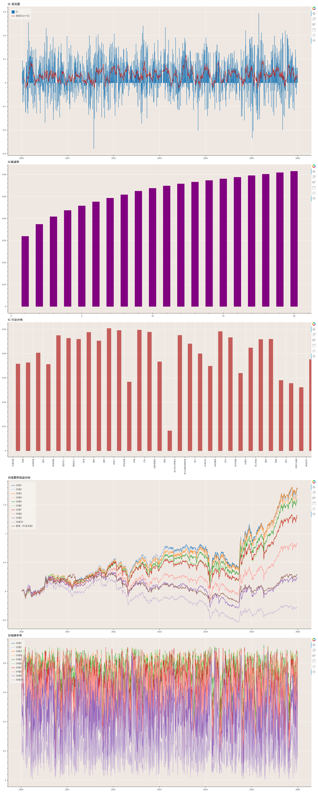

#### 日度 IC、滚动 IC 与累计 Rank IC

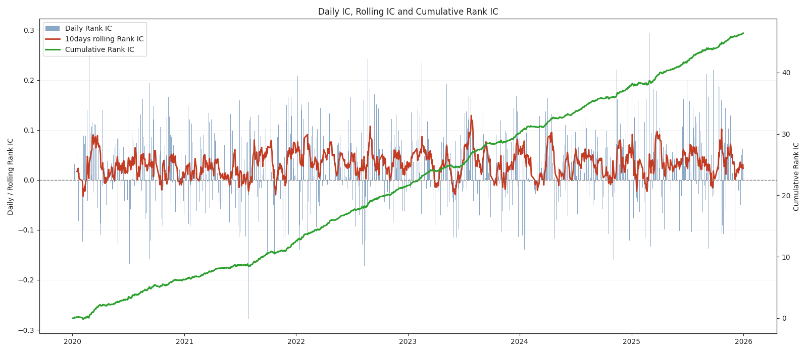

### 因子回测总结

#### IC 统计（中心与显著性）

| 指标          | Result    |
| ----------- | --------- |
| 样本天数        | 1,454     |
| 平均 Rank IC  | 0.032     |
| Rank IC 标准差 | 0.077     |
| ICIR        | 0.415     |
| 年化 ICIR     | 6.588     |
| IC t 值      | 15.825    |
| IC p 值      | 3.670e-52 |

#### IC 统计（分布与持久性）

| 指标         | Result |
| ---------- | ------ |
| 正 IC 占比    | 0.664  |
| 负 IC 占比    | 0.336  |
| IC 偏度      | -0.146 |
| IC 峰度      | 0.036  |
| IC 一阶自相关   | -0.016 |
| 累计 Rank IC | 46.423 |

- 本次绩效计算使用的基准区间： 2020-01-06 至 2025-12-31
- 策略与基准共同样本天数： 1453

#### 分组绝对收益与风险

| 分组               | 累计收益率  | 年化收益率  | 年化波动率 | 夏普比率   | Sortino 比率 | 最大回撤   | Calmar 比率 |
| ---------------- | ------ | ------ | ----- | ------ | ---------- | ------ | --------- |
| q0               | 1.777  | 0.194  | 0.230 | 0.886  | 1.216      | -0.310 | 0.626     |
| q1               | 1.716  | 0.189  | 0.231 | 0.868  | 1.194      | -0.316 | 0.599     |
| q2               | 1.783  | 0.194  | 0.232 | 0.883  | 1.214      | -0.309 | 0.628     |
| q3               | 1.672  | 0.186  | 0.233 | 0.848  | 1.164      | -0.312 | 0.596     |
| q4               | 1.596  | 0.180  | 0.237 | 0.818  | 1.122      | -0.311 | 0.580     |
| q5               | 1.318  | 0.157  | 0.239 | 0.731  | 1.002      | -0.322 | 0.488     |
| q6               | 1.304  | 0.156  | 0.243 | 0.718  | 0.987      | -0.329 | 0.474     |
| q7               | 0.839  | 0.111  | 0.249 | 0.550  | 0.750      | -0.394 | 0.283     |
| q8               | 0.233  | 0.037  | 0.255 | 0.271  | 0.366      | -0.473 | 0.078     |
| q9               | -0.268 | -0.053 | 0.282 | -0.050 | -0.068     | -0.624 | -0.085    |
| total（十组等权）      | 1.056  | 0.133  | 0.240 | 0.641  | 0.876      | -0.329 | 0.405     |
| long_short_q0_q9 | 2.383  | 0.235  | 0.114 | 1.911  | 2.968      | -0.143 | 1.651     |

#### 分组日收益分布

| 分组               | 日胜率   | 平均日收益  | 日收益偏度  | 日收益峰度 |
| ---------------- | ----- | ------ | ------ | ----- |
| q0               | 0.560 | 0.001  | -0.773 | 9.849 |
| q1               | 0.552 | 0.001  | -0.709 | 9.543 |
| q2               | 0.549 | 0.001  | -0.750 | 9.176 |
| q3               | 0.557 | 0.001  | -0.738 | 9.488 |
| q4               | 0.554 | 0.001  | -0.725 | 9.435 |
| q5               | 0.551 | 0.001  | -0.686 | 8.615 |
| q6               | 0.541 | 0.001  | -0.622 | 8.011 |
| q7               | 0.537 | 0.001  | -0.639 | 7.669 |
| q8               | 0.537 | 0.000  | -0.597 | 6.370 |
| q9               | 0.521 | -0.000 | -0.427 | 6.239 |
| total（十组等权）      | 0.545 | 0.001  | -0.673 | 8.572 |
| long_short_q0_q9 | 0.547 | 0.001  | -0.034 | 1.177 |

#### 分组相对基准绩效

| 分组               | 基准年化收益率 | 年化超额收益（几何） | 年化收益差（算术） | Alpha（年化） | Beta   | 跟踪误差  | 信息比率   |
| ---------------- | ------- | ---------- | --------- | --------- | ------ | ----- | ------ |
| q0               | 0.046   | 0.142      | 0.148     | 0.138     | 1.020  | 0.106 | 1.315  |
| q1               | 0.046   | 0.137      | 0.144     | 0.134     | 1.023  | 0.106 | 1.275  |
| q2               | 0.046   | 0.142      | 0.149     | 0.138     | 1.031  | 0.105 | 1.328  |
| q3               | 0.046   | 0.134      | 0.140     | 0.131     | 1.040  | 0.105 | 1.265  |
| q4               | 0.046   | 0.128      | 0.134     | 0.125     | 1.059  | 0.106 | 1.218  |
| q5               | 0.046   | 0.106      | 0.111     | 0.105     | 1.073  | 0.105 | 1.042  |
| q6               | 0.046   | 0.105      | 0.110     | 0.104     | 1.095  | 0.107 | 1.031  |
| q7               | 0.046   | 0.063      | 0.066     | 0.064     | 1.122  | 0.110 | 0.656  |
| q8               | 0.046   | -0.008     | -0.009    | -0.005    | 1.137  | 0.118 | 0.036  |
| q9               | 0.046   | -0.094     | -0.098    | -0.093    | 1.225  | 0.146 | -0.539 |
| total（十组等权）      | 0.046   | 0.084      | 0.088     | 0.084     | 1.082  | 0.105 | 0.851  |
| long_short_q0_q9 | 0.046   | 0.181      | 0.190     | 0.231     | -0.205 | 0.264 | 0.581  |

#### 分组换手率

| 分组               | 平均日换手率 | 中位数日换手率 | 年化换手率   | 最大单日换手率 |
| ---------------- | ------ | ------- | ------- | ------- |
| q0               | 0.592  | 0.624   | 149.161 | 0.901   |
| q1               | 0.696  | 0.730   | 175.395 | 0.902   |
| q2               | 0.717  | 0.762   | 180.770 | 0.904   |
| q3               | 0.716  | 0.763   | 180.492 | 0.926   |
| q4               | 0.703  | 0.749   | 177.098 | 0.925   |
| q5               | 0.679  | 0.725   | 171.191 | 0.921   |
| q6               | 0.642  | 0.683   | 161.742 | 0.911   |
| q7               | 0.579  | 0.612   | 145.926 | 0.909   |
| q8               | 0.441  | 0.447   | 111.017 | 0.897   |
| q9               | 0.235  | 0.210   | 59.179  | 0.756   |
| total（十组等权）      | 0.600  | 0.632   | 151.197 | 0.880   |
| long_short_q0_q9 | 0.827  | 0.836   | 208.340 | 1.648   |

## 17. LSV 模型

### 因子公式

**用于捕捉基金“抱团”羊群效应的行为金融模型**

LSV 模型的核心指标计算如下：

$$
\text{LSV}_{i,t} = \left| p_{i,t} - p_t \right| - \mathbb{E}\left| p_{i,t} - p_t \right|
$$

其中，第二项为在无羊群效应假设下的期望绝对偏差，其计算公式为：

$$
\mathbb{E}\left| p_{i,t} - p_t \right| = \text{AF}(i,t) = \sum_{k=1}^{N_{i,t}} \binom{N_{i,t}}{k} p_t^k (1 - p_t)^{N_{i,t}-k} \left| \frac{k}{N_{i,t}} - p_t \right|
$$

各基础变量定义如下：

$$
p_{i,t} = \frac{B(i,t)}{B(i,t) + S(i,t)}
$$

$$
p_t = \frac{\sum_{i=1}^{N} p_{i,t}}{N}
$$

$$
N_{i,t} = B(i,t) + S(i,t)
$$

其中：

- $B(i,t)$ 为在区间 $t$ 内买入股票 $i$ 的基金数量（即报告期持仓相较上期增加的基金数）；
- $S(i,t)$ 为在区间 $t$ 内卖出股票 $i$ 的基金数量（即报告期持仓相较上期减少的基金数）；
- $N_{i,t}$ 为持仓发生变动的基金总数（买入基金与卖出基金之和）；
- $p_{i,t}$ 为股票 $i$ 在区间 $t$ 内买入基金的占比；
- $p_t$ 为全市场所有股票在区间 $t$ 内买入基金占比的均值（跨股票平均值）；
- $N$ 为全市场股票总数。

### 因子描述

LSV 模型从基金持股变动数据出发，通过比较某只股票实际被买入的比例与全市场平均买入比例的偏差程度，来判断该股票是否被基金集中买入或集中卖出，从而有效捕捉基金“抱团”现象。

当 $\text{LSV}_{i,t} > 0$ 且数值较大时，表明股票 $i$ 在当期存在显著的基金集体买入或集体卖出行为，即基金“抱团”现象明显。基金抱团是股票出现羊群效应的潜在驱动因子之一，抱团行为可能导致股价偏离基本面价值，并在未来出现价格反转。

数据：基金持仓数据

### 因子米筐回测图表

#### 米筐完整回测报告

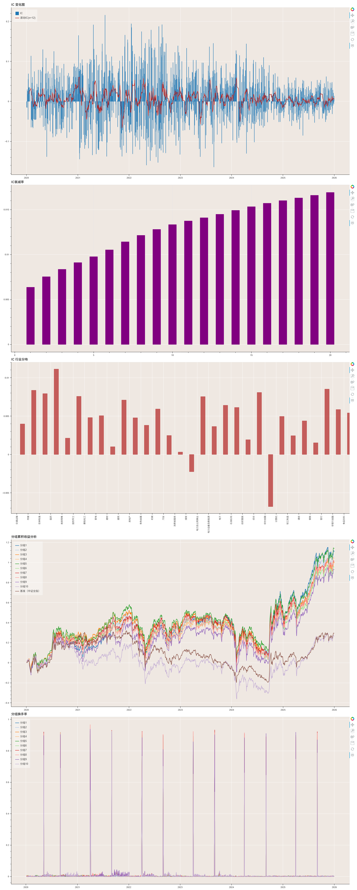

#### 日度 IC、滚动 IC 与累计 Rank IC

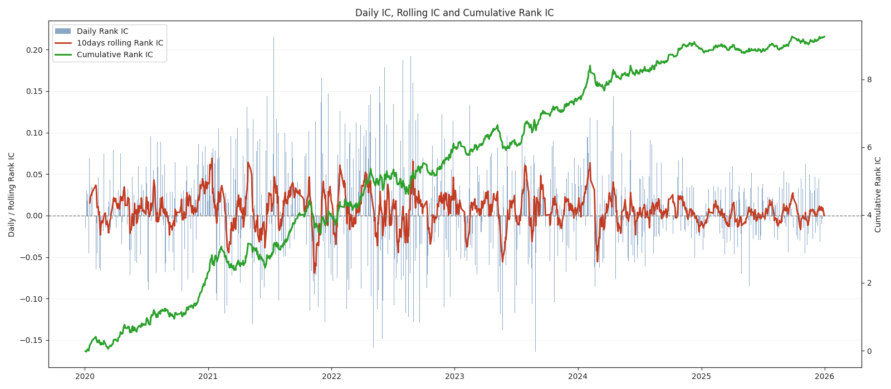

### 因子回测总结

#### IC 统计（中心与显著性）

| 指标          | Result    |
| ----------- | --------- |
| 样本天数        | 1,454     |
| 平均 Rank IC  | 0.006     |
| Rank IC 标准差 | 0.057     |
| ICIR        | 0.112     |
| 年化 ICIR     | 1.772     |
| IC t 值      | 4.256     |
| IC p 值      | 2.217e-05 |

#### IC 统计（分布与持久性）

| 指标         | Result |
| ---------- | ------ |
| 正 IC 占比    | 0.550  |
| 负 IC 占比    | 0.450  |
| IC 偏度      | 0.110  |
| IC 峰度      | 0.411  |
| IC 一阶自相关   | 0.032  |
| 累计 Rank IC | 9.258  |

- 本次绩效计算使用的基准区间： 2020-01-06 至 2025-12-31
- 策略与基准共同样本天数： 1453

#### 分组绝对收益与风险

| 分组               | 累计收益率 | 年化收益率 | 年化波动率 | 夏普比率  | Sortino 比率 | 最大回撤   | Calmar 比率 |
| ---------------- | ----- | ----- | ----- | ----- | ---------- | ------ | --------- |
| q0               | 1.109 | 0.138 | 0.244 | 0.654 | 0.894      | -0.327 | 0.422     |
| q1               | 1.059 | 0.133 | 0.234 | 0.653 | 0.902      | -0.361 | 0.370     |
| q2               | 1.003 | 0.128 | 0.229 | 0.641 | 0.888      | -0.337 | 0.380     |
| q3               | 1.044 | 0.132 | 0.232 | 0.652 | 0.899      | -0.329 | 0.401     |
| q4               | 1.143 | 0.141 | 0.230 | 0.690 | 0.957      | -0.338 | 0.418     |
| q5               | 0.956 | 0.123 | 0.234 | 0.615 | 0.849      | -0.337 | 0.366     |
| q6               | 1.010 | 0.129 | 0.236 | 0.632 | 0.868      | -0.327 | 0.394     |
| q7               | 1.020 | 0.130 | 0.245 | 0.621 | 0.851      | -0.351 | 0.369     |
| q8               | 0.930 | 0.121 | 0.254 | 0.577 | 0.784      | -0.361 | 0.335     |
| q9               | 0.264 | 0.042 | 0.266 | 0.287 | 0.386      | -0.504 | 0.082     |
| total（十组等权）      | 0.943 | 0.122 | 0.238 | 0.604 | 0.828      | -0.350 | 0.349     |
| long_short_q0_q9 | 0.592 | 0.084 | 0.069 | 1.207 | 1.817      | -0.069 | 1.223     |

#### 分组日收益分布

| 分组               | 日胜率   | 平均日收益 | 日收益偏度  | 日收益峰度 |
| ---------------- | ----- | ----- | ------ | ----- |
| q0               | 0.551 | 0.001 | -0.708 | 9.221 |
| q1               | 0.549 | 0.001 | -0.524 | 8.899 |
| q2               | 0.546 | 0.001 | -0.497 | 9.039 |
| q3               | 0.550 | 0.001 | -0.556 | 8.202 |
| q4               | 0.549 | 0.001 | -0.507 | 8.572 |
| q5               | 0.540 | 0.001 | -0.530 | 9.239 |
| q6               | 0.549 | 0.001 | -0.609 | 8.380 |
| q7               | 0.543 | 0.001 | -0.643 | 8.013 |
| q8               | 0.536 | 0.001 | -0.756 | 7.834 |
| q9               | 0.535 | 0.000 | -0.703 | 8.205 |
| total（十组等权）      | 0.546 | 0.001 | -0.624 | 8.792 |
| long_short_q0_q9 | 0.536 | 0.000 | 0.066  | 1.926 |

#### 分组相对基准绩效

| 分组               | 基准年化收益率 | 年化超额收益（几何） | 年化收益差（算术） | Alpha（年化） | Beta   | 跟踪误差  | 信息比率  |
| ---------------- | ------- | ---------- | --------- | --------- | ------ | ----- | ----- |
| q0               | 0.046   | 0.089      | 0.093     | 0.088     | 1.096  | 0.107 | 0.881 |
| q1               | 0.046   | 0.084      | 0.088     | 0.082     | 1.102  | 0.081 | 1.091 |
| q2               | 0.046   | 0.079      | 0.082     | 0.076     | 1.086  | 0.073 | 1.122 |
| q3               | 0.046   | 0.083      | 0.086     | 0.080     | 1.094  | 0.078 | 1.113 |
| q4               | 0.046   | 0.092      | 0.096     | 0.089     | 1.082  | 0.080 | 1.178 |
| q5               | 0.046   | 0.074      | 0.078     | 0.074     | 1.087  | 0.088 | 0.904 |
| q6               | 0.046   | 0.079      | 0.083     | 0.079     | 1.085  | 0.093 | 0.905 |
| q7               | 0.046   | 0.080      | 0.084     | 0.081     | 1.107  | 0.106 | 0.822 |
| q8               | 0.046   | 0.072      | 0.075     | 0.075     | 1.112  | 0.124 | 0.660 |
| q9               | 0.046   | -0.004     | -0.004    | 0.003     | 1.135  | 0.141 | 0.083 |
| total（十组等权）      | 0.046   | 0.073      | 0.076     | 0.073     | 1.099  | 0.092 | 0.854 |
| long_short_q0_q9 | 0.046   | 0.037      | 0.038     | 0.086     | -0.039 | 0.219 | 0.083 |

#### 分组换手率

| 分组               | 平均日换手率 | 中位数日换手率 | 年化换手率 | 最大单日换手率 |
| ---------------- | ------ | ------- | ----- | ------- |
| q0               | 0.008  | 0.000   | 1.966 | 0.898   |
| q1               | 0.008  | 0.000   | 2.134 | 0.921   |
| q2               | 0.009  | 0.000   | 2.229 | 0.893   |
| q3               | 0.009  | 0.000   | 2.329 | 0.915   |
| q4               | 0.010  | 0.000   | 2.410 | 0.919   |
| q5               | 0.010  | 0.000   | 2.465 | 0.923   |
| q6               | 0.010  | 0.000   | 2.540 | 0.934   |
| q7               | 0.010  | 0.000   | 2.561 | 0.967   |
| q8               | 0.010  | 0.000   | 2.500 | 0.939   |
| q9               | 0.008  | 0.000   | 1.904 | 0.927   |
| total（十组等权）      | 0.009  | 0.001   | 2.304 | 0.898   |
| long_short_q0_q9 | 0.015  | 0.000   | 3.870 | 1.809   |

## 18. 基于沪深总成交额的注意力捕捉

### 因子公式

**行为金融因子 —— 投资者注意力**

首先，统计每日沪深两市的总成交额，作为市场关注程度的代理指标：

$$
\text{mkt\_vol}_d = \text{Vol}_{\text{SH},d} + \text{Vol}_{\text{SZ},d}
$$

其中，$\text{Vol}_{\text{SH},d}$ 为上海证券交易所所有股票在交易日 $d$ 的总成交额，$\text{Vol}_{\text{SZ},d}$ 为深圳证券交易所所有股票在交易日 $d$ 的总成交额。

进一步，将上述市场关注代理指标与个股日收益进行月度时序回归，回归方程如下：

$$
r_{i,d} = \mu_{i,t} + \beta_{i,t} \cdot \text{mkt\_vol}_d + \rho_{1,i,t} \text{Mkt}_d + \rho_{2,i,t} \text{SMB}_d + \rho_{3,i,t} \text{HML}_d + \rho_{4,i,t} \text{UMD}_d + \varepsilon_{i,t}
$$

其中，系数 $\beta_{i,t}$ 的绝对值 $|\beta_{i,t}|$ 即为股票 $i$ 对市场关注程度的敏感度，用于衡量该股票受全市场成交额变化影响的大小。

各变量定义如下：

- $r_{i,d}$ 为股票 $i$ 在交易日 $d$ 的收益率；
- $\text{mkt\_vol}_d$ 为交易日 $d$ 的沪深两市总成交额；
- $\text{Mkt}_d$、$\text{SMB}_d$、$\text{HML}_d$ 分别为经典的 Fama‑French 三因子在 $d$ 日的收益；
- $\text{UMD}_d$ 为动量因子收益，即全市场过去 11 个月累积收益率排名前 30% 与后 30% 的股票组合在 $d$ 日的收益差；
- $\mu_{i,t}$ 为截距项，$\varepsilon_{i,t}$ 为残差项。

### 因子描述

不同股票对同一市场关注度事件的反映程度往往不同，可通过个股收益对市场关注度事件的敏感程度（即 $|\beta_{i,t}|$）来衡量股票对该事件的注意力捕捉效应。捕捉能力越强（敏感程度越高），表明该股票更能吸引市场注意，从而导致其股价波动性增大，买盘压力增加，股价被高估。

上述因子以沪深两市总成交额作为市场关注度事件，其原因在于：市场总成交额是反映全市场交易活跃度和投资者参与热情的最直接指标之一。成交额越高，说明市场整体关注度越高，资金流动越活跃，处于该市场环境下的个股受到的关注程度也随之提升。

数据：股票分类数据（上海交易所、深圳交易所）、日度成交额、日度收盘价、Fama‑French 三因子

### 因子米筐回测图表

#### 米筐完整回测报告

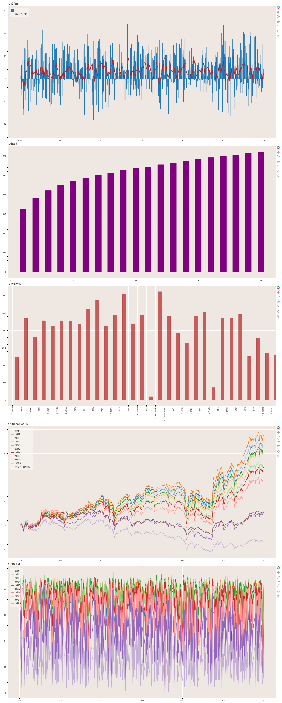

#### 日度 IC、滚动 IC 与累计 Rank IC

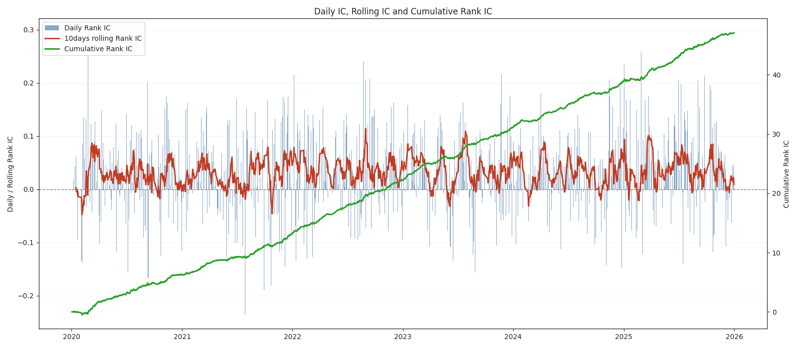

### 因子回测总结

#### IC 统计（中心与显著性）

| 指标          | Result    |
| ----------- | --------- |
| 样本天数        | 1,454     |
| 平均 Rank IC  | 0.032     |
| Rank IC 标准差 | 0.079     |
| ICIR        | 0.413     |
| 年化 ICIR     | 6.551     |
| IC t 值      | 15.737    |
| IC p 值      | 1.209e-51 |

#### IC 统计（分布与持久性）

| 指标         | Result |
| ---------- | ------ |
| 正 IC 占比    | 0.668  |
| 负 IC 占比    | 0.332  |
| IC 偏度      | -0.104 |
| IC 峰度      | -0.093 |
| IC 一阶自相关   | -0.021 |
| 累计 Rank IC | 47.111 |

- 本次绩效计算使用的基准区间： 2020-01-06 至 2025-12-31
- 策略与基准共同样本天数： 1453

#### 分组绝对收益与风险

| 分组               | 累计收益率  | 年化收益率  | 年化波动率 | 夏普比率   | Sortino 比率 | 最大回撤   | Calmar 比率 |
| ---------------- | ------ | ------ | ----- | ------ | ---------- | ------ | --------- |
| q0               | 1.731  | 0.190  | 0.229 | 0.876  | 1.201      | -0.307 | 0.620     |
| q1               | 1.738  | 0.191  | 0.231 | 0.872  | 1.197      | -0.311 | 0.613     |
| q2               | 1.866  | 0.200  | 0.233 | 0.902  | 1.242      | -0.313 | 0.641     |
| q3               | 1.563  | 0.177  | 0.234 | 0.817  | 1.121      | -0.316 | 0.562     |
| q4               | 1.608  | 0.181  | 0.237 | 0.822  | 1.130      | -0.311 | 0.581     |
| q5               | 1.304  | 0.156  | 0.240 | 0.725  | 0.992      | -0.315 | 0.495     |
| q6               | 1.208  | 0.147  | 0.244 | 0.686  | 0.937      | -0.323 | 0.455     |
| q7               | 1.011  | 0.129  | 0.249 | 0.612  | 0.838      | -0.354 | 0.364     |
| q8               | 0.262  | 0.041  | 0.254 | 0.286  | 0.390      | -0.477 | 0.086     |
| q9               | -0.303 | -0.061 | 0.282 | -0.081 | -0.109     | -0.615 | -0.099    |
| total（十组等权）      | 1.056  | 0.133  | 0.240 | 0.641  | 0.876      | -0.329 | 0.405     |
| long_short_q0_q9 | 2.491  | 0.242  | 0.114 | 1.952  | 3.024      | -0.125 | 1.932     |

#### 分组日收益分布

| 分组               | 日胜率   | 平均日收益  | 日收益偏度  | 日收益峰度 |
| ---------------- | ----- | ------ | ------ | ----- |
| q0               | 0.557 | 0.001  | -0.815 | 9.612 |
| q1               | 0.554 | 0.001  | -0.788 | 9.920 |
| q2               | 0.555 | 0.001  | -0.760 | 9.853 |
| q3               | 0.555 | 0.001  | -0.704 | 8.839 |
| q4               | 0.552 | 0.001  | -0.716 | 8.993 |
| q5               | 0.551 | 0.001  | -0.719 | 8.507 |
| q6               | 0.544 | 0.001  | -0.693 | 8.524 |
| q7               | 0.546 | 0.001  | -0.620 | 7.791 |
| q8               | 0.535 | 0.000  | -0.483 | 6.561 |
| q9               | 0.514 | -0.000 | -0.399 | 5.851 |
| total（十组等权）      | 0.545 | 0.001  | -0.673 | 8.572 |
| long_short_q0_q9 | 0.555 | 0.001  | -0.060 | 0.943 |

#### 分组相对基准绩效

| 分组               | 基准年化收益率 | 年化超额收益（几何） | 年化收益差（算术） | Alpha（年化） | Beta   | 跟踪误差  | 信息比率   |
| ---------------- | ------- | ---------- | --------- | --------- | ------ | ----- | ------ |
| q0               | 0.046   | 0.138      | 0.145     | 0.135     | 1.012  | 0.107 | 1.276  |
| q1               | 0.046   | 0.139      | 0.145     | 0.135     | 1.024  | 0.107 | 1.278  |
| q2               | 0.046   | 0.148      | 0.155     | 0.143     | 1.031  | 0.107 | 1.355  |
| q3               | 0.046   | 0.126      | 0.132     | 0.124     | 1.036  | 0.107 | 1.175  |
| q4               | 0.046   | 0.129      | 0.135     | 0.126     | 1.057  | 0.106 | 1.225  |
| q5               | 0.046   | 0.105      | 0.110     | 0.104     | 1.072  | 0.107 | 1.017  |
| q6               | 0.046   | 0.097      | 0.102     | 0.096     | 1.095  | 0.108 | 0.951  |
| q7               | 0.046   | 0.080      | 0.083     | 0.080     | 1.125  | 0.109 | 0.806  |
| q8               | 0.046   | -0.004     | -0.004    | -0.001    | 1.142  | 0.115 | 0.071  |
| q9               | 0.046   | -0.102     | -0.106    | -0.102    | 1.229  | 0.144 | -0.607 |
| total（十组等权）      | 0.046   | 0.084      | 0.088     | 0.084     | 1.082  | 0.105 | 0.850  |
| long_short_q0_q9 | 0.046   | 0.188      | 0.196     | 0.238     | -0.217 | 0.266 | 0.597  |

#### 分组换手率

| 分组               | 平均日换手率 | 中位数日换手率 | 年化换手率   | 最大单日换手率 |
| ---------------- | ------ | ------- | ------- | ------- |
| q0               | 0.630  | 0.671   | 158.862 | 0.899   |
| q1               | 0.723  | 0.754   | 182.091 | 0.911   |
| q2               | 0.747  | 0.788   | 188.134 | 0.917   |
| q3               | 0.748  | 0.793   | 188.517 | 0.920   |
| q4               | 0.738  | 0.783   | 186.024 | 0.919   |
| q5               | 0.716  | 0.762   | 180.489 | 0.930   |
| q6               | 0.680  | 0.722   | 171.373 | 0.910   |
| q7               | 0.621  | 0.663   | 156.532 | 0.890   |
| q8               | 0.474  | 0.488   | 119.410 | 0.855   |
| q9               | 0.255  | 0.241   | 64.262  | 0.714   |
| total（十组等权）      | 0.633  | 0.667   | 159.569 | 0.867   |
| long_short_q0_q9 | 0.885  | 0.913   | 223.124 | 1.596   |

## 19. SLSV 模型（对称 LSV 模型）

### 因子公式

**行为金融因子 —— 羊群效应（基金买卖方向识别）**

SLSV 模型在 LSV 模型的基础上引入方向符号，以区分基金的买入从众和卖出从众行为：

$$
\text{SLSV}_{i,t} =
\begin{cases}
\text{LSV}_{i,t}, & p_{i,t} > p_t, \\
-\text{LSV}_{i,t}, & p_{i,t} < p_t
\end{cases}
$$

其中，$\text{LSV}_{i,t}$ 为 LSV 模型的核心指标，计算方式如下：

$$
\text{LSV}_{i,t} = \left| p_{i,t} - p_t \right| - \mathbb{E}\left| p_{i,t} - p_t \right|
$$

期望绝对偏差项在无羊群效应假设下计算：

$$
\mathbb{E}\left| p_{i,t} - p_t \right| = \text{AF}(i,t) = \sum_{k=1}^{N_{i,t}} \binom{N_{i,t}}{k} p_t^k (1 - p_t)^{N_{i,t}-k} \left| \frac{k}{N_{i,t}} - p_t \right|
$$

各基础变量定义如下：

$$
p_{i,t} = \frac{B(i,t)}{B(i,t) + S(i,t)}
$$

$$
p_t = \frac{\sum_{i=1}^{N} p_{i,t}}{N}
$$

$$
N_{i,t} = B(i,t) + S(i,t)
$$

其中：

- $B(i,t)$ 为在区间 $t$ 内买入股票 $i$ 的基金数量（即报告期持仓相较上期增加的基金数）；
- $S(i,t)$ 为在区间 $t$ 内卖出股票 $i$ 的基金数量（即报告期持仓相较上期减少的基金数）；
- $N_{i,t}$ 为持仓发生变动的基金总数（买入基金与卖出基金之和）；
- $p_{i,t}$ 为股票 $i$ 在区间 $t$ 内买入基金的占比；
- $p_t$ 为全市场所有股票在区间 $t$ 内买入基金占比的均值（跨股票平均值）；
- $N$ 为全市场股票总数。

### 因子描述

LSV 模型从基金持股变动数据出发，通过比较某只股票实际被买入的比例与全市场平均买入比例的偏差程度，来判断该股票是否存在基金集中交易行为，从而捕捉基金“抱团”现象。

在此基础上，**SLSV 模型（对称 LSV）进一步考虑了投资者的买卖方向**，对 LSV 指标进行符号化处理：

- 当 $\text{SLSV}_{i,t} > 0$ 时（即 $p_{i,t} > p_t$），表明基金对该股票的买入比例高于市场平均水平，对应**买入从众效应**（集体加仓）；
- 当 $\text{SLSV}_{i,t} < 0$ 时（即 $p_{i,t} < p_t$），表明基金对该股票的买入比例低于市场平均水平（卖出比例更高），对应**卖出从众效应**（集体减仓）。

SLSV 指标的正负方向能够有效区分基金是“集体买入”还是“集体卖出”某只股票，为研究羊群效应的方向性差异提供了更丰富的信息。

数据：基金持仓数据

### 因子米筐回测图表

#### 米筐完整回测报告

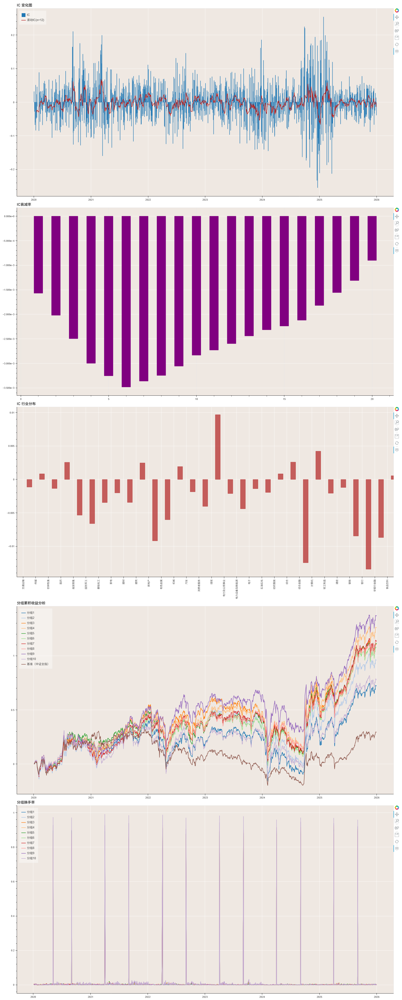

#### 日度 IC、滚动 IC 与累计 Rank IC

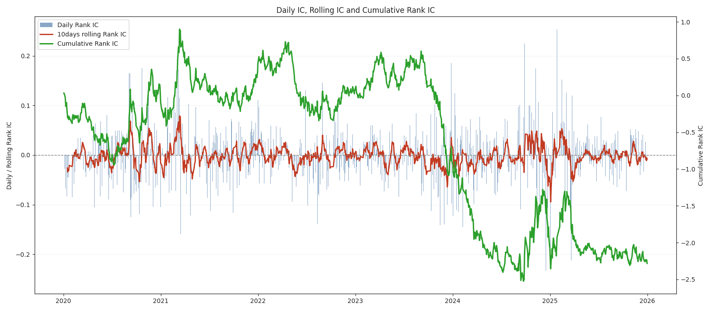

### 因子回测总结

#### IC 统计（中心与显著性）

| 指标          | Result    |
| ----------- | --------- |
| 样本天数        | 1,454     |
| 平均 Rank IC  | -0.002    |
| Rank IC 标准差 | 0.057     |
| ICIR        | -0.027    |
| 年化 ICIR     | -0.434    |
| IC t 值      | -1.043    |
| IC p 值      | 2.972e-01 |

#### IC 统计（分布与持久性）

| 指标         | Result |
| ---------- | ------ |
| 正 IC 占比    | 0.491  |
| 负 IC 占比    | 0.509  |
| IC 偏度      | 0.174  |
| IC 峰度      | 1.761  |
| IC 一阶自相关   | 0.049  |
| 累计 Rank IC | -2.283 |

- 本次绩效计算使用的基准区间： 2020-01-06 至 2025-12-31
- 策略与基准共同样本天数： 1453

#### 分组绝对收益与风险

| 分组               | 累计收益率  | 年化收益率  | 年化波动率 | 夏普比率   | Sortino 比率 | 最大回撤   | Calmar 比率 |
| ---------------- | ------ | ------ | ----- | ------ | ---------- | ------ | --------- |
| q0               | 0.722  | 0.099  | 0.260 | 0.493  | 0.670      | -0.412 | 0.240     |
| q1               | 0.957  | 0.124  | 0.247 | 0.596  | 0.818      | -0.362 | 0.341     |
| q2               | 1.104  | 0.138  | 0.240 | 0.658  | 0.908      | -0.353 | 0.390     |
| q3               | 1.262  | 0.152  | 0.235 | 0.721  | 0.997      | -0.315 | 0.483     |
| q4               | 1.117  | 0.139  | 0.236 | 0.671  | 0.923      | -0.319 | 0.435     |
| q5               | 1.076  | 0.135  | 0.236 | 0.655  | 0.905      | -0.341 | 0.396     |
| q6               | 1.131  | 0.140  | 0.239 | 0.669  | 0.914      | -0.315 | 0.445     |
| q7               | 1.132  | 0.140  | 0.234 | 0.678  | 0.926      | -0.300 | 0.468     |
| q8               | 1.374  | 0.162  | 0.241 | 0.743  | 1.011      | -0.313 | 0.516     |
| q9               | 0.777  | 0.105  | 0.257 | 0.518  | 0.698      | -0.362 | 0.290     |
| total（十组等权）      | 1.064  | 0.134  | 0.240 | 0.644  | 0.881      | -0.329 | 0.407     |
| long_short_q0_q9 | -0.037 | -0.007 | 0.064 | -0.072 | -0.106     | -0.182 | -0.036    |

#### 分组日收益分布

| 分组               | 日胜率   | 平均日收益  | 日收益偏度  | 日收益峰度 |
| ---------------- | ----- | ------ | ------ | ----- |
| q0               | 0.538 | 0.001  | -0.687 | 9.502 |
| q1               | 0.542 | 0.001  | -0.529 | 8.795 |
| q2               | 0.547 | 0.001  | -0.490 | 8.770 |
| q3               | 0.544 | 0.001  | -0.528 | 8.865 |
| q4               | 0.557 | 0.001  | -0.558 | 8.979 |
| q5               | 0.543 | 0.001  | -0.520 | 9.114 |
| q6               | 0.545 | 0.001  | -0.700 | 8.576 |
| q7               | 0.542 | 0.001  | -0.755 | 7.942 |
| q8               | 0.546 | 0.001  | -0.847 | 7.525 |
| q9               | 0.548 | 0.001  | -0.817 | 6.870 |
| total（十组等权）      | 0.544 | 0.001  | -0.670 | 8.565 |
| long_short_q0_q9 | 0.482 | -0.000 | 0.529  | 5.217 |

#### 分组相对基准绩效

| 分组               | 基准年化收益率 | 年化超额收益（几何） | 年化收益差（算术） | Alpha（年化） | Beta   | 跟踪误差  | 信息比率   |
| ---------------- | ------- | ---------- | --------- | --------- | ------ | ----- | ------ |
| q0               | 0.046   | 0.051      | 0.053     | 0.057     | 1.107  | 0.138 | 0.461  |
| q1               | 0.046   | 0.074      | 0.078     | 0.077     | 1.083  | 0.119 | 0.690  |
| q2               | 0.046   | 0.088      | 0.092     | 0.089     | 1.065  | 0.111 | 0.842  |
| q3               | 0.046   | 0.102      | 0.106     | 0.100     | 1.068  | 0.098 | 1.068  |
| q4               | 0.046   | 0.089      | 0.093     | 0.088     | 1.076  | 0.096 | 0.971  |
| q5               | 0.046   | 0.085      | 0.089     | 0.085     | 1.082  | 0.095 | 0.949  |
| q6               | 0.046   | 0.090      | 0.095     | 0.091     | 1.066  | 0.108 | 0.879  |
| q7               | 0.046   | 0.091      | 0.095     | 0.090     | 1.070  | 0.096 | 0.983  |
| q8               | 0.046   | 0.111      | 0.116     | 0.110     | 1.077  | 0.109 | 1.052  |
| q9               | 0.046   | 0.057      | 0.059     | 0.061     | 1.115  | 0.129 | 0.529  |
| total（十组等权）      | 0.046   | 0.084      | 0.088     | 0.085     | 1.081  | 0.105 | 0.857  |
| long_short_q0_q9 | 0.046   | -0.050     | -0.052    | -0.004    | -0.009 | 0.212 | -0.327 |

#### 分组换手率

| 分组               | 平均日换手率 | 中位数日换手率 | 年化换手率 | 最大单日换手率 |
| ---------------- | ------ | ------- | ----- | ------- |
| q0               | 0.007  | 0.000   | 1.820 | 0.901   |
| q1               | 0.008  | 0.000   | 2.127 | 0.917   |
| q2               | 0.009  | 0.002   | 2.179 | 0.925   |
| q3               | 0.009  | 0.002   | 2.299 | 0.918   |
| q4               | 0.009  | 0.002   | 2.338 | 0.911   |
| q5               | 0.009  | 0.002   | 2.301 | 0.893   |
| q6               | 0.009  | 0.002   | 2.313 | 0.888   |
| q7               | 0.009  | 0.002   | 2.391 | 0.930   |
| q8               | 0.010  | 0.002   | 2.457 | 0.947   |
| q9               | 0.010  | 0.000   | 2.498 | 0.992   |
| total（十组等权）      | 0.009  | 0.001   | 2.272 | 0.906   |
| long_short_q0_q9 | 0.017  | 0.002   | 4.317 | 1.860   |

## 20. 基于换手率的注意力溢出（SPILL）

### 因子公式

**行为金融因子 —— 投资者注意力溢出效应**

首先，计算每月日度换手率均值作为个股层面的注意力代理指标：

$$
\text{ATTN}_{i,t} = \frac{1}{m} \sum_{t=1}^{t-m+1} \text{TURN}_{i,t}
$$

其中，$\text{TURN}_{i,t}$ 为股票 $i$ 在交易日 $t$ 的换手率，$m$ 为交易日窗口，一般取为月度。

进一步，计算当期相近股票的注意力均值与个股注意力之差，即为注意力溢出程度：

$$
\text{SPILL}_{i,t} = \text{ATTN}_{i,t} - \overline{\text{ATTN}}_{g(i),t}
$$

其中，$\overline{\text{ATTN}}_{g(i),t}$ 为股票 $i$ 所属分组 $g(i)$ 内所有股票在 $t$ 期的注意力均值（不含股票 $i$ 自身）。

#### 分组标准

相近股票的确定标准如下：

1. 先以**中信一级行业**作为分类标准，将全市场股票划分为不同行业；
2. 在每个行业内，按市值规模从大到小排序，以 **3:4:3** 的比例将股票分为**大市值、中市值、小市值**三组；
3. 同一行业同一市值组内的股票即被定义为“相近股票”。

### 因子描述

投资者注意力存在溢出效应，当一只股票关注度较高时，投资者也会注意到与其相似的邻居股票，导致这些邻居股票的未来收益也会有不错的收益，享有注意力溢价；上述因子以日均换手率为注意力代理指标，计算注意力差值，注意力差值越大，表明未来注意力溢出效应越显著，股票预期会取得正向超额。

数据：中信一级行业数据、日度市值

### 因子米筐回测图表

#### 米筐完整回测报告

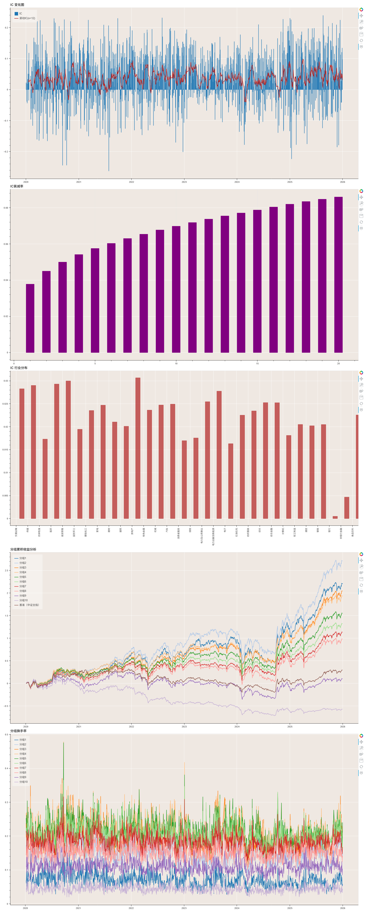

#### 日度 IC、滚动 IC 与累计 Rank IC

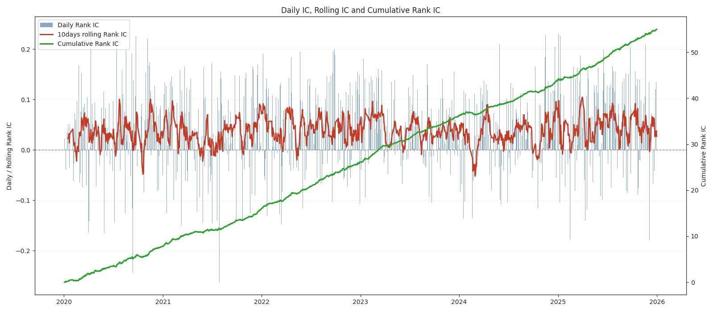

### 因子回测总结

#### IC 统计（中心与显著性）

| 指标          | Result    |
| ----------- | --------- |
| 样本天数        | 1,454     |
| 平均 Rank IC  | 0.038     |
| Rank IC 标准差 | 0.081     |
| ICIR        | 0.467     |
| 年化 ICIR     | 7.421     |
| IC t 值      | 17.826    |
| IC p 值      | 1.939e-64 |

#### IC 统计（分布与持久性）

| 指标         | Result |
| ---------- | ------ |
| 正 IC 占比    | 0.699  |
| 负 IC 占比    | 0.301  |
| IC 偏度      | -0.261 |
| IC 峰度      | 0.042  |
| IC 一阶自相关   | -0.016 |
| 累计 Rank IC | 54.979 |

- 本次绩效计算使用的基准区间： 2020-01-06 至 2025-12-31
- 策略与基准共同样本天数： 1453

#### 分组绝对收益与风险

| 分组               | 累计收益率  | 年化收益率  | 年化波动率 | 夏普比率   | Sortino 比率 | 最大回撤   | Calmar 比率 |
| ---------------- | ------ | ------ | ----- | ------ | ---------- | ------ | --------- |
| q0               | 2.215  | 0.224  | 0.252 | 0.929  | 1.290      | -0.353 | 0.635     |
| q1               | 2.717  | 0.256  | 0.236 | 1.083  | 1.496      | -0.327 | 0.783     |
| q2               | 2.050  | 0.213  | 0.228 | 0.963  | 1.329      | -0.306 | 0.697     |
| q3               | 1.941  | 0.206  | 0.227 | 0.940  | 1.300      | -0.316 | 0.651     |
| q4               | 1.555  | 0.177  | 0.221 | 0.849  | 1.169      | -0.304 | 0.582     |
| q5               | 1.322  | 0.157  | 0.218 | 0.781  | 1.074      | -0.287 | 0.548     |
| q6               | 1.134  | 0.141  | 0.222 | 0.704  | 0.966      | -0.303 | 0.464     |
| q7               | 0.985  | 0.126  | 0.250 | 0.602  | 0.824      | -0.343 | 0.368     |
| q8               | 0.097  | 0.016  | 0.274 | 0.197  | 0.265      | -0.493 | 0.033     |
| q9               | -0.571 | -0.137 | 0.321 | -0.297 | -0.397     | -0.750 | -0.182    |
| total（十组等权）      | 1.062  | 0.134  | 0.240 | 0.643  | 0.879      | -0.328 | 0.407     |
| long_short_q0_q9 | 5.402  | 0.380  | 0.123 | 2.672  | 4.354      | -0.120 | 3.174     |

#### 分组日收益分布

| 分组               | 日胜率   | 平均日收益  | 日收益偏度  | 日收益峰度  |
| ---------------- | ----- | ------ | ------ | ------ |
| q0               | 0.556 | 0.001  | -0.497 | 10.430 |
| q1               | 0.557 | 0.001  | -0.770 | 8.969  |
| q2               | 0.554 | 0.001  | -0.731 | 9.031  |
| q3               | 0.553 | 0.001  | -0.671 | 9.552  |
| q4               | 0.551 | 0.001  | -0.755 | 9.240  |
| q5               | 0.551 | 0.001  | -0.746 | 9.156  |
| q6               | 0.555 | 0.001  | -0.730 | 8.453  |
| q7               | 0.540 | 0.001  | -0.658 | 7.519  |
| q8               | 0.531 | 0.000  | -0.640 | 5.662  |
| q9               | 0.506 | -0.000 | -0.370 | 6.428  |
| total（十组等权）      | 0.544 | 0.001  | -0.672 | 8.563  |
| long_short_q0_q9 | 0.568 | 0.001  | 0.094  | 2.316  |

#### 分组相对基准绩效

| 分组               | 基准年化收益率 | 年化超额收益（几何） | 年化收益差（算术） | Alpha（年化） | Beta   | 跟踪误差  | 信息比率   |
| ---------------- | ------- | ---------- | --------- | --------- | ------ | ----- | ------ |
| q0               | 0.046   | 0.171      | 0.179     | 0.165     | 1.082  | 0.131 | 1.302  |
| q1               | 0.046   | 0.201      | 0.210     | 0.189     | 1.033  | 0.114 | 1.672  |
| q2               | 0.046   | 0.160      | 0.168     | 0.154     | 1.009  | 0.106 | 1.463  |
| q3               | 0.046   | 0.153      | 0.160     | 0.148     | 1.011  | 0.102 | 1.456  |
| q4               | 0.046   | 0.125      | 0.131     | 0.122     | 1.001  | 0.092 | 1.332  |
| q5               | 0.046   | 0.107      | 0.112     | 0.106     | 0.995  | 0.087 | 1.206  |
| q6               | 0.046   | 0.091      | 0.095     | 0.090     | 1.021  | 0.086 | 1.065  |
| q7               | 0.046   | 0.077      | 0.081     | 0.077     | 1.132  | 0.108 | 0.793  |
| q8               | 0.046   | -0.028     | -0.029    | -0.024    | 1.202  | 0.137 | -0.078 |
| q9               | 0.046   | -0.174     | -0.182    | -0.182    | 1.336  | 0.189 | -0.846 |
| total（十组等权）      | 0.046   | 0.084      | 0.088     | 0.085     | 1.082  | 0.105 | 0.855  |
| long_short_q0_q9 | 0.046   | 0.320      | 0.334     | 0.346     | -0.254 | 0.275 | 0.963  |

#### 分组换手率

| 分组               | 平均日换手率 | 中位数日换手率 | 年化换手率  | 最大单日换手率 |
| ---------------- | ------ | ------- | ------ | ------- |
| q0               | 0.070  | 0.068   | 17.742 | 0.188   |
| q1               | 0.162  | 0.158   | 40.779 | 0.339   |
| q2               | 0.202  | 0.198   | 50.779 | 0.427   |
| q3               | 0.216  | 0.212   | 54.460 | 0.479   |
| q4               | 0.216  | 0.212   | 54.338 | 0.476   |
| q5               | 0.204  | 0.203   | 51.408 | 0.365   |
| q6               | 0.182  | 0.181   | 45.946 | 0.317   |
| q7               | 0.151  | 0.150   | 37.960 | 0.247   |
| q8               | 0.109  | 0.108   | 27.457 | 0.169   |
| q9               | 0.044  | 0.043   | 11.203 | 0.090   |
| total（十组等权）      | 0.156  | 0.154   | 39.207 | 0.295   |
| long_short_q0_q9 | 0.115  | 0.113   | 28.945 | 0.235   |

## 21. 基于市场波动率的注意力捕捉

### 因子公式

**行为金融因子 —— 投资者注意力**

对每个行业，分别统计每日行业内成分股收益率的横截面标准差，作为市场关注程度的代理指标：

$$
\text{indus\_vol}_d = \text{std}\left( r_{i,d} \right), \quad i \in \text{行业内成分股}
$$

其中，$r_{i,d}$ 为行业成分股 $i$ 在交易日 $d$ 的收益率，$\text{indus\_vol}_d$ 为行业内所有成分股当日收益率的横截面标准差，用于衡量该行业当日的收益分歧度和交易活跃程度。

进一步，将上述市场关注代理指标与个股日收益进行月度时序回归，回归方程如下：

$$
r_{i,d} = \mu_{i,t} + \beta_{i,t} \cdot \text{indus\_vol}_d + \rho_{1,i,t} \text{Mkt}_d + \rho_{2,i,t} \text{SMB}_d + \rho_{3,i,t} \text{HML}_d + \rho_{4,i,t} \text{UMD}_d + \varepsilon_{i,t}
$$

其中，系数 $\beta_{i,t}$ 的绝对值 $|\beta_{i,t}|$ 即为股票 $i$ 对市场关注程度的敏感度，用于衡量该股票受行业波动率变化影响的大小。

各变量定义如下：

- $r_{i,d}$ 为股票 $i$ 在交易日 $d$ 的收益率；
- $\text{indus\_vol}_d$ 为交易日 $d$ 行业内成分股收益率的横截面标准差；
- $\text{Mkt}_d$、$\text{SMB}_d$、$\text{HML}_d$ 分别为经典的 Fama‑French 三因子在 $d$ 日的收益；
- $\text{UMD}_d$ 为动量因子收益，即全市场过去 11 个月累积收益率排名前 30% 与后 30% 的股票组合在 $d$ 日的收益差；
- $\mu_{i,t}$ 为截距项，$\varepsilon_{i,t}$ 为残差项。

### 因子描述

不同股票对同一市场关注度事件的反映程度往往不同，可通过个股收益对市场关注度事件的敏感程度（即 $|\beta_{i,t}|$）来衡量股票对该事件的注意力捕捉效应。捕捉能力越强（敏感程度越高），表明该股票更能吸引市场注意，从而获取超额收益。

上述因子以行业内收益率的横截面标准差（即行业波动率）作为市场关注度事件，其原因在于：行业内成分股收益的分化程度反映了市场对该行业内部不同股票的分歧和关注。当行业波动率较高时，表明该行业内部收益差异较大，市场交易活跃，关注度较高；反之，则表明行业关注度较低。因此，该指标能够有效捕捉市场注意力的变化，并用于解释个股收益的横截面差异。

数据：日度收盘价、行业分类数据、Fama‑French 三因子

### 因子米筐回测图表

#### 米筐完整回测报告

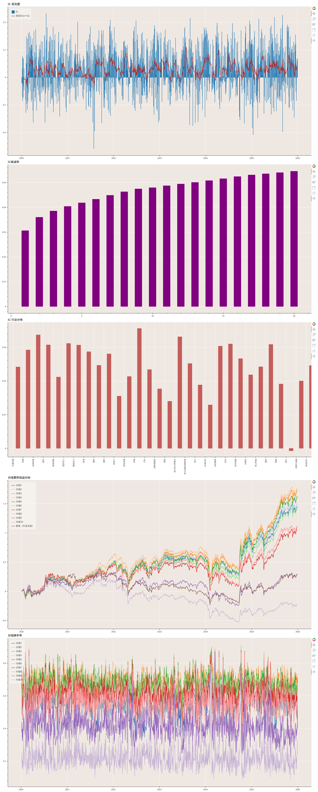

#### 日度 IC、滚动 IC 与累计 Rank IC

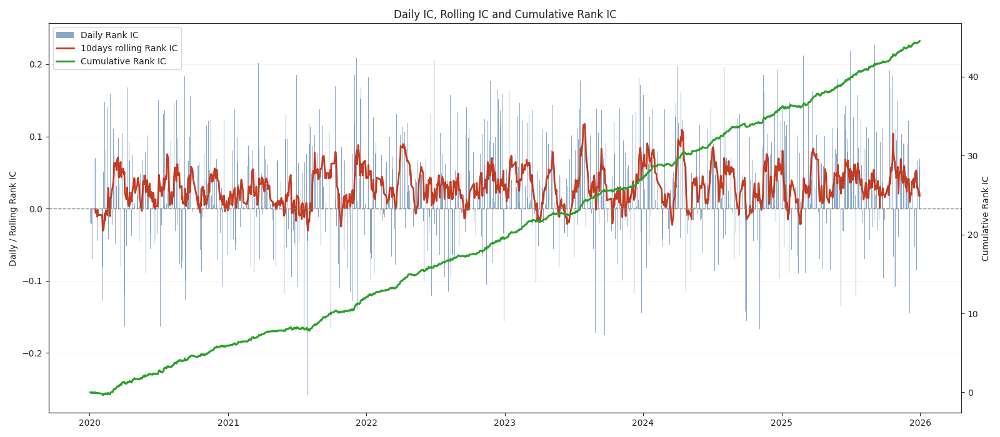

### 因子回测总结

#### IC 统计（中心与显著性）

| 指标          | Result    |
| ----------- | --------- |
| 样本天数        | 1,454     |
| 平均 Rank IC  | 0.031     |
| Rank IC 标准差 | 0.077     |
| ICIR        | 0.397     |
| 年化 ICIR     | 6.305     |
| IC t 值      | 15.144    |
| IC p 值      | 3.234e-48 |

#### IC 统计（分布与持久性）

| 指标         | Result |
| ---------- | ------ |
| 正 IC 占比    | 0.662  |
| 负 IC 占比    | 0.338  |
| IC 偏度      | -0.138 |
| IC 峰度      | -0.229 |
| IC 一阶自相关   | -0.012 |
| 累计 Rank IC | 44.532 |

- 本次绩效计算使用的基准区间： 2020-01-06 至 2025-12-31
- 策略与基准共同样本天数： 1453

#### 分组绝对收益与风险

| 分组               | 累计收益率  | 年化收益率  | 年化波动率 | 夏普比率   | Sortino 比率 | 最大回撤   | Calmar 比率 |
| ---------------- | ------ | ------ | ----- | ------ | ---------- | ------ | --------- |
| q0               | 1.442  | 0.167  | 0.229 | 0.791  | 1.077      | -0.303 | 0.553     |
| q1               | 1.494  | 0.172  | 0.230 | 0.804  | 1.103      | -0.318 | 0.540     |
| q2               | 1.723  | 0.190  | 0.230 | 0.871  | 1.198      | -0.305 | 0.621     |
| q3               | 1.758  | 0.192  | 0.234 | 0.871  | 1.198      | -0.311 | 0.619     |
| q4               | 1.618  | 0.182  | 0.236 | 0.826  | 1.137      | -0.314 | 0.579     |
| q5               | 1.433  | 0.167  | 0.240 | 0.764  | 1.047      | -0.315 | 0.529     |
| q6               | 1.093  | 0.137  | 0.244 | 0.648  | 0.885      | -0.332 | 0.412     |
| q7               | 1.126  | 0.140  | 0.249 | 0.651  | 0.895      | -0.330 | 0.423     |
| q8               | 0.291  | 0.045  | 0.255 | 0.302  | 0.409      | -0.435 | 0.104     |
| q9               | -0.228 | -0.044 | 0.283 | -0.017 | -0.023     | -0.611 | -0.072    |
| total（十组等权）      | 1.056  | 0.133  | 0.240 | 0.641  | 0.876      | -0.329 | 0.405     |
| long_short_q0_q9 | 1.822  | 0.197  | 0.111 | 1.675  | 2.555      | -0.160 | 1.231     |

#### 分组日收益分布

| 分组               | 日胜率   | 平均日收益  | 日收益偏度  | 日收益峰度 |
| ---------------- | ----- | ------ | ------ | ----- |
| q0               | 0.553 | 0.001  | -0.841 | 9.625 |
| q1               | 0.562 | 0.001  | -0.743 | 9.167 |
| q2               | 0.557 | 0.001  | -0.741 | 9.184 |
| q3               | 0.557 | 0.001  | -0.705 | 8.668 |
| q4               | 0.556 | 0.001  | -0.680 | 9.102 |
| q5               | 0.553 | 0.001  | -0.676 | 8.544 |
| q6               | 0.544 | 0.001  | -0.703 | 8.135 |
| q7               | 0.545 | 0.001  | -0.572 | 8.175 |
| q8               | 0.537 | 0.000  | -0.597 | 6.992 |
| q9               | 0.520 | -0.000 | -0.403 | 6.743 |
| total（十组等权）      | 0.545 | 0.001  | -0.673 | 8.572 |
| long_short_q0_q9 | 0.542 | 0.001  | -0.103 | 1.847 |

#### 分组相对基准绩效

| 分组               | 基准年化收益率 | 年化超额收益（几何） | 年化收益差（算术） | Alpha（年化） | Beta   | 跟踪误差  | 信息比率   |
| ---------------- | ------- | ---------- | --------- | --------- | ------ | ----- | ------ |
| q0               | 0.046   | 0.117      | 0.122     | 0.116     | 1.014  | 0.107 | 1.093  |
| q1               | 0.046   | 0.121      | 0.126     | 0.119     | 1.022  | 0.105 | 1.143  |
| q2               | 0.046   | 0.138      | 0.144     | 0.134     | 1.026  | 0.104 | 1.303  |
| q3               | 0.046   | 0.140      | 0.147     | 0.136     | 1.044  | 0.104 | 1.328  |
| q4               | 0.046   | 0.130      | 0.136     | 0.127     | 1.058  | 0.105 | 1.242  |
| q5               | 0.046   | 0.116      | 0.121     | 0.113     | 1.080  | 0.105 | 1.131  |
| q6               | 0.046   | 0.087      | 0.091     | 0.087     | 1.099  | 0.107 | 0.877  |
| q7               | 0.046   | 0.090      | 0.094     | 0.090     | 1.115  | 0.112 | 0.870  |
| q8               | 0.046   | -0.000     | -0.000    | 0.003     | 1.136  | 0.117 | 0.104  |
| q9               | 0.046   | -0.086     | -0.090    | -0.084    | 1.229  | 0.146 | -0.476 |
| total（十组等权）      | 0.046   | 0.084      | 0.088     | 0.084     | 1.082  | 0.105 | 0.851  |
| long_short_q0_q9 | 0.046   | 0.145      | 0.151     | 0.200     | -0.216 | 0.264 | 0.459  |

#### 分组换手率

| 分组               | 平均日换手率 | 中位数日换手率 | 年化换手率   | 最大单日换手率 |
| ---------------- | ------ | ------- | ------- | ------- |
| q0               | 0.546  | 0.544   | 137.701 | 0.874   |
| q1               | 0.667  | 0.669   | 168.014 | 0.878   |
| q2               | 0.691  | 0.692   | 174.031 | 0.882   |
| q3               | 0.690  | 0.692   | 173.926 | 0.895   |
| q4               | 0.678  | 0.677   | 170.734 | 0.897   |
| q5               | 0.656  | 0.655   | 165.426 | 0.913   |
| q6               | 0.619  | 0.618   | 156.033 | 0.881   |
| q7               | 0.560  | 0.556   | 141.216 | 0.902   |
| q8               | 0.419  | 0.414   | 105.689 | 0.874   |
| q9               | 0.220  | 0.209   | 55.448  | 0.740   |
| total（十组等权）      | 0.575  | 0.571   | 144.822 | 0.866   |
| long_short_q0_q9 | 0.766  | 0.753   | 193.149 | 1.598   |

## 22. 基于 PB 的前景价值 TK

### 因子公式

**行为金融因子 —— 前景理论**

① 以个股过去 $N$ 期的估值变化率（PB 估值变化率）作为衡量公司价值的代理变量，构建未来价值变化率的概率分布。将负变化率从小到大排列为 $r_{pb,-m}, \dots, r_{pb,-1}$，正变化率从小到大排列为 $r_{pb,1}, \dots, r_{pb,n}$，加上零变化率 $r_{pb,0}$，每个变化率出现的概率均为 $1/N$，其中 $N = m + n + 1$：

$$
\left( r_{pb,-m}, \frac{1}{N}; \dots; r_{pb,-1}, \frac{1}{N}; r_{pb,0}, \frac{1}{N}; r_{pb,1}, \frac{1}{N}; \dots; r_{pb,n}, \frac{1}{N} \right)
$$

② 利用价值函数和概率权重函数计算前景价值 TK：

$$
\text{TK} = \sum_{i=-m}^{-1} v(r_{pb,i}) \left[ w^-\left(\frac{i+m+1}{N}\right) - w^-\left(\frac{i+m}{N}\right) \right] + \sum_{i=1}^{n} v(r_{pb,i}) \left[ w^+\left(\frac{n-i+1}{N}\right) - w^+\left(\frac{n-i}{N}\right) \right]
$$

③ 价值函数 $v(x)$ 和概率权重函数 $w^+(P)$、$w^-(P)$ 的参数取值与标准前景理论一致，取值为 $\alpha = 0.88$，$\lambda = 2.25$，$\gamma = 0.61$，$\delta = 0.69$：

$$
v(x) =
\begin{cases}
x^{\alpha}, & x \geq 0 \\
-\lambda (-x)^{\alpha}, & x < 0
\end{cases}
$$

$$
w^+(P) = \frac{P^{\gamma}}{\left( P^{\gamma} + (1-P)^{\gamma} \right)^{1/\gamma}}
$$

$$
w^-(P) = \frac{P^{\delta}}{\left( P^{\delta} + (1-P)^{\delta} \right)^{1/\delta}}
$$

其中，$w^+(P)$ 用于估值上升（盈利）概率的权重处理，$w^-(P)$ 用于估值下降（亏损）概率的权重处理。

### 因子描述

前景价值 TK 代表了投资者对每只个股估值水平的“综合打分”。与标准 TK 因子以历史收益率作为价值参考不同，**基于 PB 的前景价值 TK 采用 PB 估值变化率作为衡量公司价值的代理变量**。

其核心逻辑在于：投资者在决策时，会基于公司估值的历史变化形成参考点，高估值股票虽然当前价值量（TK）较高，但投资者倾向于认为其估值过高而选择卖出，导致卖出压力增大、股价被低估；相反，低估值股票因具备安全边际而受到投资者青睐，导致买入需求增加、股价被高估。

因此，在该框架下，**前景价值 TK 与股票未来预期收益呈正相关关系**：TK 值越高（对应高估值股票），未来收益反而可能更高（因超卖后的价格修复）；TK 值越低（对应低估值股票），未来收益反而可能更低（因超买后的价格回落）。

数据：PB估值

### 因子米筐回测图表

#### 米筐完整回测报告

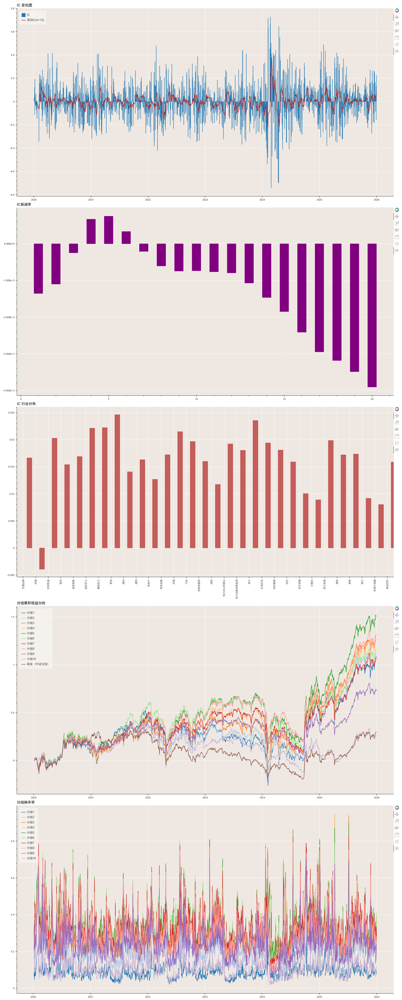

#### 日度 IC、滚动 IC 与累计 Rank IC

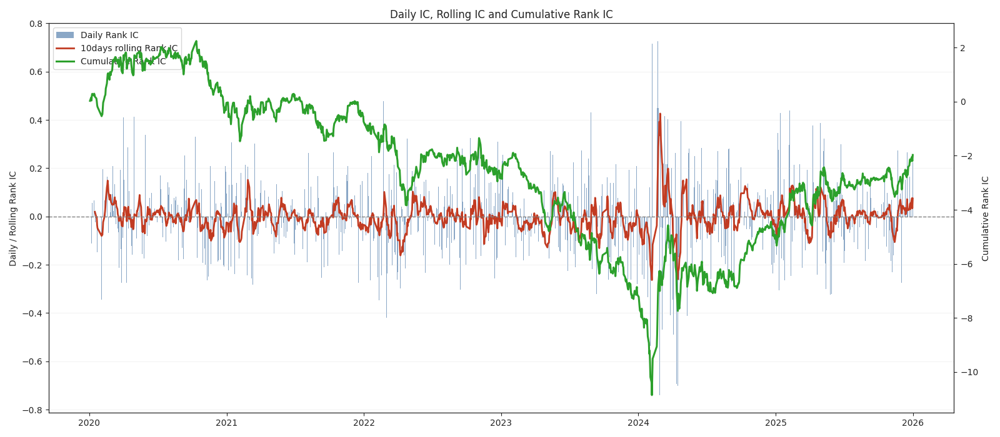

### 因子回测总结

#### IC 统计（中心与显著性）

| 指标          | Result    |
| ----------- | --------- |
| 样本天数        | 1,454     |
| 平均 Rank IC  | -0.001    |
| Rank IC 标准差 | 0.167     |
| ICIR        | -0.008    |
| 年化 ICIR     | -0.129    |
| IC t 值      | -0.309    |
| IC p 值      | 7.570e-01 |

#### IC 统计（分布与持久性）

| 指标         | Result |
| ---------- | ------ |
| 正 IC 占比    | 0.495  |
| 负 IC 占比    | 0.505  |
| IC 偏度      | 0.184  |
| IC 峰度      | 1.428  |
| IC 一阶自相关   | 0.077  |
| 累计 Rank IC | -1.970 |

- 本次绩效计算使用的基准区间： 2020-01-06 至 2025-12-31
- 策略与基准共同样本天数： 1453

#### 分组绝对收益与风险

| 分组               | 累计收益率 | 年化收益率 | 年化波动率 | 夏普比率  | Sortino 比率 | 最大回撤   | Calmar 比率 |
| ---------------- | ----- | ----- | ----- | ----- | ---------- | ------ | --------- |
| q0               | 1.081 | 0.136 | 0.307 | 0.568 | 0.801      | -0.517 | 0.262     |
| q1               | 1.103 | 0.138 | 0.287 | 0.594 | 0.825      | -0.419 | 0.329     |
| q2               | 1.310 | 0.156 | 0.273 | 0.670 | 0.927      | -0.392 | 0.398     |
| q3               | 1.244 | 0.150 | 0.260 | 0.670 | 0.915      | -0.382 | 0.394     |
| q4               | 1.506 | 0.173 | 0.249 | 0.766 | 1.050      | -0.344 | 0.502     |
| q5               | 1.151 | 0.142 | 0.238 | 0.678 | 0.921      | -0.332 | 0.427     |
| q6               | 1.061 | 0.134 | 0.228 | 0.666 | 0.901      | -0.305 | 0.438     |
| q7               | 1.272 | 0.153 | 0.218 | 0.763 | 1.040      | -0.285 | 0.536     |
| q8               | 0.739 | 0.101 | 0.208 | 0.567 | 0.764      | -0.271 | 0.372     |
| q9               | 0.260 | 0.041 | 0.213 | 0.295 | 0.400      | -0.362 | 0.113     |
| total（十组等权）      | 1.069 | 0.134 | 0.240 | 0.646 | 0.883      | -0.328 | 0.410     |
| long_short_q0_q9 | 0.675 | 0.094 | 0.210 | 0.531 | 0.777      | -0.362 | 0.259     |

#### 分组日收益分布

| 分组               | 日胜率   | 平均日收益 | 日收益偏度  | 日收益峰度  |
| ---------------- | ----- | ----- | ------ | ------ |
| q0               | 0.539 | 0.001 | -0.285 | 7.940  |
| q1               | 0.541 | 0.001 | -0.441 | 8.021  |
| q2               | 0.539 | 0.001 | -0.557 | 8.362  |
| q3               | 0.542 | 0.001 | -0.690 | 8.401  |
| q4               | 0.546 | 0.001 | -0.721 | 8.746  |
| q5               | 0.548 | 0.001 | -0.771 | 8.725  |
| q6               | 0.547 | 0.001 | -0.842 | 9.188  |
| q7               | 0.552 | 0.001 | -0.758 | 8.758  |
| q8               | 0.551 | 0.000 | -0.824 | 8.589  |
| q9               | 0.536 | 0.000 | -0.631 | 7.402  |
| total（十组等权）      | 0.544 | 0.001 | -0.671 | 8.561  |
| long_short_q0_q9 | 0.503 | 0.000 | -0.044 | 13.543 |

#### 分组相对基准绩效

| 分组               | 基准年化收益率 | 年化超额收益（几何） | 年化收益差（算术） | Alpha（年化） | Beta  | 跟踪误差  | 信息比率   |
| ---------------- | ------- | ---------- | --------- | --------- | ----- | ----- | ------ |
| q0               | 0.046   | 0.086      | 0.090     | 0.091     | 1.286 | 0.176 | 0.623  |
| q1               | 0.046   | 0.088      | 0.092     | 0.091     | 1.233 | 0.154 | 0.687  |
| q2               | 0.046   | 0.106      | 0.111     | 0.106     | 1.186 | 0.139 | 0.849  |
| q3               | 0.046   | 0.100      | 0.105     | 0.101     | 1.139 | 0.128 | 0.854  |
| q4               | 0.046   | 0.122      | 0.127     | 0.120     | 1.095 | 0.118 | 1.063  |
| q5               | 0.046   | 0.092      | 0.096     | 0.093     | 1.056 | 0.110 | 0.879  |
| q6               | 0.046   | 0.084      | 0.088     | 0.086     | 1.016 | 0.102 | 0.854  |
| q7               | 0.046   | 0.103      | 0.107     | 0.103     | 0.976 | 0.096 | 1.059  |
| q8               | 0.046   | 0.053      | 0.055     | 0.058     | 0.927 | 0.094 | 0.563  |
| q9               | 0.046   | -0.005     | -0.005    | 0.004     | 0.906 | 0.113 | -0.017 |
| total（十组等权）      | 0.046   | 0.085      | 0.089     | 0.085     | 1.082 | 0.105 | 0.861  |
| long_short_q0_q9 | 0.046   | 0.046      | 0.048     | 0.087     | 0.380 | 0.232 | 0.202  |

#### 分组换手率

| 分组               | 平均日换手率 | 中位数日换手率 | 年化换手率  | 最大单日换手率 |
| ---------------- | ------ | ------- | ------ | ------- |
| q0               | 0.090  | 0.083   | 22.617 | 0.518   |
| q1               | 0.215  | 0.199   | 54.082 | 0.941   |
| q2               | 0.287  | 0.270   | 72.308 | 0.947   |
| q3               | 0.326  | 0.310   | 82.227 | 0.941   |
| q4               | 0.346  | 0.329   | 87.153 | 0.900   |
| q5               | 0.349  | 0.333   | 88.016 | 0.835   |
| q6               | 0.336  | 0.321   | 84.706 | 0.831   |
| q7               | 0.302  | 0.285   | 76.108 | 0.793   |
| q8               | 0.235  | 0.223   | 59.220 | 0.706   |
| q9               | 0.105  | 0.099   | 26.495 | 0.478   |
| total（十组等权）      | 0.259  | 0.246   | 65.293 | 0.768   |
| long_short_q0_q9 | 0.195  | 0.181   | 49.112 | 0.996   |
